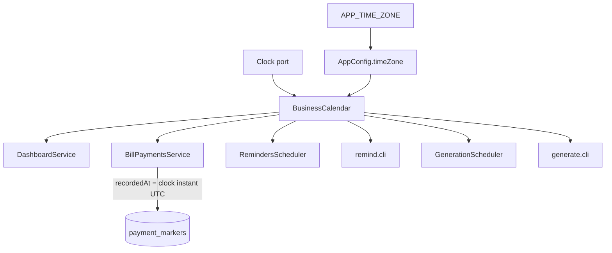
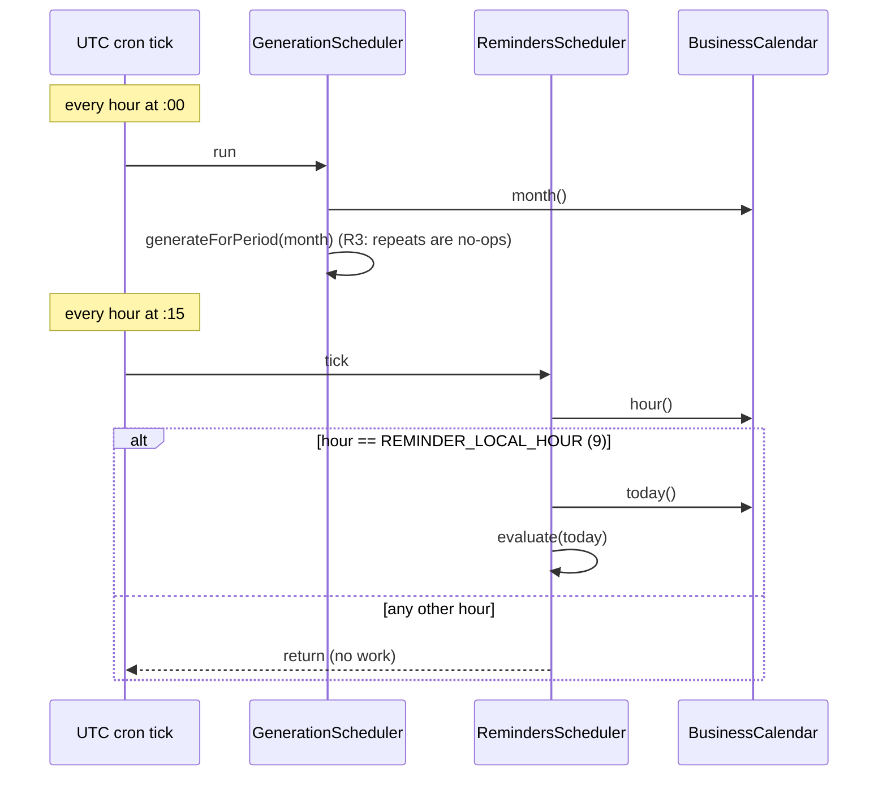

# Design Document — app-timezone

## Overview

**Purpose**: Every business calendar value PayPilot derives from the clock —
"today" and the current month — follows one configured **business timezone**
instead of the UTC date, so a user in São Paulo sees their own day after 21:00
and on the last evening of a month.

**Users**: All users (dashboard, payment defaults, reminders, recurring bills);
the operator sets the zone once through the environment.

**Impact**: Replaces the six UTC-date derivations with one `BusinessCalendar`
provider, adds `APP_TIME_ZONE` to the validated config, and moves the two
scheduled jobs off the server's implicit zone onto an hourly UTC tick with a
local-hour gate. No schema, migration or API contract change.

### Goals

- One tested derivation of business today / month / hour (requirement 2).
- Dashboard, bill payments, reminders and generation use it (3–6).
- Scheduled jobs never depend on the server timezone (5.2, 6.2).
- `APP_TIME_ZONE=UTC` reproduces today's date behaviour (7.2).

### Non-Goals

- Per-user timezones; a timezone field on `User`.
- Re-deriving stored dates (`paidOn`, due dates, periods, delivery identity).
- The web's own "current cycle" default on the cards page.
- A date library or the `cron` package as a new dependency.

## Architecture

### Existing Architecture Analysis

- `Clock` (`common/clock.ts`, global `ClockModule`) returns the current
  instant; tests replace it with `FixedClock` through the `CLOCK` token.
- Calendar values are derived ad hoc with UTC getters at each call site:

| Call site | Today | Derivation |
| --------- | ----- | ---------- |
| `DashboardService.getSummary` | today + default month | `toDateString(now)`, `monthOf(now)` |
| `BillPaymentsService.setPayment` | default `paidOn`, future check | `toDateString(now)` |
| `RemindersScheduler` | evaluation date | `toDateString(now)` |
| `remind.cli` | default evaluation date | `toDateString(now)` |
| `GenerationScheduler` | period | `deriveCurrentPeriod(clock)` |
| `generate.cli` | default period | `deriveCurrentPeriod(clock)` |

- `GenerationScheduler` runs `EVERY_DAY_AT_1AM` in the server's implicit zone;
  `RemindersScheduler` runs `0 12 * * *` UTC.
- Everything downstream of these call sites already works on date-only
  strings (`month-range`, `reminder-windows`, `summarizeMonth`,
  `clampDay`) and is timezone-independent — it stays untouched.

### Architecture Pattern & Boundary Map



**Architecture Integration**:

- Selected pattern: one injectable calendar adapter over the existing `Clock`
  port (research.md, option A).
- Boundaries: `BusinessCalendar` owns instant → calendar conversion; features
  receive date-only strings and keep their pure domain functions.
- Existing patterns preserved: injected clock, `FixedClock` in tests, zod env
  validation reporting names only, static `@Cron` decorators, R2/R3 DB
  uniqueness as the idempotency source of truth.
- New component rationale: a single provider makes "forgot one call site"
  structurally hard and keeps instants (`paidAt`, `sentAt`) on the raw clock.
- Steering compliance: `financial-rules.md` (clock injected, timezone explicit),
  `docs/conventions.md` Time section, `security.md` (no values in config
  errors).

### Technology Stack

| Layer | Choice / Version | Role in Feature | Notes |
| ----- | ---------------- | --------------- | ----- |
| Backend / Services | NestJS 11, `@nestjs/schedule` 6.1.3 | Provider + static UTC crons | No new dependency |
| Runtime | Node 24 built-in ICU (`Intl.DateTimeFormat`) | Instant → wall-clock parts in a zone | DST-aware; independent of process `TZ` |
| Config | zod (existing `env.schema.ts`) | Validate `APP_TIME_ZONE` | Default `America/Sao_Paulo` |
| Data / Storage | — | Unchanged | No migration |

## System Flows



- Generation is ungated: the first hourly tick inside a new business month
  generates it, so 6.3 holds in any zone, including on DST days.
- The reminder gate matches exactly one hour per business day; by 09:15 local
  the 00:00…09:00 generation ticks have completed (6.5).

## Requirements Traceability

| Requirement | Summary | Components | Interfaces |
| ----------- | ------- | ---------- | ---------- |
| 1.1–1.5 | Configured, validated zone | `env.schema.ts`, `.env.example` | `AppConfig.timeZone` |
| 2.1–2.6 | One derivation | `BusinessCalendar`, `calendarParts` | `today()`, `month()`, `hour()` |
| 3.1–3.5 | Dashboard | `DashboardService` | `BusinessCalendar` |
| 4.1–4.5 | Bill payments | `BillPaymentsService` | `BusinessCalendar`, `Clock` |
| 5.1–5.4 | Reminders | `RemindersScheduler`, `remind.cli`, `reminder.constants.ts` | `BusinessCalendar` |
| 6.1–6.5 | Generation | `GenerationScheduler`, `generate.cli`, `generation.helpers.ts` | `BusinessCalendar` |
| 7.1–7.4 | Compatibility | all of the above; unit + integration tests | — |

## Components and Interfaces

| Component | Layer | Intent | Req | Key Dependencies | Contracts |
| --------- | ----- | ------ | --- | ---------------- | --------- |
| `env.schema.ts` (extended) | Config | Parse + validate `APP_TIME_ZONE` | 1 | zod, `Intl` (P0) | State |
| `BusinessCalendar` (new) | Common | Instant → business date/month/hour | 2 | `CLOCK`, `APP_CONFIG` (P0) | Service |
| `DashboardService` | Dashboard | Use business today/month | 3 | `BusinessCalendar` (P0) | — |
| `BillPaymentsService` | Bill payments | Use business today; keep UTC instant | 4 | `BusinessCalendar`, `CLOCK` (P0) | — |
| `RemindersScheduler` | Reminders | Hourly tick, local-hour gate | 5 | `BusinessCalendar` (P0) | Batch |
| `GenerationScheduler` | Recurring bills | Hourly tick, business month | 6 | `BusinessCalendar` (P0) | Batch |
| `remind.cli`, `generate.cli` | CLIs | Default date/period from calendar | 5, 6 | `BusinessCalendar` (P1) | — |

### Config

#### `env.schema.ts` — `APP_TIME_ZONE`

**Responsibilities & Constraints**

- `APP_TIME_ZONE: z.string().min(1).default("America/Sao_Paulo")`.
- `superRefine` adds an issue on `APP_TIME_ZONE` unless
  `isIanaTimeZone(value)`; `loadConfig` already reports names only (1.3).
- `isIanaTimeZone(value)`: `new Intl.DateTimeFormat("en-US", { timeZone: value })`
  does not throw **and** `value` does not start with `+` or `-` (rejects
  offset strings, research.md). `UTC` passes (1.4).
- `AppConfig` gains `readonly timeZone: string`.
- `.env.example` documents `APP_TIME_ZONE="America/Sao_Paulo"` with a comment
  (1.5).

### Common

#### `BusinessCalendar`

| Field | Detail |
| ----- | ------ |
| Intent | The only place an instant becomes a business calendar value |
| Requirements | 2.1–2.6 |

**Responsibilities & Constraints**

- Pure `calendarParts(instant: Date, timeZone: string): CalendarParts` using a
  cached `Intl.DateTimeFormat("en-US", { timeZone, year: "numeric",
  month: "2-digit", day: "2-digit", hour: "2-digit", hourCycle: "h23" })` and
  `formatToParts`. Throws on an invalid instant.
- `BusinessCalendar` is `@Injectable()`, injects `CLOCK` and `APP_CONFIG`, reads
  the clock once per call. Provided and exported by the global `ClockModule`,
  so tests that override `CLOCK` automatically drive it.
- Never returns or alters instants; callers that persist an instant keep using
  `Clock.now()` (4.4).

**Contracts**: Service [x]

##### Service Interface

```typescript
export interface CalendarParts {
  /** "YYYY-MM-DD" wall-clock date in the zone. */
  readonly date: string;
  /** "YYYY-MM". */
  readonly month: string;
  /** 0–23 wall-clock hour in the zone. */
  readonly hour: number;
}

export function calendarParts(instant: Date, timeZone: string): CalendarParts;

@Injectable()
export class BusinessCalendar {
  constructor(clock: Clock, config: AppConfig);
  /** Business today, "YYYY-MM-DD". */
  today(): string;
  /** Business month, "YYYY-MM". */
  month(): string;
  /** Business wall-clock hour, 0–23. */
  hour(): number;
}
```

- Preconditions: `config.timeZone` passed `isIanaTimeZone` at startup.
- Postconditions: results depend only on the clock instant and the zone, never
  on `process.env.TZ` (2.6).
- Invariants: `month() === today().slice(0, 7)` for the same instant.

### Features

#### `DashboardService` (3.1–3.5)

- `today = calendar.today()`; `target = month ?? calendar.month()`; rest
  unchanged. The `monthOf` helper in `month-range.ts` is removed (its only
  caller), with its spec cases moved to `BusinessCalendar`.

#### `BillPaymentsService` (4.1–4.5)

- `now = clock.now()` (still recorded as `recordedAt`/`paidAt`),
  `today = calendar.today()`; validation order and messages unchanged.

#### `RemindersScheduler` (5.1–5.4) — Batch

- `@Cron(REMINDER_TICK_CRON_UTC, { timeZone: "UTC" })` with
  `REMINDER_TICK_CRON_UTC = "15 * * * *"` and `REMINDER_LOCAL_HOUR = 9`
  replacing `REMINDER_CRON_UTC` in `reminder.constants.ts`.
- Tick: `if (calendar.hour() !== REMINDER_LOCAL_HOUR) return;` then
  `evaluate(calendar.today())`. `ReminderEvaluationService`, windows, R1/R2
  and delivery identity unchanged (5.3, 5.4).
- `remind.cli`: `arg ?? calendar.today()` (no gate — a manual run is explicit).

#### `GenerationScheduler` (6.1–6.5) — Batch

- `@Cron(GENERATION_TICK_CRON_UTC, { timeZone: "UTC" })` with
  `GENERATION_TICK_CRON_UTC = "0 * * * *"` (new constant next to the
  scheduler); period `calendar.month()`.
- Logging: one line per run only when `created > 0` or `failed > 0`, so 24
  ticks a day do not flood the log.
- `deriveCurrentPeriod` is removed from `generation.helpers.ts`; `generate.cli`
  uses `arg ?? calendar.month()`. `clampDay` and R3 unchanged (6.4).

## Error Handling

- Invalid `APP_TIME_ZONE` → startup error `Offending variable(s): APP_TIME_ZONE`
  (existing `loadConfig` path).
- A failing scheduled run keeps today's behaviour: the service logs and the
  next tick retries (generation hourly; reminders the next business day, as
  before).

## Testing Strategy

- **Unit — `calendarParts` / `BusinessCalendar`** (2.2–2.6, 7.4):
  - `2026-11-22T01:30Z` SP → `2026-11-21`, hour 22; `2026-11-22T03:00Z` →
    `2026-11-22`, hour 0; `2026-12-01T02:00Z` → month `2026-11`.
  - `UTC` zone reproduces `toDateString`/UTC month (7.2).
  - DST: `America/New_York` across 2026-03-08 and 2026-11-01 transitions.
  - Same results with `process.env.TZ` set to other zones inside the test.
- **Unit — config** (1.1–1.4): default, `UTC`, valid IANA, rejects `foo/bar`,
  `+03:00`, empty; error message names the variable without its value.
- **Unit — services/schedulers**:
  - Dashboard at `2026-12-01T02:00Z` summarizes `2026-11`; a bill due
    `2026-11-30` is Overdue only when unpaid and today is after it (3.5).
  - Bill payments at `2026-11-22T01:30Z`: default `2026-11-21`; `2026-11-22`
    rejected; `recordedAt` is the raw instant (4.3, 4.4).
  - Reminders tick: evaluates only when the business hour is 9, with business
    today; no call at other hours (5.1, 5.2).
  - Generation tick: period from the business month at `2026-12-01T02:00Z` →
    `2026-11`, at `2026-12-01T03:00Z` → `2026-12` (6.1, 6.3).
- **Integration** (existing suites, `TZ=America/Sao_Paulo`): rewrite
  `generation.helpers.spec.ts` / `month-range.spec.ts` cases that asserted UTC
  semantics; add one bill-payments and one dashboard case with a fixed clock
  at `2026-11-22T01:30Z`; existing noon-UTC suites unchanged (7.1, 7.3).
- **Reminder identity** (5.4): evaluating the same business date twice — the
  switch-over case — sends once.
