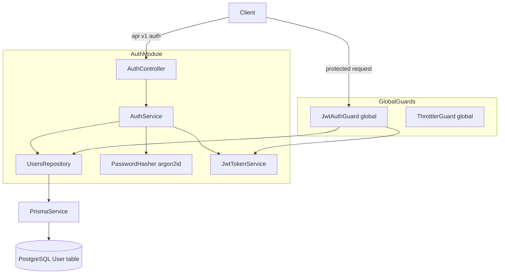
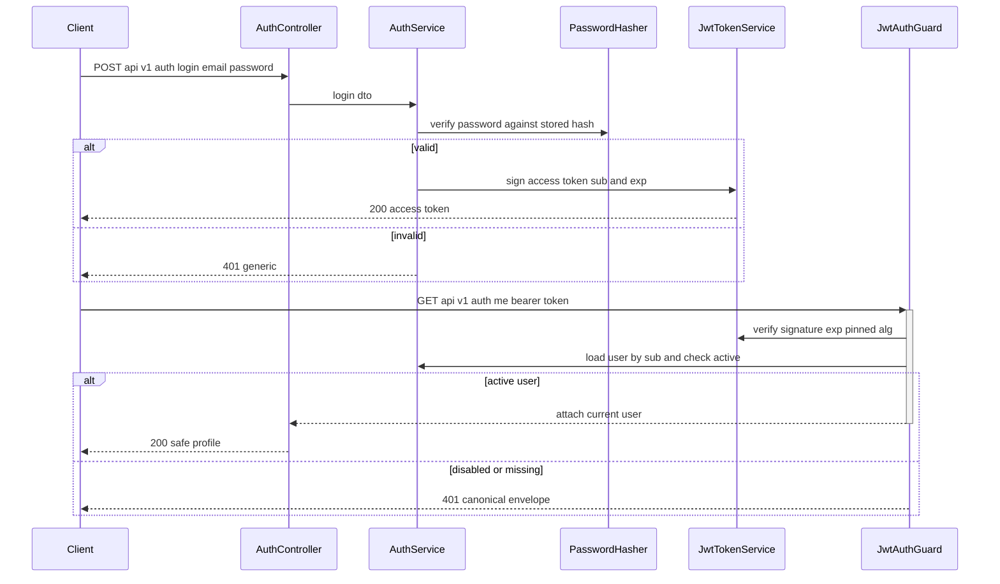

# Technical Design: auth-jwt

## Overview

**Purpose**: Add authentication (registration/login + JWT) and the per-user authorization baseline to PayPilot, on top of `platform-foundation`. It delivers user accounts, a stateless JWT access-token flow with a global guard, a safe current-user endpoint, abuse protection (rate limiting), and reusable ownership primitives that future financial features depend on.

**Users**: End users (register/login); every later feature relies on the authenticated-user context and ownership helpers introduced here.

**Impact**: Introduces PayPilot's first Prisma model (`User`) + first migration, a new `AuthModule`, a global authentication guard, and rate limiting. Reuses foundation config/error/Prisma/request-id primitives.

### Goals
- Email/password registration with normalized emails and DB-enforced uniqueness.
- Stateless JWT login (short-lived, algorithm-pinned) + a global guard with `@Public()` opt-out.
- `GET /api/v1/auth/me` returning a safe profile.
- Per-user isolation primitives, testable without business endpoints.
- Rate limiting on auth endpoints (in-memory, MVP).

### Non-Goals
- Server-side logout, token revocation/blacklist, refresh-token rotation.
- Email verification, password reset, OAuth/social, MFA.
- Any business feature endpoint or model beyond `User`.
- Redis / jobs infrastructure (in-memory limiter only).

## Architecture

### Architecture Pattern & Boundary Map

`AuthModule` follows the foundation's layered feature-module pattern (controller → service → repository/Prisma), plus cross-cutting global guards. Password hashing and token signing are isolated behind small services (ports) so they are unit-testable and swappable.



**Architecture Integration**:
- **Reuses**: `AppConfigModule` (env), `AllExceptionsFilter` + `ErrorResponse`, request-id middleware, `PrismaService`, global `ValidationPipe`.
- **New cross-cutting**: `JwtAuthGuard` and `ThrottlerGuard` registered as `APP_GUARD` (global); `@Public()` decorator opts routes out of auth. **Guard order: `ThrottlerGuard` runs before `JwtAuthGuard`** (register it first), so abusive traffic is throttled *before* the guard's per-request DB lookup. Login/register limiters key on **client IP** (not email) so rate-limit behavior never reveals whether an account exists.
- **Concrete rate-limit defaults** (per client IP, configurable via validated env):
  - **Login: 5 / minute**
  - **Register: 3 / minute**
  - **App-wide default: 100 / minute** (lenient, to avoid over-throttling authenticated traffic)
  - Use the **current `@nestjs/throttler` config shape** for the installed version (named throttlers / `@Throttle({ ... })` per-route overrides); confirm the exact API at implementation against the pinned version.
  - The in-memory store is **non-production-grade** (per-instance, not shared); a shared store (e.g. Redis) is deferred to a future production/deployment spec.
- **Steering compliance**: authn/authz separated and centralized (`security.md`); secrets via validated env, never committed (R8); per-user isolation derived from token (`security.md`); auth-critical paths tested (`testing.md`).

### Technology Stack

| Layer | Choice | Role | Notes |
|-------|--------|------|-------|
| Auth tokens | `@nestjs/jwt` | sign/verify JWT, algorithm pinned | HS256; reject unexpected `alg` |
| Password hashing | `@node-rs/argon2` (argon2id) | hash/verify passwords | prebuilt napi — no build script |
| Rate limiting | `@nestjs/throttler` | login/register throttling | in-memory (non-prod-grade), no Redis |
| Validation | `class-validator`/DTOs (foundation) | request validation | reuse global ValidationPipe |
| Data | Prisma 7 + `PrismaService` | `User` model + migration | first model/migration |

## System Flows

**Login** and **protected request** (with active-user check):



## Requirements Traceability

| Requirement | Summary | Components |
|-------------|---------|------------|
| 1.1–1.7 | Registration, email normalize, DB unique, race-safe, 409, no plaintext | AuthController, AuthService, UsersRepository, `User` model |
| 2.1–2.7 | Login, JWT `sub`/`exp`, no sensitive claims, 401, signed, short TTL, alg/iss/aud pinned | AuthService, JwtTokenService |
| 3.1–3.5 | Bearer required, 401 before logic, identity to handlers, public opt-out, disabled/deleted rejected | JwtAuthGuard, `@Public()`, `@CurrentUser()` |
| 4.1–4.6 | Ownership, query scoping, deny cross-user (404-like), derive owner from token, reusable primitives, test-only resource | `@CurrentUser()`, ownership helper, test-only module |
| 5.1–5.7 | Password length 12–256 (reject, no truncate), passphrases, no composition rules, argon2id, no logging | PasswordHasher, register DTO |
| 6.1–6.5 | JWT secret+TTL from env, secret strength, fail-fast, name-only errors, not committed | env schema (config) |
| 7.1–7.3 | Canonical envelope, 401/403/409, request id | AllExceptionsFilter (reuse), `ErrorCode` |
| 8.1–8.9 | No secret logging, allowed log fields, attempts/denials logged, tests | AuthService logging, test suites |
| 9.1–9.4 | `GET /auth/me` safe profile, guarded | AuthController, user mapper |
| 10.1–10.7 | Rate limit login/register, 429 canonical, no account disclosure, logged, in-memory | ThrottlerGuard, throttler config |

## Components and Interfaces

| Component | Layer | Intent | Reqs |
|-----------|-------|--------|------|
| AuthController | transport | `/auth/register`, `/auth/login`, `/auth/me` | 1,2,9 |
| AuthService | application | orchestrates register/login/profile | 1,2,5,8 |
| UsersRepository | data | Prisma access for users (normalized-email lookup, create) | 1,3,4 |
| PasswordHasher | domain port | argon2id hash/verify | 5 |
| JwtTokenService | domain port | sign/verify access tokens (alg-pinned) | 2,3 |
| JwtAuthGuard | transport (global) | verify token + active-user check; honor `@Public()` | 3 |
| `@Public()` / `@CurrentUser()` | transport | route opt-out / inject authenticated user | 3,4 |
| ownership helper | domain | `assertOwnership(resourceOwnerId, userId)` → 404-like on mismatch | 4 |
| Throttler config | transport (global) | rate limits on auth routes | 10 |

### AuthService (Service contract)
```typescript
interface RegisterInput { email: string; password: string; }
interface LoginInput { email: string; password: string; }
interface AuthResult { accessToken: string; }
interface SafeUser { id: string; email: string; createdAt: string; }

interface AuthService {
  register(input: RegisterInput): Promise<SafeUser>;   // 409 on duplicate (DB unique)
  login(input: LoginInput): Promise<AuthResult>;       // 401 generic on failure
  toSafeUser(user: UserRecord): SafeUser;              // strips hash/internal fields
}
```
- Preconditions: email normalized (trim+lowercase, no provider-specific rules); password 12–256 chars.
- Postconditions: password never returned/logged; duplicate → `ConflictException` (409) backed by the DB unique constraint (race-safe).
- Invariants: owner identity derives from token, never request body.
- **Anti-enumeration (timing):** `login` runs password `verify` for **both existing and missing users**. When the email is not found it verifies the supplied password against a **dummy hash that is precomputed once at startup/config time** (not generated per request) using the **same argon2id parameters** as real password hashes — so response timing does not reveal whether the account exists. Failures return a single generic 401 (R2.2). (Registration's 409 is the documented existence-disclosure tradeoff; login must not add a second, timing-based leak.)

### JwtTokenService
```typescript
interface AccessTokenClaims { sub: string; exp: number; iat?: number; iss?: string; aud?: string; }
interface JwtTokenService {
  sign(userId: string): Promise<string>;                 // sets sub + exp (short TTL)
  verify(token: string): Promise<AccessTokenClaims>;     // pins allowed algorithm; rejects others
}
```
- **Design decisions (R2.7):** algorithm **HS256** with the configured secret; `exp` = `JWT_ACCESS_TTL` (e.g. 15m); include `iat`; `iss`/`aud` optional (set `iss="paypilot"`, omit `aud` for MVP); verification **pins** `algorithms: ["HS256"]` to reject forged `alg` (e.g. `none`/RS confusion). Payload carries only `sub`/`exp`/`iat`/`iss` — no PII, hashes, or secrets.

### JwtAuthGuard
- Global (`APP_GUARD`). Skips routes marked `@Public()`. Extracts Bearer token; `verify()`; then **loads the user by `sub` via UsersRepository and checks `isActive`** (R3 active-user verification for stateless tokens). Missing/disabled/expired/invalid → `UnauthorizedException` (401) via the canonical envelope. On success attaches `SafeUser`/id to the request for `@CurrentUser()`.
- **Tradeoff:** one indexed PK lookup per authenticated request; acceptable for MVP, cacheable later.

### Ownership primitive (R4)
```typescript
// Throws a generic NotFound (404-like) when ownership fails — does not reveal existence.
function assertOwnership(resourceOwnerId: string, currentUserId: string): void;
```
- **Design decision (R4 note):** cross-user access returns **404 (Not Found)**, never disclosing whether the record exists. (403 reserved for future explicit-forbidden cases.)
- Future repositories/services scope queries by `currentUserId` and/or call `assertOwnership`. Validated by a **test-only owned resource** declared in the test suite (no production business endpoint).

## Data Models

### User (first Prisma model + migration)
```
model User {
  id           String   @id @default(uuid()) @db.Uuid
  email        String   @unique                 // stored normalized (trim+lowercase)
  passwordHash String
  isActive     Boolean  @default(true)
  createdAt    DateTime @default(now()) @db.Timestamptz(6)
  updatedAt    DateTime @updatedAt @db.Timestamptz(6)
  @@map("users")
}
```
- **Uniqueness** enforced by the DB `@unique` index on `email` (race-safe; app surfaces 409). Timestamps are UTC `timestamptz` per `docs/conventions.md`.
- A migration is created via `prisma migrate` (Prisma 7 + pg adapter, per foundation). `isActive` supports the disabled-user rejection (soft-disable; hard delete also rejected since lookup misses).
- **`isActive` decision:** a `Boolean` `isActive` is accepted for the MVP. A richer `UserStatus` enum (e.g. active/disabled/pending) may be introduced later if account lifecycle grows — out of scope here.

### Email normalization (single source)
- A **single shared normalization function** is used by **all** user creation and lookup paths (register, login, guard lookup). Normalization is **limited to trim + lowercase** — it does **not** remove dots, strip `+` aliases, or apply any provider-specific rules. The DB unique constraint applies to this normalized value.
- **Tests must verify:** `User@Example.com`, ` user@example.com `, and `user@example.com` all normalize to the same value; and that dots and `+` aliases are **preserved** (`u.s.e.r@example.com` and `user+tag@example.com` remain distinct).

### Config additions (env schema)
- `JWT_SECRET` — required. Must be a randomly generated secret with **≥ 256 bits of entropy**, recommended as base64/base64url-encoded random bytes. Validation (Zod) rejects missing, too-short (decoded < 32 bytes), placeholder, malformed, or obviously weak values **in non-test environments** (e.g. reject known placeholders like `secret`, `super-secret`, `changeme`, or low-charset-diversity strings). Startup failure reports only the variable **name**, never the value.
- `JWT_ACCESS_TTL` — short access-token lifetime. **Default `15m`.** Validated as a duration and bounded: **reject values below `5m` or above `1h`** (unless a future security decision changes the bounds). Parsing uses the `ms` library (string → milliseconds); the design pins exact version at implementation.
- `.env.example` shows a non-secret placeholder only:
  ```env
  JWT_SECRET="<replace-with-256-bit-random-secret>"
  JWT_ACCESS_TTL="15m"
  ```
  Never commit a real secret or weak example (`secret`, `super-secret`, etc.).

## Error Handling

Reuse the foundation `AllExceptionsFilter` + canonical `ErrorResponse`. Extend the shared `ErrorCode` enum with: `UNAUTHORIZED` (401), `FORBIDDEN` (403), `CONFLICT` (409), `NOT_FOUND` (404), `TOO_MANY_REQUESTS` (429).

> **Foundation change required:** today the filter sets `code = exception.name` for 4xx other than 400 (so a 401 would emit `"UnauthorizedException"`, a 429 `"ThrottlerException"`). Extend `AllExceptionsFilter` with an explicit **HTTP-status → `ErrorCode`** map so the canonical `code` matches the table below (default to the existing behavior for unmapped statuses). This keeps R7's contract stable for clients.
>
> This is tracked as a **dedicated task** in `tasks.md`: update the shared `ErrorCode` enum and the foundation filter, and verify `401→UNAUTHORIZED`, `403→FORBIDDEN`, `404→NOT_FOUND`, `409→CONFLICT`, `429→TOO_MANY_REQUESTS` — all via the canonical envelope including `requestId`.

Mapping:

| Condition | Status | Code |
|-----------|--------|------|
| Invalid body / password policy | 400 | VALIDATION_ERROR |
| Bad credentials / missing-invalid-expired token / disabled user | 401 | UNAUTHORIZED |
| Duplicate email | 409 | CONFLICT |
| Cross-user resource access | 404 | NOT_FOUND |
| Rate limit exceeded | 429 | TOO_MANY_REQUESTS |

All responses carry `requestId` + `timestamp`; 401/409/404/429 messages are generic (no account-existence disclosure).

## Testing Strategy

### Unit
- `PasswordHasher`: hash≠plaintext, verify true/false, rejects >256 chars (no truncation).
- `JwtTokenService`: sign sets `sub`/`exp`; verify rejects wrong/`none` algorithm, expired, tampered.
- Email normalization: `User@Example.com`, ` user@example.com `, `user@example.com` → same value; dots and `+` aliases preserved (distinct).
- `assertOwnership`: passes for owner, throws 404-like for non-owner.
- Config validation: rejects missing/weak/placeholder `JWT_SECRET`; rejects `JWT_ACCESS_TTL` below `5m` / above `1h`.

### Integration (Testcontainers, real PostgreSQL)
- Register → 201/safe profile; duplicate (incl. concurrent) → single user, 409.
- Login valid → token; invalid → 401 generic.
- `GET /auth/me` with valid token → safe profile (no hash); no/expired/disabled-user token → 401 canonical.
- Guard: protected route blocked without token; `@Public()` route open.
- **Per-user isolation** via a **test-only owned resource module** in the suite: owner reads ok; other user → 404-like.
- Rate limit: exceeding login/register attempts → 429 canonical.
- **Guard order proof:** a throttled request carrying a **valid Bearer token** to a protected route returns **429 before `JwtTokenService.verify` or `UsersRepository.findActiveById` are called** (spies on both assert they are not invoked for the throttled request). This proves throttling precedes authentication even when the request would otherwise trigger token verification + active-user lookup. Guard registration order is documented in the implementation — not relied upon via comments alone.

## Security Considerations
- argon2id hashing; passwords 12–256 (reject, no truncation); never logged.
- JWT secret from validated env, fail-fast, never committed: must have **≥ 256 bits of entropy** (preferably base64/base64url-encoded random bytes); weak/placeholder/malformed values are rejected in non-test environments. Algorithm pinned (HS256) to block `alg` confusion.
- Logs: **failed login attempts must not log full email addresses.** Logs may include event type, request id, result, and user id **only when safely known**. Never log raw JWTs, `Authorization` headers, passwords, password hashes, or credential inputs. If email correlation is needed later, use a masked or hashed-normalized-email strategy defined in a future design.
- Stateless tokens + per-request active-user check (no revocation in MVP — documented in Non-Goals).
- Rate limiting mitigates brute force; in-memory store is non-production-grade (future shared store).

## Resolved Decisions
- **Algorithm/claims:** HS256, `sub`+`exp`+`iat`(+`iss`), `aud` omitted (MVP), verification pins HS256.
- **Hashing:** argon2id via `@node-rs/argon2` (prebuilt; no build-script approval).
- **Active-user check:** per-request PK lookup in the guard.
- **Cross-user response:** 404-like (non-disclosure).
- **Rate limiting:** `@nestjs/throttler` in-memory (no Redis), stricter on auth routes; `ThrottlerGuard` registered **before** `JwtAuthGuard`; auth limiters key on client IP.
- **Login timing:** constant-time login — always run a password `verify` (dummy hash when the user is missing) to prevent timing-based user enumeration (R2.2).
- **Error codes:** extend `AllExceptionsFilter` with an HTTP-status → `ErrorCode` map so 401/403/404/409/429 emit stable canonical codes (foundation change).
