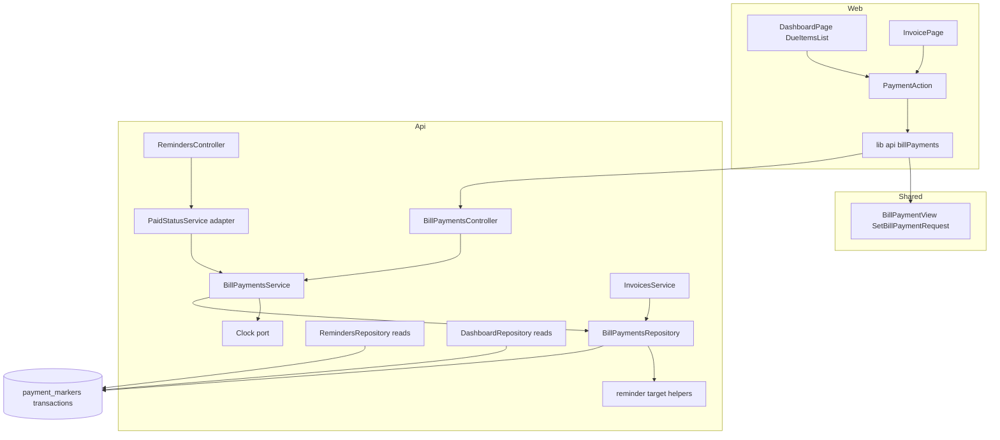
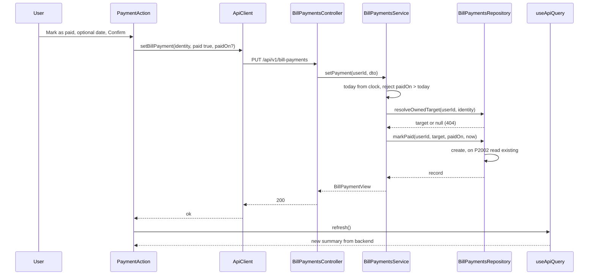

# Technical Design — bill-payments

## Overview

**Purpose**: make "paid" a product-level fact for PayPilot's two payable item
kinds — a generated recurring occurrence and a credit-card invoice — and let
the user mark and undo it from the dashboard and the invoice page.

**Users**: the authenticated PayPilot user keeping their monthly bills up to
date, including bills paid outside PayPilot.

**Impact**: a new `bill-payments` API module takes write ownership of the
existing `payment_markers` table (one additive migration: `paidOn DATE`), a
product-level `PUT /bill-payments` endpoint, additive fields on the dashboard
and invoice contracts, and mark/undo actions in the web app. Reminders keep
reading the same records; `PUT /reminders/paid` keeps its behaviour.

### Goals

- One paid state per (user, payable item), shared by reminders, dashboard and
  the new endpoint (1.1, 1.2, 7.1).
- Payment date that may be back-dated but never in the future (2.2–2.5).
- Idempotent mark and unmark, safe under concurrent requests (2.6, 3.2, 8.3).
- One-action mark/undo where bills are shown, refreshed from the backend
  (6.x, 5.4).

### Non-Goals

- Real payments, reconciliation, partial payments, refunds, auto-detection.
- Paying `MANUAL` / `IMPORTED` rows; bulk actions; editing a payment date
  (unmark + mark covers it).
- Relocating `reminder-target.ts` out of the reminders folder (research D1).

## Architecture

### Existing Architecture Analysis

| Asset | Location | Reused as |
| ----- | -------- | --------- |
| `payment_markers` (`@@unique([userId, targetType, targetKey])`, typed FKs) | `prisma/schema.prisma` | The single payment store (D1) |
| `recurringTarget` / `cardInvoiceTarget` | `reminders/domain/reminder-target.ts` | Canonical identity, imported cross-feature |
| `resolveOwnedTarget` | `reminders/reminders.repository.ts` | Moved to `BillPaymentsRepository` |
| Mark/unmark logic | `reminders/paid-status.service.ts` | Moved to `BillPaymentsService`; the old service becomes an adapter |
| `isPaid`, `findDueItems` marker reads | `reminders/reminders.repository.ts` | Unchanged (7.1, 7.2) |
| `findPaidKeys` | `dashboard/dashboard.repository.ts` | Extended to select `paidOn` |
| P2002 reconciliation pattern | `recurring-bills/generation.service.ts` | Concurrency guard (8.3) |
| `useApiQuery`, `useApiMutation` | `apps/web/src/lib/api/hooks.ts` | `useApiQuery` gains `refresh()` (D6) |

### Architecture Pattern & Boundary Map



- **Boundaries**: `bill-payments` is the only writer of `payment_markers`.
  Reminders and dashboard only read. No feature writes ledger rows (1.5).
- **Dependency direction**: `reminders` → `bill-payments` (adapter) and
  `cards` → `bill-payments` (invoice paid read). `bill-payments` imports only
  the pure identity helpers from reminders, so there is no module cycle.

### Technology Stack

| Layer | Choice | Role | Notes |
| ----- | ------ | ---- | ----- |
| Backend | NestJS 11 | `BillPaymentsModule` (controller, service, repository) | Exports the service and repository |
| Data | PostgreSQL 16 + Prisma 7 | `paidOn DATE NOT NULL` on `payment_markers` | One migration (D2) |
| Shared | `@paypilot/shared` | New payment contracts; additive fields | Implemented by the api |
| Frontend | Next.js 16, React 19 | `PaymentAction` component, hook `refresh()` | No new dependency |
| Tests | Jest, Testcontainers, Vitest | Unit, integration (incl. concurrency), UI | Existing setup |

## System Flows



- Undo is the same flow with `paid: false` and `deleteMany` (no-op when
  already unpaid).
- On any non-OK result the action shows the error and does **not** call
  `refresh()`, so the previous state stays on screen (6.6).

## Requirements Traceability

| Requirement | Summary | Components | Interfaces | Flows |
| ----------- | ------- | ---------- | ---------- | ----- |
| 1.1, 1.2, 1.3 | One record per item, canonical identity, invoice-level | `BillPaymentsRepository`, identity helpers | unique index | — |
| 1.4 | Owner, item, payment date, recording instant | `payment_markers.paidOn`, `paidAt` | `BillPaymentView` | — |
| 1.5 | Ledger untouched | `BillPaymentsRepository` (no ledger writes) | — | — |
| 1.6 | Existing markers stay paid | migration back-fill | — | — |
| 2.1–2.3 | Mark, default today, chosen date | `BillPaymentsService` | `PUT /bill-payments` | Sequence |
| 2.4, 2.5 | Future / malformed date rejected | `BillPaymentsService`, `SetBillPaymentDto` | 400 | — |
| 2.6 | Re-mark keeps record | `BillPaymentsRepository.markPaid` | — | Sequence |
| 2.7 | Any due date | `BillPaymentsService` (no due-date check) | — | — |
| 3.1–3.3 | Unmark, idempotent, status re-derived | `BillPaymentsRepository.unmark`, dashboard `dueStatus` | — | — |
| 4.1–4.5 | Auth, 404 without disclosure, scoped, server-derived key | global guard, `resolveOwnedTarget` | 401 / 404 | — |
| 5.1, 5.2 | Dashboard shows paid date, refreshed | `DashboardRepository`, `summarizeMonth`, `DueItemsList` | `DueItemView.paidOn` | Sequence |
| 5.3 | Invoice page shows paid state | `InvoicesService`, `InvoicePage` | `InvoiceView.paid`, `paidOn` | — |
| 5.4 | Never inferred client-side | `PaymentAction`, `useApiQuery.refresh` | — | — |
| 6.1–6.7 | Mark/undo UI states | `PaymentAction` | `setBillPayment` | Sequence |
| 7.1, 7.2, 7.4 | Reminders respect the state | unchanged reminder reads | — | — |
| 7.3 | `PUT /reminders/paid` unchanged | `PaidStatusService` adapter | existing response | — |
| 8.1–8.6 | Tests, clock, no secrets | test suites | — | — |

## Components and Interfaces

| Component | Layer | Intent | Req | Dependencies |
| --------- | ----- | ------ | --- | ------------ |
| `BillPaymentsController` | API / transport | `PUT /bill-payments` | 2.x, 3.x, 4.1 | `BillPaymentsService` |
| `SetBillPaymentDto` | API / transport | Validate identity parts, `paid`, `paidOn` shape | 2.5, 4.5 | class-validator |
| `BillPaymentsService` | API / application | Clock, future-date rule, delegate | 2.x, 3.x, 8.5 | `CLOCK`, repository |
| `BillPaymentsRepository` | API / data | Owned-target resolution, create/delete, P2002, reads | 1.x, 4.x, 8.3 | `PrismaService`, identity helpers |
| `PaidStatusService` (changed) | API / reminders | Adapter keeping `PUT /reminders/paid` | 7.3 | `BillPaymentsService` |
| `DashboardRepository` / `summarizeMonth` (changed) | API / dashboard | Carry `paidOn` | 5.1 | — |
| `InvoicesService` (changed) | API / cards | Add invoice paid state | 5.3 | `BillPaymentsRepository` |
| `setBillPayment` | Web / lib | Typed client call | 6.x | `request` |
| `useApiQuery` (changed) | Web / lib | `refresh()` in loaded state | 6.5, 6.6 | — |
| `PaymentAction` | Web / feature | Mark (date picker) / Undo with states | 6.1–6.7 | `useApiMutation` |
| `DueItemsList`, `InvoicePage` (changed) | Web / feature | Host `PaymentAction`, show paid date | 5.1, 5.3, 6.1, 6.2 | — |

### API

#### BillPaymentsService

```typescript
export interface BillPaymentsService {
  /** Mark (`paid: true`) or unmark (`paid: false`) one owned payable item. */
  setPayment(userId: string, input: SetBillPaymentRequest): Promise<BillPaymentView>;
}
```

- Reads `CLOCK` once: `now = clock.now()`, `today = toDateString(now)`.
- `paid: true`: `paidOn = input.paidOn ?? today`; if `paidOn > today` →
  `BadRequestException` (canonical `VALIDATION_ERROR`) before any write (2.4).
- Resolves the target via the repository; `null` → `NotFoundException` (4.2,
  4.3). Resolution happens **after** the date check, so a bad date never
  reveals whether a target exists.
- Never checks the due date (2.7).

#### BillPaymentsRepository

```typescript
export interface BillPaymentsRepository {
  resolveOwnedTarget(userId: string, input: PaidTargetInput): Promise<ReminderTarget | null>;
  /** Create the record; on P2002 return the existing one unchanged (2.6, 8.3). */
  markPaid(userId: string, target: ReminderTarget, paidOn: string, recordedAt: Date): Promise<PaymentRecord>;
  /** Idempotent delete scoped to the user (3.1, 3.2). */
  unmark(userId: string, target: ReminderTarget): Promise<void>;
  /** Invoice-level read for the invoice page (5.3). */
  findPayment(userId: string, target: ReminderTarget): Promise<PaymentRecord | null>;
}

export interface PaymentRecord {
  targetType: ReminderTargetType;
  targetKey: string;
  paidOn: string; // YYYY-MM-DD
  recordedAt: string; // ISO UTC (the `paidAt` column)
}
```

- `markPaid` first reads by the unique key; if present it returns it (fast
  idempotent path), otherwise `create`; a P2002 from a concurrent winner is
  caught and the winner re-read.
- `resolveOwnedTarget` is moved verbatim from `RemindersRepository` (same
  rules: owned `RECURRING` row; owned card with ≥ 1 `CARD` row in the cycle).
- `userId` is in every `where`. No method touches `transactions` except the
  ownership `findFirst` reads.

#### BillPaymentsController

| Method | Endpoint | Request | Response | Errors |
| ------ | -------- | ------- | -------- | ------ |
| PUT | `/api/v1/bill-payments` | `SetBillPaymentDto` | `BillPaymentView` (200) | 400 `VALIDATION_ERROR`, 401, 404, 429 |

`SetBillPaymentDto` = the `SetPaidDto` fields plus
`@ValidateIf(paid === true) @IsOptional() @IsIsoCalendarDate() paidOn?`, and a
rule rejecting `paidOn` when `paid` is false.

#### PaidStatusService (adapter)

Keeps its signature and `PaidStatusView { targetType, targetKey, paid, paidAt }`.
Delegates to `BillPaymentsService.setPayment` (no `paidOn`, so today) and maps
`recordedAt` → `paidAt`. `RemindersRepository.resolveOwnedTarget` is removed;
its unit tests move to `BillPaymentsRepository`.

### Web

#### useApiQuery — `refresh()`

```typescript
export type QueryState<T> =
  | { status: "loading" }
  | { status: "error"; error: ApiError; retry: () => void }
  | { status: "empty" }
  | { status: "loaded"; data: T; refresh: () => Promise<boolean> };
```

`refresh` refetches without leaving `loaded`; on success it replaces `data`
(and honours `isEmpty`), on failure it keeps `data` and resolves `false`.

#### PaymentAction

- Props: the item identity (`targetType` + parts), `paid`, a `label` (the item
  description, used in accessible names), `onChanged: () => Promise<boolean>`.
- Unpaid: button "Mark as paid" → inline form with an optional date input
  (`max` = backend `today` when known; empty = today) and Confirm / Cancel.
- Paid: button "Undo" (single action; reversible).
- While pending: the active button is disabled with "Saving…" (6.4).
- On success: awaits `onChanged()` (the page's `refresh`) (6.5).
- On failure: inline `role="alert"` with a generic message and the request id;
  state unchanged (6.6). Accessible names: "Mark Condo as paid", "Undo payment
  for Condo" (6.7).

`DueItemsList` adds an "Actions" column hosting `PaymentAction` and shows
"Paid on DD/MM/YYYY" for paid items. To build the identity it needs the parts,
so `DueItemView` carries them (see contracts). `InvoicePage` shows "Paid on …"
or "Not paid" plus one `PaymentAction`.

## Data Models

### Physical change (migration `add_payment_date`)

```sql
ALTER TABLE "payment_markers" ADD COLUMN "paidOn" DATE;
UPDATE "payment_markers" SET "paidOn" = ("paidAt" AT TIME ZONE 'UTC')::date;
ALTER TABLE "payment_markers" ALTER COLUMN "paidOn" SET NOT NULL;
```

Prisma: `paidOn DateTime @db.Date`. `paidAt` keeps meaning "recorded at".

### Data Contracts (`@paypilot/shared`)

```typescript
export interface SetBillPaymentRequest {
  targetType: "RECURRING_TRANSACTION" | "CARD_INVOICE";
  transactionId?: string;
  creditCardId?: string;
  invoiceCycle?: string; // YYYY-MM
  paid: boolean;
  paidOn?: string; // YYYY-MM-DD, only with paid: true
}

export interface BillPaymentView {
  targetType: "RECURRING_TRANSACTION" | "CARD_INVOICE";
  targetKey: string;
  paid: boolean;
  paidOn: string | null; // YYYY-MM-DD
  recordedAt: string | null; // ISO UTC
}

// DueItemView (additive)
//   paidOn: string | null;
//   transactionId: string | null;   // RECURRING items
//   creditCardId: string | null;    // CARD items
//   invoiceCycle: string | null;    // CARD items
// InvoiceView (additive): paid: boolean; paidOn: string | null;
```

The identity parts on `DueItemView` are the same values the server derives the
key from; the client sends them back as validated parts, never the key (4.5).

## Error Handling

- **400 `VALIDATION_ERROR`** — malformed identity, malformed `paidOn`,
  `paidOn` with `paid: false`, future `paidOn`.
- **404 `NOT_FOUND`** — unknown, foreign, `MANUAL`/`IMPORTED`, or empty-cycle
  targets, indistinguishably.
- **401 / 429** — existing guard and throttler.
- UI: every failure renders the generic inline alert with `requestId`; a 401
  still flows through the existing session-clear redirect.

## Testing Strategy

### Unit

- `BillPaymentsService`: default today, back-dated date, future date rejected
  before resolution, 404 on unresolved, unmark, under `FixedClock`.
- `BillPaymentsRepository`: create path, existing-record path (re-mark keeps
  `paidOn`), P2002 path re-reads the winner, unmark scoped by user,
  `resolveOwnedTarget` cases moved from reminders.
- `PaidStatusService` adapter: response shape unchanged.
- `summarizeMonth`: `paidOn` and identity parts carried through.

### Integration (`test/bill-payments.int.spec.ts`)

- Mark/unmark/re-mark/re-unmark round trip; ledger row count unchanged (1.5).
- Back-dated `paidOn` stored and returned; future date → 400; nothing written.
- User B cannot mark user A's item (404); `MANUAL`/`IMPORTED` ids → 404.
- Two parallel marks → exactly one row (8.3).
- Dashboard shows `PAID` + `paidOn` after marking; `OVERDUE` again after undo.
- Invoice endpoint reports `paid`/`paidOn`.
- Reminders: an item marked via `/bill-payments` is not sent (R1); unmarked,
  an unsent window fires.
- Migration back-fill: a marker created before the new column exists gets
  `paidOn` = its `paidAt` UTC date (run on a fresh DB with a seeded row
  between migrations, or asserted via raw SQL on the migrated schema).

### Frontend

- `PaymentAction`: mark with default and chosen date, cancel, pending
  disabled, success calls refresh, failure shows request id and keeps state,
  accessible names.
- `useApiQuery.refresh`: replaces data on success, keeps data on failure.
- Dashboard and invoice pages render "Paid on" and the actions.

## Migration Strategy

Single forward migration with back-fill inside Prisma's migration transaction.
Rollback is dropping the column; no other table changes.

## Security Considerations

Identity is always server-derived from validated parts; ownership is checked
on every write; not-found never discloses existence. No secrets or new public
configuration (8.6).
