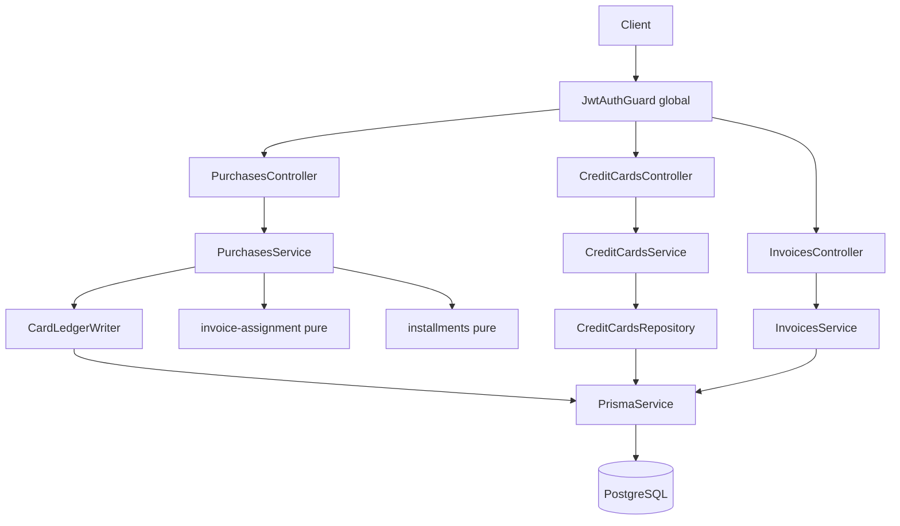
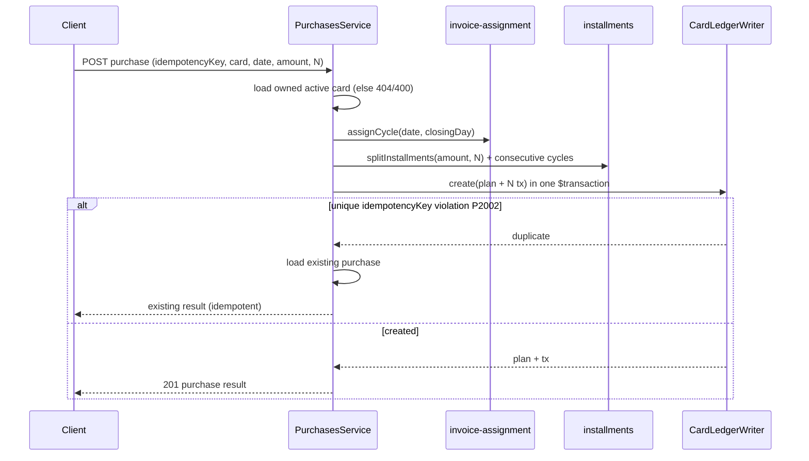

# Technical Design: credit-cards-invoices

## Overview

**Purpose**: Add credit cards and the assignment of card purchases (single and installment) to the correct monthly invoice, upholding financial-rules **R4** (invoice assignment by closing/due day) and **R5** (predictable installments), with **idempotent** and **atomic** purchase creation.

**Users**: Authenticated users register cards, record purchases, and view a card's invoice for a cycle.

**Impact**: Introduces a `cards` feature and two new models (`CreditCard`, `CardPurchase`); the shared `Transaction` ledger gains `source = CARD` plus card-link columns; the existing source-aware CHECK constraint is rewritten to cover three sources. Invoices are a **derived view**, not a stored table.

### Goals
- Card CRUD (owner-scoped; DELETE = deactivate).
- Idempotent, atomic recording of single/installment purchases as `CARD` ledger rows.
- Deterministic invoice assignment (R4) and installment schedules (R5) via pure, clock-injected domain logic.
- Derived per-cycle invoice view; three-source ledger protection preserved.

### Non-Goals
- Editing/deleting card transactions after creation; correction/cancellation/refund/chargeback/adjustment; paying an invoice / payment settlement; available-credit-limit enforcement; interest/late fees; reminders; CSV import; multi-currency; a stored Invoice entity; admin/RBAC.

## Requirements Traceability
| Req | Summary | Components |
|-----|---------|-----------|
| 1 | Create card (+ creditLimit validation) | CreditCardsController/Service/Repository, DTOs |
| 2 | Read cards | CreditCardsController/Service/Repository |
| 3 | Update card (future-only effect) | CreditCardsService |
| 4 | Deactivate on DELETE | CreditCardsService/Repository |
| 5 | Record purchase (`source=CARD`, snapshot, link, max) | PurchasesController/Service, CardLedgerWriter |
| 6 | Invoice assignment R4 (cycle=closing month, clamp, rollover) | `invoice-assignment` domain |
| 7 | Installments R5 (split, consecutive cycles, atomic, date) | `installments` domain, CardLedgerWriter |
| 8 | Invoice view (derived, validated cycle) | InvoicesController/Service |
| 9 | Source protection + mutation scope | CardsRepository, ExpensesRepository, CHECK |
| 10 | Per-user isolation | owner-scoped queries, `@CurrentUser` |
| 11 | Money/date/clock | DTO validators, `createMoney`, `Clock` |
| 12 | Persistence/errors/tests | migration, enum, filter, tests |
| 13 | Idempotent purchase creation | `@@unique([userId, idempotencyKey])`, `$transaction`, P2002 |

## Architecture

### Existing Architecture Analysis
Reuses: global `JwtAuthGuard` + `@CurrentUser`; owner-scoped repositories + `assertOwnership`; `AllExceptionsFilter`/`ErrorCode`; `Clock` port; shared `Money` (`createMoney`) + `ledger-money-date` helpers; `clampDay`/period math (recurring-bills); Prisma via `PrismaService`; the recurring-bills CHECK-constraint precedent. Preserves the per-feature folder + inward dependency direction (controllers → services → pure domain → repository).

### Architecture Pattern & Boundary Map

**Key decisions**: pure domain (`invoice-assignment`, `installments`) has no framework imports and takes dates/amounts as explicit inputs — **no clock read** (deterministic by construction). `CardLedgerWriter` owns the atomic `$transaction` (plan + N rows). Invoices are derived by `InvoicesService`, no stored entity. Steering-compliant: `apps/api/src/cards/`.

### Technology Stack
| Layer | Choice / Version | Role | Notes |
|-------|------------------|------|-------|
| Backend | NestJS 11 | controllers/services/module | reuse global guard/pipe/filter |
| Data | Prisma 7 + PostgreSQL | `CreditCard`, `CardPurchase`, `Transaction` (CARD) | atomic `$transaction`; `@@unique` idempotency; rewritten CHECK |

Assignment/installment logic is **pure over explicit inputs** (the client-provided `purchaseDate` + card days), so it reads **no server clock** — R11.5 is satisfied by construction, and unit tests need no clock. `Clock` is available for audit timestamps only; no `Date.now()` in domain logic. No new external dependencies.

## System Flows

Purchase creation (idempotent, atomic):


## Components and Interfaces

| Component | Domain/Layer | Intent | Req | Contracts |
|-----------|--------------|--------|-----|-----------|
| CreditCardsController | transport | `/api/v1/credit-cards` CRUD; DELETE=deactivate | 1–4 | API |
| CreditCardsService | application | validate, money, ownership, deactivate | 1–4,10,11 | Service |
| CreditCardsRepository | data | owner-scoped card access | 1–4,10 | State |
| PurchasesController | transport | `POST /api/v1/credit-cards/:cardId/purchases` | 5,13 | API |
| PurchasesService | application | assign, split, idempotent+atomic create | 5,7,10,13 | Service |
| InvoicesController | transport | `GET /api/v1/credit-cards/:cardId/invoices/:cycle` | 8 | API |
| InvoicesService | application | derived invoice (sum + due date) | 8,10 | Service |
| invoice-assignment | domain (pure) | `assignCycle`, `dueDate` (R4) | 6 | Service |
| installments | domain (pure) | `splitInstallments`, `installmentCycles` (R5) | 7 | Service |
| CardLedgerWriter | data | atomic plan + N `CARD` rows | 5,7,9,13 | Batch/State |
| ExpensesRepository (changed) | data | already `source:MANUAL`; regression vs CARD | 9 | State |

### Domain: invoice-assignment (pure)
```typescript
// invoiceCycle = the closing month "YYYY-MM"; not derived from server time.
interface InvoiceAssignment {
  assignCycle(purchaseDate: string, closingDay: number): string;      // "YYYY-MM"
  dueDate(cycle: string, closingDay: number, dueDay: number): string; // "YYYY-MM-DD"
}
```
- `assignCycle`: effective closing = `min(closingDay, daysInMonth(month))`; `purchaseDay <= effectiveClosing` → purchase month, else next month (year rolls at December).
- `dueDate`: if `dueDay > closingDay`, due is in the cycle (closing) month; else it rolls to the following month; day clamped to that month's length.
- Preconditions: `purchaseDate` valid `YYYY-MM-DD`; `closingDay/dueDay` 1–31. Invariants: pure, deterministic, no tz dependence (date-only string math).

### Domain: installments (pure)
```typescript
interface Installments {
  splitInstallments(totalMinor: number, n: number): number[];  // length n, sums to total
  installmentCycles(startCycle: string, n: number): string[];  // n consecutive "YYYY-MM"
}
```
- `splitInstallments`: `base = floor(total/n)`; remainder `total - base*n` added to index 0. Sum equals `total`. Postcondition: `sum(result) === totalMinor`, `result.length === n`, all `> 0` for valid inputs.
- `installmentCycles`: `startCycle` then `n-1` consecutive months (year rolls).

### Application: PurchasesService
```typescript
interface CreatePurchaseInput {
  idempotencyKey: string;
  purchaseDate: string;   // YYYY-MM-DD
  amountMinor: number;    // > 0 safe int
  currency: string;       // BRL
  description: string;
  category?: string;
  installments: number;   // 1..MAX_INSTALLMENTS
}
interface PurchaseResult {
  id: string; cardId: string; installments: number;
  transactions: CardTransactionResponse[]; // seq, total, invoiceCycle, dueDate, amountMinor
}
interface PurchasesService {
  create(userId: string, cardId: string, input: CreatePurchaseInput): Promise<PurchaseResult>;
}
```
- Loads the owned card (404 if not owned/missing; **400** if inactive). Builds `Money` via `createMoney` (each per-installment amount is validated through `createMoney`). Computes start cycle + per-installment amounts/cycles. Delegates the atomic write to `CardLedgerWriter`.
- **Idempotency contract & reconciliation** (R13.4): `idempotencyKey` is one-per-logical-request; a retry reuses the same key with the same payload. On `P2002` the service does a fresh read (after the aborted `$transaction`) of the existing `CardPurchase` and reconciles it against a stored **request fingerprint** (`requestHash` = hash of `purchaseDate`, `amountMinor`, `currency`, `installments`):
  - fingerprint matches **and** the stored `creditCardId` equals the path `:cardId` → return the existing purchase result (idempotent success, no new rows);
  - divergent payload or a **different `:cardId`** under the same key → **409 `CONFLICT`** (`IDEMPOTENCY_KEY_REUSED`), never a silently-returned unrelated purchase.
- Concurrency: the loser's insert blocks on the unique index until the winner commits, then the fresh read sees the committed row — so overlapping requests converge to exactly one plan.

### Data: CardLedgerWriter
- **Batch/State contract**: within one `prisma.$transaction`, insert the `CardPurchase` (with `idempotencyKey`) then the `N` `Transaction` rows (`source=CARD`, `cardPurchaseId`, `creditCardId`, `invoiceCycle`, `installmentSeq`, `installmentTotal`, `transactionDate = dueDate(cycle)`, snapshotted amount/currency/description/category, owner = card's user). Idempotency & recovery: unique `(userId, idempotencyKey)`; all-or-none (partial schedule impossible).

### Application: InvoicesService (derived)
```typescript
interface InvoiceView {
  cardId: string; cycle: string;   // YYYY-MM (closing month)
  dueDate: string;                 // YYYY-MM-DD
  totalMinor: number;
  transactions: CardTransactionResponse[];
}
interface InvoicesService {
  getInvoice(userId: string, cardId: string, cycle: string): Promise<InvoiceView>;
}
```
- Validates `cycle` as `YYYY-MM` (else 400). Loads the owned card (404 else). Queries `source=CARD AND creditCardId AND invoiceCycle` (owner-scoped), sums `amountMinor` (exact), computes `dueDate` from the card. Empty cycle → zero-total invoice (not an error).
- **Inactive cards remain viewable** (R4.3 history preservation): the invoice query does **not** filter `isActive`, so a deactivated card's past/future installment cycles are still returned. The per-cycle transaction set is naturally small (installments of purchases assigned to that closing month); no pagination in the MVP, ordered `installmentSeq, id` for determinism.

### DTOs
- `CreateCreditCardDto`: `label` (trim, non-empty, ≤100), `closingDay`/`dueDay` (`@IsInt @Min(1) @Max(31)`), `creditLimitMinor?` (`@IsInt @Min(0) @Max(MAX_SAFE_INTEGER)`).
- `UpdateCreditCardDto = PartialType` (editable fields only; empty body → 400; never owner/id/isActive/timestamps).
- `ListCreditCardsQueryDto`: `page`/`pageSize` (≤100), `active?` (explicit boolean parser — `"true"`/`"false"` only, else 400, per the recurring-bills pattern).
- `CreatePurchaseDto`: `idempotencyKey` (trim, non-empty, ≤200), `purchaseDate` (`IsIsoCalendarDate`), `amountMinor` (`@IsInt @IsPositive @Max(MAX_SAFE_INTEGER)`), `currency` (trim+upper, `@IsIn(["BRL"])`), `description` (trim, non-empty, ≤255), `category?` (≤100), `installments` (`@IsInt @Min(1) @Max(MAX_INSTALLMENTS)`).
- Invoice cycle path param validated `^\d{4}-(0[1-9]|1[0-2])$` (else 400).

## Data Models

### CreditCard (new)
```
model CreditCard {
  id             String   @id @default(uuid()) @db.Uuid
  userId         String   @db.Uuid
  user           User     @relation(fields: [userId], references: [id], onDelete: Restrict)
  label          String   @db.VarChar(100)
  closingDay     Int      @db.SmallInt
  dueDay         Int      @db.SmallInt
  creditLimitMinor BigInt?
  isActive       Boolean  @default(true)
  createdAt      DateTime @default(now()) @db.Timestamptz(6)
  updatedAt      DateTime @updatedAt @db.Timestamptz(6)
  purchases      CardPurchase[]
  transactions   Transaction[]
  @@index([userId])
  @@map("credit_cards")
}
```

### CardPurchase (new) — originating purchase / installment plan
```
model CardPurchase {
  id             String   @id @default(uuid()) @db.Uuid
  userId         String   @db.Uuid
  user           User     @relation(fields: [userId], references: [id], onDelete: Restrict)
  creditCardId   String   @db.Uuid
  creditCard     CreditCard @relation(fields: [creditCardId], references: [id], onDelete: Restrict)
  idempotencyKey String   @db.VarChar(200)
  requestHash    String   @db.Char(64) // sha-256 of the core payload; reconciles key reuse (409 on mismatch)
  purchaseDate   DateTime @db.Date
  amountMinor    BigInt
  currency       String   @db.Char(3)
  description    String   @db.VarChar(255)
  categoryLabel  String?  @db.VarChar(100)
  installments   Int      @db.SmallInt
  startCycle     String   @db.Char(7) // YYYY-MM
  createdAt      DateTime @default(now()) @db.Timestamptz(6)
  updatedAt      DateTime @updatedAt @db.Timestamptz(6)
  transactions   Transaction[]
  @@unique([userId, idempotencyKey])   // DB-level idempotency (R13)
  @@index([creditCardId])
  @@map("card_purchases")
}
```

### Transaction (extended) — CARD link columns
```
enum TransactionSource { MANUAL  RECURRING  CARD }  // + CARD

model Transaction {
  // ...existing fields + recurring link...
  creditCardId    String?        @db.Uuid
  creditCard      CreditCard?    @relation(fields: [creditCardId], references: [id], onDelete: Restrict)
  cardPurchaseId  String?        @db.Uuid
  cardPurchase    CardPurchase?  @relation(fields: [cardPurchaseId], references: [id], onDelete: Restrict)
  invoiceCycle    String?        @db.Char(7)  // YYYY-MM (closing month)
  installmentSeq  Int?           @db.SmallInt
  installmentTotal Int?          @db.SmallInt
  @@index([creditCardId, invoiceCycle])       // invoice view lookups
}
```

### CHECK constraint (rewritten, source-aware)
The migration **drops** `transactions_recurring_link_chk` and adds a three-source constraint: exactly the columns for a row's source are set, all others NULL.
```sql
ALTER TABLE "transactions" DROP CONSTRAINT "transactions_recurring_link_chk";
ALTER TABLE "transactions" ADD CONSTRAINT "transactions_source_link_chk" CHECK (
  (source = 'MANUAL'    AND "recurringBillId" IS NULL     AND "periodKey" IS NULL
                        AND "creditCardId" IS NULL AND "cardPurchaseId" IS NULL AND "invoiceCycle" IS NULL
                        AND "installmentSeq" IS NULL AND "installmentTotal" IS NULL)
  OR (source = 'RECURRING' AND "recurringBillId" IS NOT NULL AND "periodKey" IS NOT NULL
                        AND "creditCardId" IS NULL AND "cardPurchaseId" IS NULL AND "invoiceCycle" IS NULL
                        AND "installmentSeq" IS NULL AND "installmentTotal" IS NULL)
  OR (source = 'CARD'   AND "recurringBillId" IS NULL AND "periodKey" IS NULL
                        AND "creditCardId" IS NOT NULL AND "cardPurchaseId" IS NOT NULL AND "invoiceCycle" IS NOT NULL
                        AND "installmentSeq" IS NOT NULL AND "installmentTotal" IS NOT NULL)
);
```
- **Migration**: create `credit_cards`, `card_purchases`; add enum value `CARD`; add card columns + FKs + `@@index` to `transactions`; swap the CHECK. Generated via `migrate diff` → hand-edit (CHECK) → `migrate deploy`, per the recurring-bills precedent.

### Constants
`MAX_INSTALLMENTS = 24` (hard-coded for MVP; documented). Money as integer minor units; dates date-only `@db.Date`; audit timestamps `@db.Timestamptz(6)`.

## Error Handling
Reuse `AllExceptionsFilter`/`ErrorCode`: 400 validation (bad body, `installments > MAX`, malformed cycle, inactive card), 401 guard, 404 not-owned/missing (no disclosure). Idempotent retry (same key + matching fingerprint + same card) → return existing result (**not** an error; 200/201-style success). Key reuse with a **divergent** payload or a **different** card → **409 `CONFLICT`** (`IDEMPOTENCY_KEY_REUSED`). `P2002` on the idempotency key is caught in the service (triggering the reconciliation above); other DB errors surface as canonical 500 without leaking internals.

## Testing Strategy

### Unit (pure domain — no DB/HTTP)
- `invoice-assignment.assignCycle`: on/before closing → current; after → next; short-month clamp (closing 31 in Feb); December→January year rollover (the 3 worked examples).
- `invoice-assignment.dueDate`: `dueDay > closingDay` same month vs roll to next; day clamp.
- `installments.splitInstallments`: sums to total; remainder on first; `n=1` → full amount; non-even division (e.g. 10000/3).
- `installments.installmentCycles`: consecutive months incl. year roll.

### Integration (Testcontainers, real PostgreSQL — serial, non-UTC TZ)
- Card CRUD + isolation (cross-user → 404); DELETE deactivates (204); `active` filter parsing (other → 400); `creditLimitMinor` negative → 400.
- **Purchase**: single → 1 `CARD` row; N installments → N rows, correct cycles/dates, snapshot fields, owner = card user; `installments > 24` / `< 1` → 400; inactive card → 400.
- **Idempotency (R13)**: same `idempotencyKey` + same payload twice → one plan + N rows, second returns existing; concurrent `Promise.all` → exactly one plan; same key with a **divergent** payload or a **different** card → **409**.
- **Atomicity (R7)**: a forced failure mid-write leaves **0** rows (never partial).
- **Invoice view (R8)**: total = exact sum; due date computed; empty cycle → zero total; malformed cycle → 400; cross-user/unknown card → 404; a **deactivated** card still returns its invoices (history preserved).
- **Source protection (R9)**: manual endpoints cannot list/read/update/delete a `CARD` row; CHECK rejects each invalid link state (MANUAL/RECURRING/CARD) via raw insert; existing manual/recurring suites stay green.
- **tz safety**: installment `transactionDate` round-trips unchanged under `TZ=America/Sao_Paulo`.

## Security Considerations
Per-user isolation via token-derived `userId` + owner-scoped queries; generated rows owned by the card's user. Three-source ledger protection prevents cross-feature mutation. No available-limit/payment logic (deferred). No new external surface.

## Resolved Decisions
- Source value **`CARD`**; `type` stays `EXPENSE`.
- Purchase/plan = **`CardPurchase`** aggregate; ledger rows link via `cardPurchaseId` + self-describing columns.
- Idempotency: required `idempotencyKey` + `@@unique([userId, idempotencyKey])` + stored `requestHash`; **atomic** `$transaction`; matching retry → existing result, divergent payload / different card under the same key → **409**.
- Assignment/installment domain is **pure over explicit inputs** — no server clock read (R11.5 by construction).
- `invoiceCycle` = **closing month**; due date derived (may roll to next month); documented examples.
- Installment `transactionDate` = **cycle due date** (date-only, tz-safe).
- Split remainder on the **first** installment; **`MAX_INSTALLMENTS = 24`** (MVP constant).
- Invoice = **derived view** (no stored entity).
- CHECK **rewritten** source-aware (MANUAL/RECURRING/CARD).
