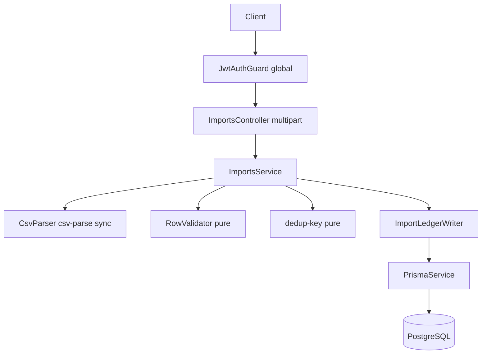

# Technical Design: csv-import

## Overview

**Purpose**: Bulk-import expense transactions from a bank/card statement CSV into the shared `Transaction` ledger (`source = IMPORTED`), upholding financial-rules **R6** (duplicate avoidance by date, amount, description) with a **database-level** guarantee, and recording an `ImportRun` provenance summary.

**Users**: Authenticated users upload a CSV; the API returns a per-file summary (imported / duplicate / invalid).

**Impact**: Adds an `imports` feature and an `ImportRun` model; the `Transaction` ledger gains `source = IMPORTED` + `dedupHash` + `importRunId`; the source-aware CHECK is rewritten to four sources and a partial unique index enforces dedup. MVP imports **expenses only**, synchronously within bounded limits.

### Goals
- Multipart CSV upload → parse → per-row validate → dedup → persist, all owner-scoped.
- DB-level duplicate protection for imported rows (partial unique on `(userId, dedupHash)`), skip-not-fail on conflict.
- `ImportRun` provenance; four-source ledger protection preserved.

### Non-Goals
- Income/refunds/credits/chargebacks/transfers/negative amounts/balances/reconciliation; dedup against MANUAL/RECURRING/CARD; async/background processing; editing/deleting imported rows; undo/rollback; bank/Open-Finance integrations; multi-currency; admin/RBAC.

## Requirements Traceability
| Req | Summary | Components |
|-----|---------|-----------|
| 1 | Import + summary | ImportsController/Service, CsvParser, ImportLedgerWriter |
| 2 | Dedup R6 (DB-level, IMPORTED-only) | dedup-key domain, partial unique index, `createMany skipDuplicates` |
| 3 | Row validation / partial success | RowValidator, amount/date parsing, `createMoney` |
| 4 | Untrusted input + whole-file vs row-level | FileInterceptor limits, structural validation |
| 5 | Per-user isolation | owner-scoped queries, `@CurrentUser` |
| 6 | Source protection | source-aware CHECK, `IMPORTED` scoping, tests |
| 7 | Money/date/persistence | migration, enum, `Clock`, error envelope |
| 8 | Import run / provenance | ImportRun model + `importRunId` link |
| 9 | CSV schema + parser | fixed schema, `csv-parse` (exact) |
| 10 | Test coverage | unit + Testcontainers |

## Architecture

### Existing Architecture Analysis
Reuses: global `JwtAuthGuard` + `@CurrentUser`; owner-scoped repositories + `assertOwnership`; `AllExceptionsFilter`/`ErrorCode`; shared `Money` (`createMoney`) + `ledger-money-date`; `IsIsoCalendarDate`; the card/recurring **CHECK + partial-index** precedent; Prisma via `PrismaService`; `@nestjs/platform-express` multer. Preserves the per-feature folder + inward dependency direction (controller → service → pure domain → repository/writer).

### Architecture Pattern & Boundary Map

**Key decisions**: parsing/validation/dedup-key are pure (framework-free, no clock read) and unit-tested directly. `ImportLedgerWriter` owns the interactive transaction (create `ImportRun` → `createMany skipDuplicates` → finalize counts). Structural/size rejection happens before any persistence. Steering-compliant: `apps/api/src/imports/`.

### Technology Stack
| Layer | Choice / Version | Role | Notes |
|-------|------------------|------|-------|
| Transport | NestJS 11 + `FileInterceptor` (multer, memory storage) | multipart upload, size limit | multer already `>=2.2.0` |
| Parsing | `csv-parse` (exact, sync API) | RFC-4180 parse of the buffer | no install scripts / deps; policy-compliant |
| Data | Prisma 7 + PostgreSQL | `ImportRun`, `Transaction` (IMPORTED) | partial unique index; `createMany skipDuplicates`; rewritten CHECK |

Assignment/validation is pure over explicit inputs — **no system clock read**; `Clock` is used only for audit timestamps. Adds one exact prod dependency (`csv-parse`).

## System Flows

```mermaid
sequenceDiagram
    participant C as Client
    participant S as ImportsService
    participant P as CsvParser
    participant V as RowValidator
    participant W as ImportLedgerWriter
    C->>S: POST multipart file
    S->>S: enforce size/row limits (else 400/413, persist nothing)
    S->>P: parse buffer (structural check -> 400 if bad header)
    loop each data row
        S->>V: validate + parse amount/date (invalid -> collect lineNumber+reasonCode)
    end
    S->>S: compute dedupHash; app-level dedup (existing IMPORTED + in-file)
    S->>W: create ImportRun + createMany(skipDuplicates) survivors + finalize counts
    W-->>S: importedCount (DB truth)
    S-->>C: summary { totalRows, importedCount, duplicateCount, invalidCount, invalidRows[] }
```

## Components and Interfaces

| Component | Domain/Layer | Intent | Req | Contracts |
|-----------|--------------|--------|-----|-----------|
| ImportsController | transport | `POST /api/v1/imports` (multipart) | 1,4 | API |
| ImportsService | application | orchestrate parse→validate→dedup→persist, build summary | 1–5 | Service |
| CsvParser | infra | parse buffer via `csv-parse/sync`; structural check | 4,9 | Service |
| RowValidator | domain (pure) | validate a raw row → candidate or invalid(reasonCode) | 3,9 | Service |
| dedup-key | domain (pure) | normalize + `dedupHash` | 2 | Service |
| ImportLedgerWriter | data | atomic ImportRun + `createMany skipDuplicates` | 1,2,7,8 | Batch/State |
| ImportsRepository | data | owner-scoped existing-hash lookup + run reads | 2,5,8 | State |

### Domain: dedup-key (pure)
```typescript
interface DedupKey {
  normalizeDescription(raw: string): string;      // trim, collapse whitespace, lowercase
  dedupHash(dateIso: string, amountMinor: number, description: string): string; // sha-256 hex
}
```
- Invariant: identical normalization for incoming rows and stored comparison; deterministic; no tz/clock.

### Domain: RowValidator (pure)
```typescript
type RowResult =
  | { ok: true; candidate: { date: string; amountMinor: number; currency: string; description: string; category: string | null } }
  | { ok: false; reasonCode: string };
interface RowValidator { validate(raw: Record<string, string>, lineNumber: number): RowResult; }
```
- Rejects: unparseable/invalid calendar date; non-positive or non-integer amount; unsupported currency (BRL only); missing required field; over-long field. Amount string → minor units (documented decimal parse), then `createMoney`.

### Application: ImportsService
```typescript
interface ImportSummary {
  totalRows: number;
  importedCount: number;
  duplicateCount: number;
  invalidCount: number;
  invalidRows: Array<{ lineNumber: number; reasonCode: string }>;
  duplicateRows?: Array<{ lineNumber: number }>;
  importRunId: string;
}
interface ImportsService { import(userId: string, file: UploadedFile): Promise<ImportSummary>; }
```
- Enforce size/row limits (whole-file reject → 400/413, persist nothing). Parse (bad header/structure → 400). Validate rows (collect invalids). Compute `dedupHash`; app-level dedup vs the user's existing `IMPORTED` hashes + in-file (first wins) for `duplicateRows`. Delegate persistence to the writer; `importedCount` comes from the DB. `duplicateCount = validRows - importedCount`.

### Data: ImportLedgerWriter
- **Batch/State**: in one `prisma.$transaction` — create `ImportRun` (status `processing`), `createMany({ data: survivors, skipDuplicates: true })` (each row `source=IMPORTED`, `type=EXPENSE`, `importRunId`, `dedupHash`, owner=userId), then update the run with final counts + status `completed`. `skipDuplicates` → `ON CONFLICT DO NOTHING` (partial unique), so an overlapping import is skipped, never fatal. All-or-none on unexpected failure.

### API Contract
| Method | Endpoint | Request | Response | Errors |
|--------|----------|---------|----------|--------|
| POST | /api/v1/imports | multipart `file` (CSV) | 201 `ImportSummary` | 400 (structure/validation), 401, 413 (size) |

## Data Models

### ImportRun (new)
```
enum ImportStatus { PROCESSING  COMPLETED  FAILED }

model ImportRun {
  id             String       @id @default(uuid()) @db.Uuid
  userId         String       @db.Uuid
  user           User         @relation(fields: [userId], references: [id], onDelete: Restrict)
  status         ImportStatus @default(PROCESSING)
  totalRows      Int          @default(0)
  importedCount  Int          @default(0)
  duplicateCount Int          @default(0)
  invalidCount   Int          @default(0)
  fileHash       String?      @db.Char(64)
  createdAt      DateTime     @default(now()) @db.Timestamptz(6)
  updatedAt      DateTime     @updatedAt @db.Timestamptz(6)
  transactions   Transaction[]
  @@index([userId])
  @@map("import_runs")
}
```

### Transaction (extended) — import link columns
```
enum TransactionSource { MANUAL  RECURRING  CARD  IMPORTED }  // + IMPORTED

model Transaction {
  // ...existing + recurring + card columns...
  dedupHash   String?     @db.Char(64)  // set only for IMPORTED
  importRunId String?     @db.Uuid
  importRun   ImportRun?  @relation(fields: [importRunId], references: [id], onDelete: Restrict)
  // @@unique partial index added via raw SQL (Prisma cannot express WHERE):
  //   CREATE UNIQUE INDEX ... ON transactions (userId, dedupHash) WHERE source = 'IMPORTED'
}
```

### CHECK constraint (rewritten — four sources)
Drop `transactions_source_link_chk`, add a version where each source sets exactly its own columns; `IMPORTED` ⇒ `dedupHash` + `importRunId` NOT NULL (recurring/card cols NULL); `MANUAL`/`RECURRING`/`CARD` ⇒ `dedupHash` NULL + `importRunId` NULL (plus their existing rules).

### Partial unique index
`CREATE UNIQUE INDEX "transactions_user_dedup_uq" ON "transactions" ("userId","dedupHash") WHERE source = 'IMPORTED';`

### Migration (two steps — see research)
1. `ALTER TYPE "TransactionSource" ADD VALUE 'IMPORTED';` (alone, committed first).
2. Create `ImportStatus` enum + `import_runs`; add `dedupHash`/`importRunId` (+ FK, index) to `transactions`; **drop+add** the source-aware CHECK; add the partial unique index. (Generated via `migrate diff` → hand-edit CHECK/partial-index → `migrate deploy`.)

### CSV schema (fixed, MVP)
Required columns **date, amount, description**; optional **category, currency**. Design fixes: header names (accepted set), delimiter (`,`), encoding (UTF-8), date formats (e.g. `YYYY-MM-DD`), decimal format (dot decimal, 2 places → minor units), blank-line handling (skip). Structurally invalid header → 400 (persist nothing).

### Constants
`MAX_FILE_BYTES` and `MAX_ROWS` (config/constants); money as integer minor units; dates date-only `@db.Date`; audit timestamps `@db.Timestamptz(6)`.

## Error Handling
Reuse `AllExceptionsFilter`/`ErrorCode`: **400** (invalid header/structure, all-rows-invalid is still 201 with counts, malformed request), **401** (unauthenticated), **413** (file too large). Structural/size failures persist nothing. Row-level failures never abort the import (reported in `invalidRows`). A DB unique conflict is a skipped duplicate (not an error). Never log the raw body/rows — only operation, userId, requestId, counts, error codes.

## Testing Strategy

### Unit (pure — no DB/HTTP)
- `dedup-key`: description normalization (trim/whitespace/case); identical hash for equivalent rows; different hash on a one-field near-miss.
- `RowValidator`: valid row → candidate; rejects bad date, non-positive/non-integer amount, non-BRL, missing/over-long field; amount decimal → minor units.
- `CsvParser`: parses quoted fields/delimiters; rejects a bad header (structural).

### Integration (Testcontainers, real PostgreSQL — serial, non-UTC TZ)
- Happy path: N valid rows → N `IMPORTED`/`EXPENSE` rows owned by the user + `ImportRun` with matching counts; installment-free.
- **Dedup / R6:** existing-match skip; in-file duplicate skip; **re-import same file → zero new rows** (DB truth); near-miss (one differing field) inserted; overlapping imports converge (no duplicate `(userId, dedupHash)`).
- Validation/partial success: invalid rows reported with `lineNumber`+`reasonCode`, valid rows imported.
- Whole-file: bad header → 400 persist nothing; oversized/too-many-rows → 413/400 persist nothing.
- Isolation: another user's imported rows are never matched/returned; cross-user cannot read a run.
- **Source protection:** manual/recurring/card endpoints cannot read/update/delete an `IMPORTED` row; CHECK rejects each invalid link state (incl. IMPORTED without `dedupHash`/`importRunId`, and non-IMPORTED with `dedupHash`).
- tz safety: an imported date round-trips unchanged under `TZ=America/Sao_Paulo`.

## Security Considerations
Untrusted upload: memory storage + `limits.fileSize` + max row count; whole-file rejection before persistence; never log raw body/rows ([[security]]). Per-user isolation via token-derived `userId` + owner-scoped queries; dedup scoped to the user's IMPORTED rows. Four-source protection prevents cross-feature mutation. No secrets; one vetted exact dependency.

## Resolved Decisions
- Source **`IMPORTED`**; `type` stays `EXPENSE`; **expenses only**.
- Parser **`csv-parse`** (exact, sync); **multipart** upload (memory storage + limits).
- Dedup **DB-level**: normalized `dedupHash` + **partial unique** `(userId, dedupHash) WHERE source='IMPORTED'`; `createMany skipDuplicates` (skip-not-fail); app-level pre-pass for summary quality only; **IMPORTED-scoped**.
- **`ImportRun`** provenance + `importRunId` link; never stores raw CSV.
- **CHECK rewritten** for four sources; **two-step migration** for the new enum value.
