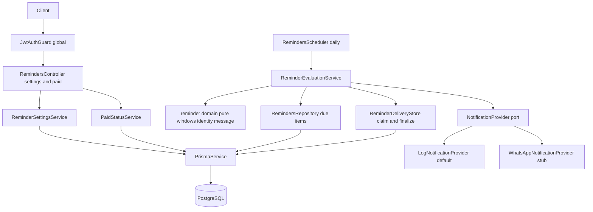
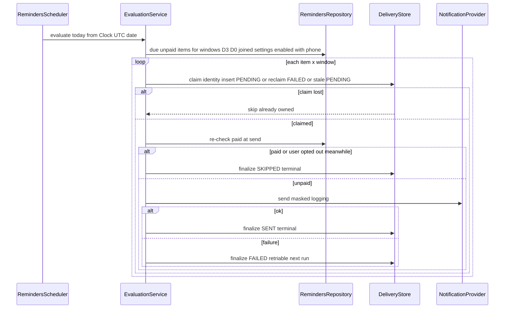

# Technical Design: due-date-reminders

## Overview

**Purpose**: Proactively remind users about upcoming/same-day due dates of **unpaid** bills — already-generated recurring occurrences (`source = RECURRING` rows) and credit-card invoices (per card + `invoiceCycle`) — upholding **R1** (paid-aware at selection and at send), **R2** (at most one successful send per `(userId, targetType, targetKey, dueDate, reminderWindow, channel)`, DB-guaranteed), and **R7** (all sends behind a PayPilot-owned `NotificationProvider` port).

**Users**: Authenticated users configure a WhatsApp destination + opt-in, mark items paid/unpaid, and receive reminders without any manual trigger.

**Impact**: Adds a `reminders` feature module and the first `integrations/notifications` provider port. Three new tables (`reminder_settings`, `payment_markers`, `reminder_deliveries`); the existing ledger tables are **untouched** (only Prisma inverse-relation fields, no SQL change). New optional env vars for provider selection.

### Goals
- Daily scheduled evaluation selecting unpaid due items in windows **D-3** and **D-0**, per user, clock-injected.
- Claim-before-send `ReminderDelivery` with DB-level uniqueness as the R2 source of truth (channel in the identity from day one).
- Paid markers (invoice-level for cards) and reminder settings endpoints, owner-scoped.
- `NotificationProvider` port + `LogNotificationProvider` default + config-gated WhatsApp stub.

### Non-Goals
- Real WhatsApp API integration (stub only — follow-up spec); other channels; delivery receipts/webhooks; OTP phone verification; custom windows/quiet hours/snooze/digests; predictive reminders for not-yet-generated occurrences; reminders for `MANUAL`/`IMPORTED`; automatic paid detection; reminder-history API; BullMQ/distributed locking; i18n.

## Requirements Traceability
| Req | Summary | Components |
|-----|---------|-----------|
| 1.1–1.7 | Eligibility, windows, daily evaluation, target identity | ReminderEvaluationService, RemindersScheduler, reminder-domain, RemindersRepository |
| 2.1–2.5 | Paid markers (invoice-level for cards) | PaidStatusService, RemindersController, `payment_markers` |
| 3.1–3.4 | R1 paid-aware (selection + send) | RemindersRepository (selection filter), ReminderEvaluationService (send-time re-check) |
| 4.1–4.5 | R2 identity + claim + retry | ReminderDeliveryStore, `reminder_deliveries` unique index |
| 5.1–5.5 | R7 port + fake default + WhatsApp stub | integrations/notifications, env schema |
| 6.1–6.4 | Settings + opt-in skip | ReminderSettingsService, RemindersController, `reminder_settings` |
| 7.1–7.3 | Message content/privacy | reminder-domain (message template), logging rules |
| 8.1–8.3 | Clock/date/money conventions | reminder-domain (pure, UTC-date anchor), `Clock` port |
| 9.1–9.3 | Per-user isolation | owner-scoped repository/services, `@CurrentUser` |
| 10.1–10.3 | Test coverage | unit (pure domain) + Testcontainers integration |

## Architecture

### Existing Architecture Analysis
Reuses: global `JwtAuthGuard` + `@CurrentUser`; owner-scoped repositories; `AllExceptionsFilter` + request-id envelope; `Clock` port (`CLOCK` token — its docstring names `NotificationProvider` as the follow-on port); in-process `@nestjs/schedule` cron precedent (safe only because DB uniqueness is the concurrency source of truth — unchanged trade-off, BullMQ stays out of scope); P2002-as-skip batch precedent; zod fail-fast env validation; `toDateString`/`toAmountNumber` money/date helpers; the serial non-UTC Testcontainers harness. Ledger reads are cross-feature but **read-only** (reminders never mutate `RECURRING`/`CARD` rows — source protection preserved).

### Architecture Pattern & Boundary Map

**Key decisions**: window/identity/message logic is pure (framework-free, no clock read — evaluation date is an input). `ReminderDeliveryStore` owns the R2 claim state machine. The provider port lives in `apps/api/src/integrations/notifications/` (steering names it verbatim); the feature module in `apps/api/src/reminders/`. Selection: Option B from `gap-analysis.md`.

### Technology Stack
| Layer | Choice / Version | Role | Notes |
|-------|------------------|------|-------|
| Scheduling | `@nestjs/schedule` (installed) | daily evaluation cron 12:00 UTC | recurring-bills precedent; no new dep |
| Data | Prisma 7 + PostgreSQL | 3 new tables + 4 new enums | single migration; ledger untouched |
| Notifications | `NotificationProvider` port (new) | R7 boundary; Log default + WhatsApp stub | **no new dependency** (stub needs no HTTP client) |
| Config | zod env schema (existing) | `NOTIFICATION_PROVIDER` + WhatsApp credentials | fail-fast, names-only errors |

## System Flows


Per-item try/catch: one item's failure is logged (codes only) and never aborts the run (1.6). Missed windows never fire later — a window matches only when `dueDate − windowDays == today` (catch-up policy, research log).

## Components and Interfaces

| Component | Domain/Layer | Intent | Req | Contracts |
|-----------|--------------|--------|-----|-----------|
| NotificationProvider port (+Log, +WhatsApp stub) | integrations | R7 boundary for outbound sends | 5 | Service |
| reminder-domain | domain (pure) | windows, target identity, message template | 1, 7, 8 | Service |
| RemindersScheduler | infra | daily trigger | 1 | Batch |
| ReminderEvaluationService | application | orchestrate select → claim → re-check → send → finalize | 1, 3, 4, 9 | Service |
| RemindersRepository | data | due-item queries (unpaid, enabled users), ownership checks | 1, 3, 9 | State |
| ReminderDeliveryStore | data | R2 claim/finalize state machine | 4 | State |
| PaidStatusService | application | mark/unmark paid by target identity | 2 | Service |
| ReminderSettingsService | application | settings read/upsert | 6 | Service |
| RemindersController | transport | settings + paid endpoints | 2, 6 | API |

### Integrations: notifications (new port)

#### NotificationProvider
| Field | Detail |
|-------|--------|
| Intent | Vendor-agnostic outbound notification boundary (R7) |
| Requirements | 5.1–5.5 |

```typescript
type NotificationChannel = "WHATSAPP";

interface OutboundNotification {
  channel: NotificationChannel;
  destination: string; // E.164; never logged unmasked
  body: string;        // final message text; never logged
}

type NotificationResult =
  | { ok: true }
  | { ok: false; errorCode: string }; // wrapped — no vendor shapes escape

interface NotificationProvider {
  send(notification: OutboundNotification): Promise<NotificationResult>;
}
export const NOTIFICATION_PROVIDER = Symbol("NOTIFICATION_PROVIDER");
```
- **`LogNotificationProvider`** (default: `NOTIFICATION_PROVIDER=log`, and always in tests/dev): logs operation + masked destination + result, returns `{ ok: true }`. No credentials needed.
- **`WhatsAppNotificationProvider`** (selected by `NOTIFICATION_PROVIDER=whatsapp`; requires `WHATSAPP_API_TOKEN` + `WHATSAPP_PHONE_NUMBER_ID`, fail-fast at boot): **MVP stub** — logs masked destination and returns `{ ok: false, errorCode: "WHATSAPP_NOT_IMPLEMENTED" }` so deliveries record `FAILED` honestly (bounded daily retry; no fabricated `SENT`). The real Cloud-API adapter is a follow-up spec; swapping it touches only this class.
- Invariants: providers never throw (failures are wrapped results); the port never appears in domain code — only the evaluation service injects it.

### Domain: reminder-domain (pure, framework-free)

```typescript
const REMINDER_WINDOWS_DAYS_BEFORE = [3, 0] as const; // D-3, D-0
type ReminderTargetType = "RECURRING_TRANSACTION" | "CARD_INVOICE";

interface ReminderTarget {
  targetType: ReminderTargetType;
  targetKey: string;            // canonical: "txn:<uuid>" | "card:<uuid>:<YYYY-MM>"
  transactionId: string | null; // RECURRING_TRANSACTION
  creditCardId: string | null;  // CARD_INVOICE
  invoiceCycle: string | null;  // CARD_INVOICE
}

interface DueItem {
  target: ReminderTarget;
  userId: string;
  dueDate: string;        // YYYY-MM-DD
  description: string;    // bill description or card label
  amountMinor: number;    // invoice = SUM of its rows
  currency: string;       // BRL
}

// windowsFor(dueDate, todayUtc) -> number[] (matching windows; [] if none)
// encodeTargetKey(target) / target builders (server-side only; never client-supplied)
// formatReminderMessage(item: DueItem, windowDays: number): string  // deterministic pt-BR amount from minor units
// addDays(dateIso: string, days: number): string                    // UTC string arithmetic
```
- Invariants: no clock read (`todayUtc` is an input — UTC calendar date of `Clock.now()`, the `deriveCurrentPeriod` precedent); date math on `YYYY-MM-DD` strings only; amount formatting from integer minor units, never floats.

### Application / Infra

#### ReminderEvaluationService
| Field | Detail |
|-------|--------|
| Intent | Orchestrate one evaluation run (see System Flow) |
| Requirements | 1.3–1.6, 3.1–3.3, 4.3, 7.3, 9.1–9.2 |

```typescript
interface EvaluationSummary { // counts only — never per-user data
  evaluated: number; sent: number; skippedClaimed: number;
  skippedPaid: number; failed: number;
}
interface ReminderEvaluationService {
  evaluate(todayUtc: string): Promise<EvaluationSummary>;
}
```
- Preconditions: `todayUtc` valid `YYYY-MM-DD`. Postconditions: every claimed identity finalized (`SENT`/`FAILED`/`SKIPPED`); summary counts consistent. Users without enabled settings + destination are filtered **before** claiming (no delivery rows written for them — 6.3 decision). Logs: operation, userId, targetKey, window, outcome code — never body/phone (7.3).

#### RemindersScheduler
- **Batch contract** — Trigger: `@Cron` daily **12:00 UTC** (09:00 América/São Paulo; hours after the 01:00 UTC generation run). Derives `todayUtc` from `CLOCK` and calls `evaluate`. Multi-instance safety = the DB claim (recurring-bills precedent). A CLI entry (`remind.cli.ts`, generation precedent) allows manual runs.

#### RemindersRepository
```typescript
interface RemindersRepository {
  findDueItems(dueDates: readonly string[]): Promise<DueItem[]>; // all users; joined: settings enabled+phone, NOT paid (LEFT JOIN payment_markers IS NULL)
  isPaid(userId: string, target: ReminderTarget): Promise<boolean>;       // send-time re-check (3.2)
  resolveOwnedTarget(userId: string, input: PaidTargetInput): Promise<ReminderTarget | null>; // ownership + existence (2.5)
}
```
- `findDueItems`: `RECURRING` rows by `transactionDate IN dueDates`; `CARD` invoices grouped `(creditCardId, invoiceCycle)` with `transactionDate IN dueDates` and `SUM(amountMinor)`. `resolveOwnedTarget`: RECURRING → owned `RECURRING` transaction exists; CARD_INVOICE → owned card + ≥1 `CARD` row in the cycle; else null → 404.

#### ReminderDeliveryStore (R2 state machine)
```typescript
type DeliveryStatus = "PENDING" | "SENT" | "FAILED" | "SKIPPED";
interface ReminderDeliveryStore {
  claim(identity: DeliveryIdentity): Promise<"claimed" | "already-owned">;
  finalize(identity: DeliveryIdentity, status: "SENT" | "FAILED" | "SKIPPED", errorCode?: string): Promise<void>;
}
```
- **State model**: `claim` = `INSERT … PENDING(attempt 1)`; on P2002 → atomic `updateMany({ where: identity + (status = FAILED OR (PENDING AND updatedAt < now − STALE_CLAIM_HOURS)), data: { status: PENDING, attempt: +1 } })`; `count 1` = re-claimed, `count 0` = already owned. `SENT`/`SKIPPED` terminal forever (incl. after paid→unpaid flips — 2.3 decision); `FAILED`/stale-`PENDING` re-claimable. `STALE_CLAIM_HOURS = 12` (documented constant; residual risk of one repeat after a crash mid-send is accepted and documented — reminders, not payments).

#### PaidStatusService / ReminderSettingsService
```typescript
interface PaidStatusService {
  setPaid(userId: string, input: PaidTargetInput, paid: boolean): Promise<PaidStatusView>; // idempotent both ways
}
interface ReminderSettingsService {
  get(userId: string): Promise<ReminderSettingsView>;                    // defaults when absent: enabled=false, phone=null
  upsert(userId: string, input: UpdateSettingsInput): Promise<ReminderSettingsView>;
}
```
- Mark = upsert marker (`ON CONFLICT DO NOTHING`), `paidAt` from `Clock`; unmark = idempotent delete (presence = paid). Phone validated `^\+[1-9]\d{7,14}$` (E.164), stored as-is, always masked in logs (`+55*******123`).

#### RemindersController — API Contract
| Method | Endpoint | Request | Response | Errors |
|--------|----------|---------|----------|--------|
| GET | /api/v1/reminders/settings | — | 200 `{ phoneE164, enabled }` | 401 |
| PUT | /api/v1/reminders/settings | `{ phoneE164?: string\|null, enabled: boolean }` | 200 settings | 400, 401 |
| PUT | /api/v1/reminders/paid | `{ targetType, transactionId? , creditCardId?, invoiceCycle?, paid: boolean }` | 200 `{ targetType, targetKey, paid, paidAt }` | 400, 401, 404 |

- DTO validation: class-validator; `targetType` discriminates required fields (RECURRING_TRANSACTION → `transactionId` uuid; CARD_INVOICE → `creditCardId` uuid + `invoiceCycle` `YYYY-MM`); cross-user/unknown target → 404 without disclosure. Global guard → 401. No endpoint mutates ledger rows.

## Data Models

### New enums
```
enum ReminderTargetType { RECURRING_TRANSACTION  CARD_INVOICE }
enum NotificationChannel { WHATSAPP }          // identity-ready for future channels
enum ReminderDeliveryStatus { PENDING SENT FAILED SKIPPED }
```

### reminder_settings
```
model ReminderSettings {
  id        String  @id @default(uuid()) @db.Uuid
  userId    String  @unique @db.Uuid     // 1:1, FK → User (Restrict)
  phoneE164 String? @db.VarChar(16)
  enabled   Boolean @default(false)
  createdAt/updatedAt Timestamptz(6)
  @@map("reminder_settings")
}
```

### payment_markers (presence = paid)
```
model PaymentMarker {
  id            String   @id @default(uuid()) @db.Uuid
  userId        String   @db.Uuid            // FK → User (Restrict), @@index
  targetType    ReminderTargetType
  targetKey     String   @db.VarChar(90)     // canonical encoding (server-derived)
  transactionId String?  @db.Uuid            // FK → Transaction (Restrict)
  creditCardId  String?  @db.Uuid            // FK → CreditCard (Restrict)
  invoiceCycle  String?  @db.Char(7)
  paidAt        DateTime @db.Timestamptz(6)  // from Clock
  createdAt/updatedAt
  @@unique([userId, targetType, targetKey])
  @@map("payment_markers")
}
```

### reminder_deliveries (R2 source of truth)
```
model ReminderDelivery {
  id             String  @id @default(uuid()) @db.Uuid
  userId         String  @db.Uuid             // FK → User (Restrict), @@index
  targetType     ReminderTargetType
  targetKey      String  @db.VarChar(90)
  transactionId  String? @db.Uuid             // FK → Transaction (Restrict)
  creditCardId   String? @db.Uuid             // FK → CreditCard (Restrict)
  invoiceCycle   String? @db.Char(7)
  dueDate        DateTime @db.Date
  windowDaysBefore Int   @db.SmallInt         // 3 | 0
  channel        NotificationChannel
  status         ReminderDeliveryStatus @default(PENDING)
  attempt        Int     @default(1)
  errorCode      String? @db.VarChar(64)      // stable code only — never message/PII
  sentAt         DateTime? @db.Timestamptz(6)
  createdAt/updatedAt
  @@unique([userId, targetType, targetKey, dueDate, windowDaysBefore, channel]) // R2
  @@map("reminder_deliveries")
}
```

### Migration (single step) + CHECKs (hand-appended SQL, precedent: csv-import)
- Create enums + 3 tables + FKs + indexes; **no change to existing tables** (Prisma inverse relations are schema-file-only).
- CHECK on `payment_markers` and `reminder_deliveries`: `targetType = 'RECURRING_TRANSACTION'` ⇒ `transactionId NOT NULL AND creditCardId IS NULL AND invoiceCycle IS NULL`; `targetType = 'CARD_INVOICE'` ⇒ inverse. (`targetKey` consistency is application-derived; typed columns + FKs carry integrity.)

### Constants
`REMINDER_WINDOWS_DAYS_BEFORE = [3, 0]`; cron `0 12 * * *` UTC; `STALE_CLAIM_HOURS = 12`; E.164 regex; message template fixed pt-BR. All in a documented constants module (csv-import precedent).

## Error Handling
Reuse `AllExceptionsFilter`: **400** (invalid DTO/phone/cycle), **401**, **404** (unowned/unknown target). Scheduled flow: provider failures → wrapped result → `FAILED` delivery (retriable); unexpected per-item errors → caught, logged (codes only), run continues; evaluation summary is counts-only. Providers never throw. No vendor/database detail leaks.

## Testing Strategy

### Unit (pure — no DB/HTTP)
- `windowsFor`/`addDays`: D-3/D-0 boundaries, month/year rollover, no match for past windows; fixed inputs, no clock.
- `encodeTargetKey` + target builders: canonical encodings, invalid inputs rejected.
- `formatReminderMessage`: deterministic amount formatting from minor units (e.g. `123456` → `R$ 1.234,56`), D-3 vs D-0 phrasing.
- Provider selection: `log` default; `whatsapp` requires credentials (env schema tests); stub returns wrapped failure.

### Integration (Testcontainers, real PostgreSQL, serial, `TZ=America/Sao_Paulo`)
- **Happy path**: user with enabled settings + due `RECURRING` row and due card invoice → one `SENT` delivery per item/window via fake provider; message/masking assertions on logs excluded (log content not asserted beyond absence of phone/body).
- **R1**: paid marker (occurrence and invoice-level) → no delivery; **paid between claim and send** (marker inserted after claim) → `SKIPPED`, no send; unmark unpaid → future windows fire, consumed identities never re-fire.
- **R2**: re-run same evaluation → no second send (`already-owned`); overlapping concurrent evaluations → exactly one `SENT` per identity; provider failure → `FAILED` then next run retries and succeeds — still one `SENT`; unique index rejects a duplicate identity at the DB.
- **Settings/opt-in**: disabled or no phone → no delivery rows; invalid phone → 400; settings/paid endpoints owner-scoped (cross-user → 404).
- **Paid endpoint**: idempotent mark/unmark; CARD_INVOICE requires owned card + existing cycle rows; `MANUAL`/`IMPORTED` transaction id → 404 (not reminder-eligible).
- **Ledger untouched**: existing suites stay green; no reminder operation mutates `transactions`.
- **tz safety**: D-3/D-0 selection identical under `TZ=America/Sao_Paulo` at month boundaries.

## Security Considerations
Per-user isolation via token-derived userId + owner-scoped queries; the scheduled job derives ownership from row data only. Phone numbers masked in every log line; message bodies never logged; provider credentials env-only (R8), validated fail-fast, absent by default (fake provider). No new attack surface beyond two small authenticated endpoints.

## Resolved Decisions
- **Option B** (gap analysis): new `reminders/` module + `integrations/notifications/` port; ledger untouched; side tables for settings/markers/deliveries.
- **R2 identity**: `(userId, targetType, targetKey, dueDate, windowDaysBefore, channel)` with `channel` from day one; canonical `targetKey` (`txn:<id>` / `card:<id>:<cycle>`) + typed FK columns + per-type CHECK.
- **Target identities**: generated `RECURRING` transaction id; `creditCardId + invoiceCycle` (invoice-level paid markers).
- **Claim state machine**: `PENDING → SENT | FAILED | SKIPPED`; terminal `SENT`/`SKIPPED`; re-claim `FAILED`/stale-`PENDING` (12 h) via atomic conditional update; already-claimed windows never re-fire.
- **Windows/schedule**: D-3 + D-0; daily cron 12:00 UTC; catch-up = exact-match-only (missed windows skipped silently).
- **Timezone anchor**: UTC calendar date of `Clock.now()` (recurring-bills precedent); all math on date strings.
- **Provider**: `NOTIFICATION_PROVIDER` env (`log` default); WhatsApp ships as an **honest stub** (`FAILED`, never fabricated `SENT`); real adapter is a follow-up spec.
- **Paid semantics**: presence-in-`payment_markers` = paid; idempotent mark/unmark; no audit history (out of scope).
