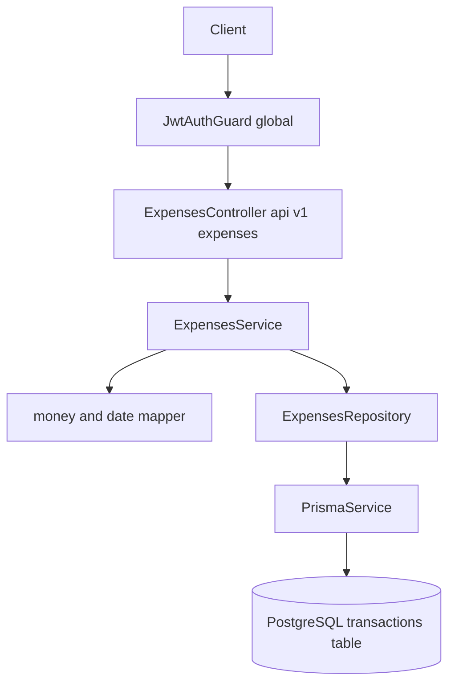
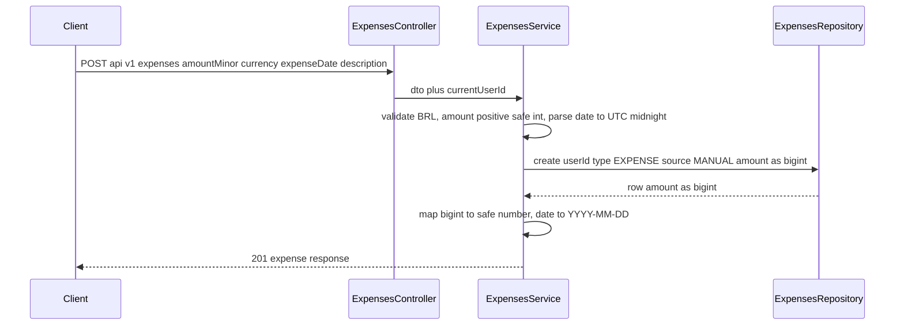

# Technical Design: manual-expenses

## Overview

**Purpose**: Add manual expense CRUD and establish the **shared transaction ledger** that later financial features write into. It is the first feature to persist user-owned financial records, so it rigorously applies per-user isolation (auth-jwt) and exact money/time modeling (`docs/conventions.md`).

**Users**: Authenticated end users record/list/edit/delete their own expenses; future specs (recurring bills, cards, CSV import) reuse the same `Transaction` ledger.

**Impact**: New `ExpensesModule` + a generic `Transaction` Prisma model (+ enums) and migration. Reuses the global guard, `@CurrentUser`, canonical errors, `Money`, and Prisma.

### Goals
- `/api/v1/expenses` CRUD, owner-scoped, validated.
- A generic ledger model (`Transaction`, `type`/`source`) that other features extend without duplicating records.
- Exact money (BIGINT minor units, BRL MVP) and stable calendar dates (`YYYY-MM-DD`, no tz shift).

### Non-Goals
- Other ledger producers (recurring bills, cards, CSV, reminders) — only manual expenses are created here.
- Categories taxonomy (only an optional free-text label), reporting/aggregation, multi-currency conversion, soft-delete/audit-history, status workflow.

## Architecture

### Architecture Pattern & Boundary Map

New `ExpensesModule` follows the established layered feature pattern: controller → service → repository → `PrismaService`, reusing cross-cutting auth/error primitives. (Option B from `gap-analysis.md`.)



**Integration**: routes are auto-protected by the global `JwtAuthGuard`; the owner id comes from `@CurrentUser`. Errors flow through `AllExceptionsFilter` (400/401/404 canonical). `Money` (`@paypilot/shared`) is the in-code amount type.

### Technology Stack

| Layer | Choice | Role |
|-------|--------|------|
| Transport | NestJS controller + DTOs (class-validator) | `/expenses` CRUD, validation |
| Domain | `Money`, money/date mapper | exact amounts, date-only mapping |
| Data | Prisma 7 `Transaction` model + migration (pg adapter) | persistence, owner-scoped queries |

## System Flows

Create (money + date mapping; the only non-trivial flow):



## Requirements Traceability

| Requirement | Components |
|-------------|------------|
| 1 create | ExpensesController.create, CreateExpenseDto, Service, Repository |
| 2 list (+date range, pagination ≤100) | Controller.list, ListExpensesQueryDto, Repository.findMany |
| 3 read | Controller.get, Repository.findOwned (404-like) |
| 4 update (PATCH editable fields) | Controller.update, UpdateExpenseDto, Repository.updateOwned |
| 5 delete (hard, 204) | Controller.remove, Repository.deleteOwned |
| 6 isolation | user-scoped queries (`WHERE id AND userId`), `@CurrentUser` |
| 7 money/date | money/date mapper, DTO validators, `Transaction.amountMinor` BIGINT, `@db.Date` |
| 8 ledger | `Transaction` model + enums + migration, FK onDelete Cascade |
| 9 errors | `AllExceptionsFilter` + `ErrorCode` (reuse) |
| 10 tests | unit (mapper/service) + integration (Testcontainers) |
| 11 classification | server-set `type=EXPENSE`, `source=MANUAL` (not in DTO) |
| 12 status | omitted (no status field) |

## Components and Interfaces

| Component | Intent | Reqs |
|-----------|--------|------|
| ExpensesController | `/expenses` CRUD endpoints | 1–5 |
| ExpensesService | validation, money/date mapping, orchestration | 1–7,11 |
| ExpensesRepository | owner-scoped Prisma access | 2–6,8 |
| money/date mapper | bigint↔number (safe), date↔`YYYY-MM-DD` | 7 |
| DTOs | request validation | 1,2,4,7 |

### ExpensesService (contract)
```typescript
interface ExpenseResponse {
  id: string;
  amountMinor: number;      // positive safe integer
  currency: string;         // uppercase ISO-4217 (BRL in MVP)
  expenseDate: string;      // YYYY-MM-DD
  description: string;
  category: string | null;
  type: "EXPENSE";
  source: "MANUAL";
  createdAt: string;        // ISO UTC
  updatedAt: string;        // ISO UTC
}

interface ExpensesService {
  create(userId: string, dto: CreateExpenseDto): Promise<ExpenseResponse>;
  list(userId: string, query: ListExpensesQueryDto): Promise<{ data: ExpenseResponse[]; meta: { page: number; pageSize: number; total: number } }>;
  get(userId: string, id: string): Promise<ExpenseResponse>;        // 404 if not owned/missing
  update(userId: string, id: string, dto: UpdateExpenseDto): Promise<ExpenseResponse>;
  remove(userId: string, id: string): Promise<void>;                 // hard delete; 404 if not owned
}
```
- **Invariants**: `userId` from token only; `type`/`source` server-set; amount `> 0` safe integer; currency uppercased + BRL-only (MVP); `expenseDate` stable (no tz shift).
- **Money is constructed via `createMoney` (`@paypilot/shared`)** as the single source of money validation (safe-integer + ISO-4217). DTOs validate request *shape* (positive int, BRL, lengths, date format); the service builds a `Money` via `createMoney` before persistence so the same invariant is reused as future ledger producers are added (not re-implemented per feature).

### Repository (owner-scoped)
- `findOwned(userId, id)` → `findFirst({ where: { id, userId } })`; null → service throws `NotFoundException`.
- `updateOwned`/`deleteOwned` → `updateMany`/`deleteMany({ where: { id, userId } })`; if `count === 0` → `NotFoundException`.
- `findMany(userId, { from, to, skip, take })` with **deterministic ordering** `orderBy: [{ transactionDate: "desc" }, { id: "desc" }]`.
- **Date-range filter is inclusive** on both ends: `where: { userId, transactionDate: { gte: fromDate, lte: toDate } }` (each bound applied only when provided).

### DTOs
- `CreateExpenseDto`: `amountMinor` (`@IsInt @IsPositive @Max(Number.MAX_SAFE_INTEGER)`), `currency` (string; transformed uppercase; `@IsIn(["BRL"])` for MVP), `expenseDate` (`@Matches(/^\d{4}-\d{2}-\d{2}$/)` + valid calendar date), `description` (`@IsString` + `@Transform(trim)` + `@IsNotEmpty` + `@MaxLength(255)`), `category?` (`@IsOptional` + trim + `@MaxLength(100)`).
- `UpdateExpenseDto`: `PartialType(CreateExpenseDto)` (PATCH; editable fields only). `type`/`source`/ids/timestamps are absent → cannot be set.
- `ListExpensesQueryDto`: `page` (default 1, `@IsInt @Min(1)`), `pageSize` (default 20, `@Min(1) @Max(100)`), `from?`/`to?` (`YYYY-MM-DD`).

## Data Models

### Transaction (generic ledger; first model of the spine)
```
enum TransactionType   { EXPENSE }            // extended by future specs
enum TransactionSource { MANUAL }             // extended by future specs

model Transaction {
  id              String            @id @default(uuid()) @db.Uuid
  userId          String            @db.Uuid
  user            User              @relation(fields: [userId], references: [id], onDelete: Restrict)
  type            TransactionType
  source          TransactionSource
  amountMinor     BigInt                                // integer minor units, > 0
  currency        String                                // uppercase ISO-4217 (BRL MVP)
  transactionDate DateTime          @db.Date            // generic ledger calendar date (date-only)
  description     String
  categoryLabel   String?                               // free-text label only (NOT a relation)
  createdAt       DateTime          @default(now()) @db.Timestamptz(6)
  updatedAt       DateTime          @updatedAt      @db.Timestamptz(6)

  @@index([userId, transactionDate])
  @@map("transactions")
}
```

Field naming note: the model is the **generic ledger**, so internal fields use
generic names (`transactionDate`, `categoryLabel`). The expenses API maps them to
`expenseDate` / `category` (see the mapper). `categoryLabel` is a free-text label,
**not** a foreign key to a categories table (taxonomy is out of scope).
`onDelete: Restrict` — there is no user-deletion flow in this spec, and financial
ledger rows must not be silently purged via user deletion; an explicit account-
lifecycle spec will define purge behavior later.
- `User` gets the inverse relation `transactions Transaction[]` (migration updates the users relation only logically; no column change).
- **Money mapping**: `amountMinor` is `BIGINT` → Prisma `bigint`. The mapper converts `bigint → number` guarded by `Number.isSafeInteger` (throws `INTERNAL_ERROR` if violated — should never happen given DTO caps), and `number → BigInt(n)` on write.
- **BigInt serialization footgun:** raw `Transaction` rows (with `bigint`) MUST NOT reach JSON — `JSON.stringify(bigint)` throws. Every response is built through the mapper (no raw row returned/logged). A test asserts the response `amountMinor` is a `number` (never `bigint`) and that the mapper rejects an unsafe integer.
- **Field mapping (API ⇄ ledger)**: the mapper translates API ⇄ persistence names — `expenseDate` ⇄ `transactionDate`, `category` ⇄ `categoryLabel` — so the API stays expense-shaped while the model stays generic.
- **`amountMinor` JSON contract (MVP)**: the API accepts/returns `amountMinor` as a JSON **number**; it must be a **positive safe integer** — values above `Number.MAX_SAFE_INTEGER`, non-integers, zero, and negatives are rejected with 400. If larger amounts are needed later, the contract moves to string-based minor units. The service still routes through `createMoney` + the guarded BigInt mapper before persistence.
- **Date mapping**: write `new Date(`${yyyyMmDd}T00:00:00.000Z`)` into `transactionDate`; read `row.transactionDate.toISOString().slice(0,10)`. Stable across server timezones.
- **Must be verified (blocking):** the Prisma 7 + `@prisma/adapter-pg` `@db.Date` round-trip is not yet proven. An integration test with the process in a **non-UTC timezone** (e.g. `TZ=America/Sao_Paulo`) must confirm a stored `YYYY-MM-DD` reads back unchanged. If the adapter applies a shift, switch to an explicit normalization (e.g. store/read the date as a plain `YYYY-MM-DD` string mapping) before the implementation is considered done.
- **Migration**: adds enums + `transactions` table + index + FK (`onDelete: Cascade`). No business data backfill.

## Error Handling
Reuse `AllExceptionsFilter`/`ErrorCode`. 400 `VALIDATION_ERROR` (bad amount/currency/date/length), 401 `UNAUTHORIZED` (guard), 404 `NOT_FOUND` (not owned/missing — no disclosure). DB/internal errors → generic 500. All include `requestId`.

## Testing Strategy

### Unit
- money/date mapper: bigint↔number round-trip; **rejects unsafe integer**; `YYYY-MM-DD`↔Date with no tz shift (e.g. `2026-03-01` stays `2026-03-01`).
- ExpensesService: sets `type=EXPENSE`/`source=MANUAL`; rejects amount ≤ 0; uppercases + BRL-only; trims description/category.

### Integration (Testcontainers, real PostgreSQL)
- CRUD happy paths; create returns `ExpenseResponse` with `YYYY-MM-DD` date + `type`/`source`.
- Validation: amount ≤ 0 → 400; non-BRL → 400; empty/over-long description → 400; `pageSize > 100` → 400.
- **Isolation**: user A cannot read/update/delete user B's expense → 404 (no disclosure).
- List: returns only own; **deterministic order** (`transactionDate desc, id desc`); date-range filter **inclusive** on both ends; pagination meta + `pageSize > 100` rejected.
- Delete → 204; subsequent GET → 404.
- **Date round-trip (non-UTC TZ, blocking):** with the process in `TZ=America/Sao_Paulo`, a stored `expenseDate` reads back as the same `YYYY-MM-DD` (proves no timezone shift under the pg adapter).
- Response `amountMinor` is a JSON `number` (raw `bigint` never serialized).

## Security Considerations
- Per-user isolation via token-derived `userId` + scoped queries (never client input); cross-user → 404-like.
- Client cannot set `type`/`source`/owner/timestamps (not in DTOs; server-controlled).
- No money as float; amounts positive safe integers; BRL-only MVP reduces surface.

## Resolved Decisions
- **Model**: generic `Transaction` (+ `type`/`source` enums), exposed via `/expenses`; manual = `EXPENSE`/`MANUAL`.
- **Money**: BIGINT column ↔ `Money.amountMinor: number` via a guarded mapper.
- **Isolation**: user-scoped `WHERE id AND userId` queries; not found → 404.
- **Date**: `@db.Date` + UTC-midnight `YYYY-MM-DD` mapping (no tz shift) — **blocking verification** via a non-UTC round-trip integration test.
- **Money construction**: via `createMoney` (single source of safe-integer + ISO-4217 validation); raw `bigint` never serialized.
- **Pagination**: offset, default 20 / max 100; index `(userId, expenseDate)`.
- **Currency**: uppercase, BRL-only MVP.
- **Status**: omitted (no status workflow). **Delete**: hard delete, `204`. **onDelete**: **Restrict** (no purge via user deletion in this spec).
- **Ledger field names**: generic (`transactionDate`, `categoryLabel`); API maps to `expenseDate`/`category`. `categoryLabel` is free-text, not a relation.
