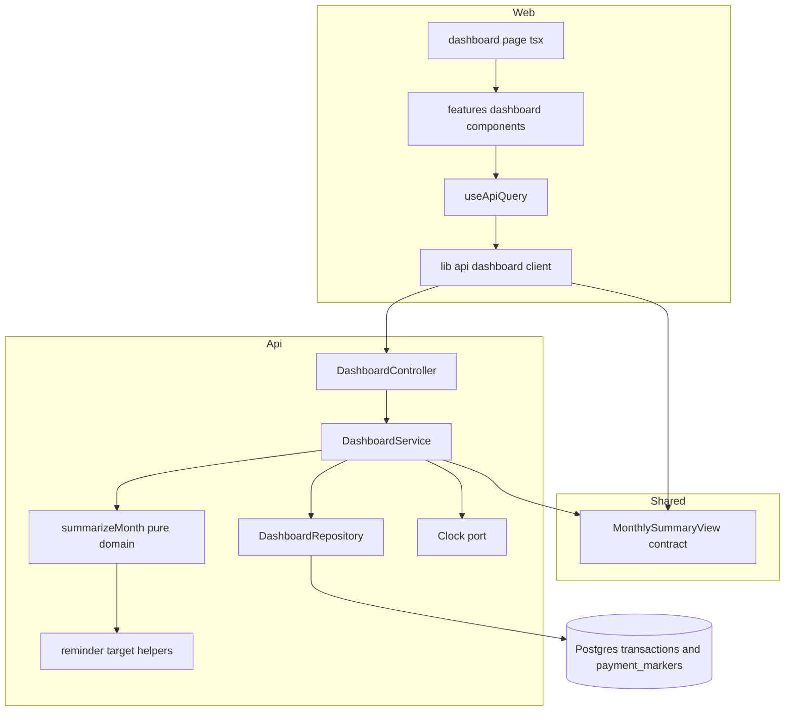
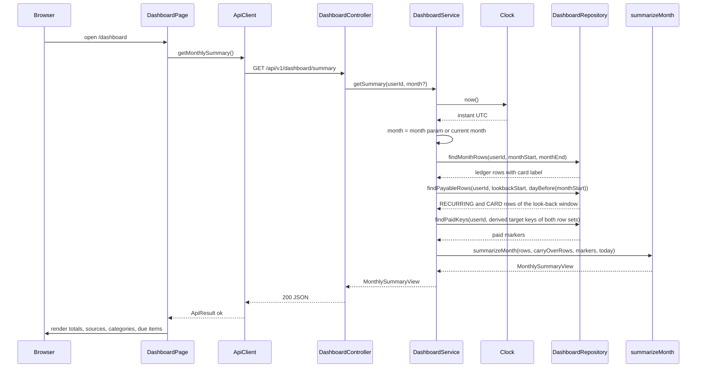
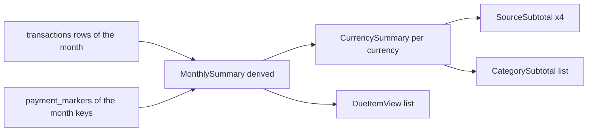

# Technical Design — monthly-dashboard

## Overview

**Purpose**: This feature delivers PayPilot's first financial overview: an
authenticated `/dashboard` page that answers, for the current month, *what
leaves my account*, *where it went*, and *what is still due* — aggregated across
all four ledger sources and computed entirely server-side.

**Users**: Every authenticated PayPilot user, as the landing page of the
authenticated shell.

**Impact**: Adds one read-only backend feature (`apps/api/src/dashboard/`) that
owns a cross-source monthly read model, one shared contract
(`packages/shared/src/api/dashboard.ts`) implemented by the API **and** consumed
by the web client, and replaces the placeholder dashboard page with a real
composition of existing UI primitives. **No schema change, no migration, no new
runtime dependency, no write path.**

The design turns on one rule, stated once here and enforced everywhere below:
**a ledger row belongs to the month of its `transactionDate`, for every
source** — and because a `CARD` row's `transactionDate` *is its invoice's due
date*, a card invoice is counted in the month it is **due**, not the month the
purchase was made. This makes the dashboard a **cash-out view** of the month, in
which the monthly total and the month's due items are two projections of one row
set and therefore cannot contradict each other (research.md, D1). Unpaid bills
of the three previous months are carried into the due list as `OVERDUE` without
touching the month's totals (research.md, D9 — revision of 2026-11-21).

### Goals

- One authenticated page showing the current month's total, per-source
  subtotals, category breakdown, and a due list in which every payable item
  carries a backend-computed status — `OVERDUE`, `DUE` or `PAID` — including
  unpaid items carried over from the overdue look-back window (D9).
- One backend capability (`GET /dashboard/summary`) that computes all of it,
  owner-scoped, from an injected clock, in integer minor units.
- Determinism: same rows + same injected `today` → same response, always.

### Non-Goals

- Forecasting, budgets, AI categorization, charts, export (explicit out-of-scope).
- Marking bills paid from the dashboard — the dashboard *reads* paid state; the
  mark/unmark UX belongs to `bill-payments`. The contract is shaped so that spec
  can add a toggle without changing it.
- A month switcher. The API accepts a `month` parameter (validated, cheap) but
  the MVP page always requests the current month.
- Any change to `apps/api`'s existing features. The dashboard reads their rows;
  it does not modify their code, their tables, or their behavior.

## Architecture

### Existing Architecture Analysis

The backend already owns every input this feature needs; nothing has to be
built, only read and combined:

| Existing asset | Location | Role here |
| -------------- | -------- | --------- |
| Unified `transactions` ledger with `source`, `amountMinor` (BIGINT), `currency`, `transactionDate` (DATE), `categoryLabel` | `prisma/schema.prisma` | The single input to the summary — all four sources are already in one table |
| `@@index([userId, transactionDate, id])` | same | Serves the owner-scoped month-range query without a new index |
| `payment_markers` + canonical identity helpers (`recurringTarget`, `cardInvoiceTarget`) | `reminders/domain/reminder-target.ts` | Paid status, read via the *same* keys the reminder pipeline writes |
| `RemindersRepository.findDueItems` | `reminders/reminders.repository.ts` | Precedent: the invoice-grouping and cross-feature ledger-read pattern this design mirrors |
| Injected `Clock` (`CLOCK` token, `FixedClock` test double) | `common/clock.ts` | Deterministic "today"/month boundaries (8.4, 10.1) |
| `toAmountNumber` / `toDateString` / `toDateOnly` | `common/ledger-money-date.ts` | The only sanctioned BigInt↔number and date-only conversions |
| Global `JwtAuthGuard`, `@CurrentUser`, `AllExceptionsFilter` + `ErrorCode` envelope | `auth/`, `common/` | Auth, isolation and error shape come for free |
| `useApiQuery` four-state hook, `<Loading/>`, `<EmptyState/>`, `<ErrorState/>`, `<Table/>`, `formatMoney`, `formatDate` | `apps/web/src/` | The page is a composition of these; only a month-label formatter is new |

**Constraint respected**: `RECURRING` occurrences are materialized by the daily
generation job. The dashboard reads the materialized ledger and never generates,
anticipates, or projects occurrences (research.md, D7).

### Architecture Pattern & Boundary Map

**Selected pattern**: a new **read-only feature module** (`dashboard`) following
the repo's transport → application → domain → data layering, with all financial
logic in a pure, framework-free domain function.



**Architecture Integration**

- **Domain/feature boundaries**: `dashboard` owns *no table*. It reads the
  ledger and the markers, exactly as `reminders` already does, and writes
  nothing. Ownership of `transactions` stays with the features that produce
  them; ownership of paid markers stays with `reminders`/`bill-payments`.
- **Existing patterns preserved**: owner-scoped repository (`userId` in every
  `where`), pure domain for anything financial, injected clock, canonical error
  envelope, thin `page.tsx` composing feature components.
- **New components rationale**: a cross-source summary spread across
  `expenses`/`cards`/`recurring-bills` would duplicate the month rule, the
  isolation rule and the currency rule three times over — and would force the
  *frontend* to merge financial data, which the steering forbids outright
  ([[tech]]: the backend owns financial truth). One read-only feature is the
  smaller boundary.
- **Steering compliance**: money stays `bigint` until a single guarded
  conversion at the response boundary; dates are date-only strings end to end;
  "today" is the UTC calendar date of the injected clock (the
  `RemindersScheduler` precedent).

### Technology Stack & Alignment

| Layer | Choice / Version | Role in Feature | Notes |
| ----- | ---------------- | --------------- | ----- |
| Frontend | Next.js 16 (App Router), React 19, TypeScript strict | `(app)/dashboard` route + `features/dashboard/` components | Existing; no new dependency |
| Shared contract | `@paypilot/shared` (workspace) | `MonthlySummaryView` — **implemented by the API, consumed by the web client** | `apps/api` already depends on this package (`createMoney`, `ErrorCode`) |
| Backend | NestJS 11, TypeScript strict | `DashboardModule` (controller + service + repository + pure domain) | New module registered in `AppModule` |
| Data | PostgreSQL + Prisma 7 | Two owner-scoped reads: month rows, paid markers | **No migration** — existing tables and indexes suffice |
| Testing | Jest (api), Vitest + Testing Library (web), Testcontainers (int) | Pure-domain unit tests, service tests with `FixedClock`, one integration spec, frontend view-state tests | Follows `test/*.int.spec.ts` precedent |

## System Flows



**Key decisions in this flow**

- The clock is read **once**, in the service, and the derived `today` /
  `monthStart` / `monthEnd` are passed down as plain strings. The domain function
  and the repository are clock-free, which is what makes them deterministic under
  test (10.1).
- The paid lookup happens **after** the rows are known: the target keys are
  derived from the month's payable rows **and** the look-back window's payable
  rows, so the marker query is bounded by what can actually be on screen.
- The look-back window is `OVERDUE_LOOKBACK_MONTHS = 3` whole calendar months
  before `monthStart` (`lookbackStart = monthRange(month − 3).start`). It is a
  backend constant, not a request parameter (D9).
- An `UNAUTHORIZED` response never reaches the page: the API client clears the
  session and `AuthProvider` redirects (`web-mvp-shell` navigation ownership —
  no router calls in `lib/api`). This satisfies 1.3 with existing code.

## Requirements Traceability

| Requirement | Summary | Components | Interfaces | Flows |
| ----------- | ------- | ---------- | ---------- | ----- |
| 1.1, 1.2, 1.3 | Authenticated route, redirect on no/expired session | `(app)/dashboard/page.tsx`, existing `(app)` layout + `AuthProvider` | — | Sequence (auth handled before render) |
| 1.4 | Month label from injected today | `DashboardService`, `MonthHeader`, `formatMonth` | `MonthlySummaryView.month` | Sequence |
| 1.5 | Thin page | `(app)/dashboard/page.tsx` → `DashboardPage` | — | — |
| 2.1, 2.2 | Monthly total, rendered not computed | `summarizeMonth`, `TotalsPanel` | `CurrencySummary.totalMinor` | Sequence |
| 2.3 | Never sum across currencies | `summarizeMonth` | `MonthlySummaryView.currencies[]` | — |
| 2.4 | Zero total on an empty month | `summarizeMonth` | zeroed `BRL` `CurrencySummary` | — |
| 3.1, 3.2 | All four sources, each amount counted once | `DashboardRepository.findMonthRows`, `summarizeMonth` | `SourceSubtotal` | Sequence |
| 3.3 | Absent source shows as zero | `summarizeMonth` | `bySource` always length 4 | — |
| 3.4 | Per-source subtotal | `TotalsPanel` | `CurrencySummary.bySource` | — |
| 4.1 | Month items + carried-over unpaid items | `DashboardRepository.findMonthRows` / `findPayableRows`, `summarizeMonth` | `MonthlySummaryView.dueItems` | Sequence |
| 4.2, 4.8 | Backend status shown as a text badge | `summarizeMonth`, `DueItemsList` | `DueItemView.status` | — |
| 4.3 | Ordered OVERDUE → DUE → PAID, then due date | `summarizeMonth` | `dueItems` order | — |
| 4.4 | Overdue / due counts and amounts | `summarizeMonth`, `DueSummaryPanel` | `MonthlySummaryView.dueTotals` | — |
| 4.5 | Carried-over items flagged, excluded from totals | `summarizeMonth`, `DueItemsList` | `DueItemView.carriedOver` | — |
| 4.6 | Date-only rendering | `DueItemsList`, `formatDate` | `DueItemView.dueDate` | — |
| 4.7 | Empty due list is first-class | `DueItemsList` | — | — |
| 5.1, 5.2 | Paid status shown and visually distinguished | `DashboardRepository.findPaidKeys`, `summarizeMonth`, `DueItemsList` | `DueItemView.status`, `paidAt` | Sequence |
| 5.3 | Graceful when unavailable | `DueItemsList` | `status` is always present (available from day one) | — |
| 5.4 | Never infer paid client-side | `DueItemsList` | — | — |
| 6.1, 6.2, 6.3 | Category breakdown, `null` → one bucket, desc by amount | `summarizeMonth`, `CategoryBreakdown` | `CategorySubtotal` | — |
| 6.4 | No taxonomy, labels as stored | `summarizeMonth` | `CategorySubtotal.label: string \| null` | — |
| 7.1, 7.2, 7.3 | Loading / error / empty states | `DashboardPage` + shared UI primitives | `useApiQuery` `QueryState` | — |
| 7.4 | Shared formatters, no float math | `formatMoney`, `formatDate`, `formatMonth` | — | — |
| 7.5 | Semantic HTML, keyboard reachable | all `features/dashboard/` components | — | — |
| 8.1, 8.2 | One capability, all four sources | `DashboardController`, `DashboardService` | `GET /dashboard/summary` | Sequence |
| 8.3 | Integer minor units only | `summarizeMonth`, `toAmountNumber` | all `*Minor: number` | — |
| 8.4 | Injected clock, explicit timezone | `DashboardService` + `CLOCK` | `today`, `monthStart`, `monthEnd` | Sequence |
| 8.5 | Owner-scoped | `DashboardRepository` | — | — |
| 8.6 | Read-only | `DashboardRepository` (no write methods) | — | — |
| 8.7 | Shared contract, no duplicated shape | `packages/shared/src/api/dashboard.ts` | imported by **both** sides | — |
| 8.8 | Status computed server-side | `summarizeMonth` (`dueStatus`) | `DueItemView.status` | — |
| 9.1, 9.2 | Paid read via existing marker semantics, no mutation | `DashboardRepository.findPaidKeys` + `reminder-target` helpers | `DueItemView.targetType`, `targetKey` | Sequence |
| 9.3 | Forward-compatible with `bill-payments` | contract carries the same identity `PUT /reminders/paid` accepts | — | — |
| 10.1, 10.2, 10.3 | Determinism, isolation, minor-unit tests | test suites (see Testing Strategy) | — | — |
| 10.4 | Frontend state/format/redirect tests | `dashboard-page.test.tsx` | — | — |
| 10.5 | No secrets, no new public config | — | — | — |

## Components and Interfaces

| Component | Domain/Layer | Intent | Req Coverage | Key Dependencies | Contracts |
| --------- | ------------ | ------ | ------------ | ---------------- | --------- |
| `DashboardController` | API / transport | Expose `GET /dashboard/summary` | 8.1, 8.5 | `DashboardService` (P0) | API |
| `DashboardService` | API / application | Resolve month from injected clock, orchestrate reads, return the shared view | 1.4, 8.1–8.6 | `CLOCK` (P0), `DashboardRepository` (P0), `summarizeMonth` (P0) | Service |
| `summarizeMonth` | API / domain (pure) | All grouping, summing, invoice grouping, paid joining, sorting | 2.x, 3.x, 4.x, 5.x, 6.x, 8.3 | `reminder-target` helpers (P0), `toAmountNumber` (P1) | Service |
| `monthRange` / `monthOf` | API / domain (pure) | `YYYY-MM` ↔ month boundaries, UTC, short-month safe | 8.4 | — | Service |
| `DashboardRepository` | API / data | Two owner-scoped reads; no write methods exist | 8.5, 8.6, 9.2 | `PrismaService` (P0) | Service |
| `MonthlySummaryQueryDto` | API / transport | Validate optional `month=YYYY-MM` | 8.1 | class-validator (P1) | API |
| `dashboard.ts` (shared) | Shared contract | The one definition of the response shape | 8.7 | — | State |
| `getMonthlySummary` | Web / lib | Typed client call | 8.7 | `request` (P0) | Service |
| `DashboardPage` | Web / feature | Compose the four view states | 1.5, 7.1–7.3 | `useApiQuery` (P0) | — |
| `MonthHeader` | Web / feature | Human-readable month label | 1.4 | `formatMonth` (P0) | — |
| `TotalsPanel` | Web / feature | Total + per-source subtotals, per currency | 2.1, 2.3, 3.3, 3.4 | `formatMoney` (P0) | — |
| `CategoryBreakdown` | Web / feature | Category table | 6.1–6.3 | `formatMoney` (P0) | — |
| `DueSummaryPanel` | Web / feature | "Overdue" and "Still to pay" counts + amounts, per currency | 4.4 | `formatMoney` (P0) | — |
| `DueItemsList` | Web / feature | Due items with status badge and "earlier month" marker; own empty sub-state | 4.1–4.8, 5.1–5.4 | `formatMoney`, `formatDate` (P0) | — |
| `formatMonth` | Web / lib | `"2026-07"` → `"July 2026"`, no `Date`, no locale data | 1.4, 7.4 | — | Service |

Detailed blocks below cover only the components that introduce a new boundary.
The web feature components are presentational compositions of existing
primitives and are fully specified by the summary row plus the contract they
render.

### API / Domain

#### summarizeMonth (pure)

| Field | Detail |
| ----- | ------ |
| Intent | Turn the month's ledger rows + paid markers into the response view — the only place financial aggregation happens |
| Requirements | 2.1, 2.3, 2.4, 3.1, 3.2, 3.3, 3.4, 4.1–4.5, 5.1, 5.2, 6.1, 6.2, 6.3, 6.4, 8.3, 8.8 |

**Responsibilities & Constraints**

- Partition rows by `currency` first, so no aggregate can span currencies *by
  construction* (2.3). Within a currency: total, the four source subtotals
  (always all four, zero when absent — 3.3), and the category breakdown
  (`categoryLabel`, `null` collapsing into exactly one bucket — 6.2, sorted by
  amount descending, ties broken by label ascending for stable output — 6.3).
- Derive payable items (D2 in research.md) from **both** row sets with the same
  rule: `RECURRING` rows are one item each; `CARD` rows are grouped by
  `(creditCardId, invoiceCycle, currency)` into one item per invoice whose
  amount is the sum of its rows and whose `dueDate` is the shared
  `transactionDate`; `MANUAL` and `IMPORTED` rows never produce payable items.
- Attach paid state from the marker set keyed by `targetKey` and compute the
  status with one pure rule (8.8, D9):
  `status = marker ? "PAID" : dueDate < today ? "OVERDUE" : "DUE"`.
- Build the due list (4.1, D9): **every** payable item of the month (any due
  date, any status — paid items stay listed, flagged, 5.2, unlike the reminders
  selection), plus the carry-over payable items whose status is `OVERDUE`
  (carry-over `PAID` items are dropped; a carry-over item can never be `DUE`
  because its due date precedes `monthStart <= today`). Carry-over items get
  `carriedOver: true`.
- Order (4.3): status rank `OVERDUE` → `DUE` → `PAID`, then `dueDate`
  ascending, then `targetKey` ascending (determinism).
- `dueTotals` (4.4): per currency, the count and `bigint` sum of `OVERDUE` items
  and of `DUE` items across the whole due list (carry-over included).
- **Carry-over rows feed only the due list.** They never touch `currencies`
  (totals, `bySource`, `byCategory`) or `hasActivity` (4.5) — the month's
  totals remain a function of the month's rows alone.
- **Money never leaves `bigint` inside this function.** Accumulators are
  `bigint`; the single conversion to `number` happens through `toAmountNumber`
  when building the view (8.3, 10.3). No `+` on `number` amounts anywhere.
- Framework-free and clock-free: `today` and `monthEnd` arrive as `YYYY-MM-DD`
  strings. The function is a pure map from inputs to output.

**Dependencies**

- Outbound: `recurringTarget` / `cardInvoiceTarget` from
  `reminders/domain/reminder-target.ts` — canonical paid identity (P0).
  Deliberate cross-feature import of a pure module: re-deriving the key strings
  here would let them drift from the `payment_markers` unique index.
- Outbound: `toAmountNumber` from `common/ledger-money-date.ts` — guarded
  BigInt→number conversion (P1).

**Contracts**: Service ✅

##### Service Interface

```typescript
/** A ledger row as read for the summary — money stays bigint. */
export interface LedgerRow {
  id: string;
  source: "MANUAL" | "RECURRING" | "CARD" | "IMPORTED";
  amountMinor: bigint;
  currency: string;
  transactionDate: string; // YYYY-MM-DD
  description: string;
  categoryLabel: string | null;
  creditCardId: string | null;
  creditCardLabel: string | null;
  invoiceCycle: string | null; // YYYY-MM
}

/** A paid marker, reduced to what the summary needs. */
export interface PaidMarker {
  targetKey: string;
  paidAt: string; // ISO instant
}

export function summarizeMonth(input: {
  month: string; // YYYY-MM
  monthStart: string; // YYYY-MM-DD
  monthEnd: string; // YYYY-MM-DD
  today: string; // YYYY-MM-DD (UTC calendar date of the injected clock)
  rows: readonly LedgerRow[];
  /** RECURRING/CARD rows of the look-back window (before monthStart). */
  carryOverRows: readonly LedgerRow[];
  markers: readonly PaidMarker[];
}): MonthlySummaryView;

/** The single status rule (8.8). */
export function dueStatus(dueDate: string, today: string, paid: boolean): DueStatus;
```

- **Preconditions**: every `rows` entry's `transactionDate` lies within
  `[monthStart, monthEnd]`; every `carryOverRows` entry is `RECURRING` or
  `CARD` with `transactionDate < monthStart` (both guaranteed by the
  repository's `where`); `CARD` rows carry `creditCardId` and `invoiceCycle`
  (schema CHECK constraint).
- **Postconditions**: `currencies` is non-empty (a zeroed `BRL` block when there
  are no rows — 2.4); `hasActivity === (rows.length > 0)`; every carry-over due
  item has `status === "OVERDUE"` and `carriedOver === true`; every
  `status === "DUE"` item has `dueDate >= today`; every `status === "OVERDUE"`
  item has `dueDate < today`; the sum of `bySource` amounts equals `totalMinor`
  within each currency block; `carryOverRows` change nothing in `currencies`.
- **Invariants**: no arithmetic across currencies; each row contributes to
  exactly one source subtotal and exactly one category bucket (3.2); output is a
  deterministic function of the inputs.

#### monthRange / monthOf (pure)

| Field | Detail |
| ----- | ------ |
| Intent | The only place month boundaries are computed |
| Requirements | 8.4 |

```typescript
/** UTC calendar month of an instant: "2026-07". */
export function monthOf(now: Date): string;

/** Inclusive date-only boundaries of a "YYYY-MM" month (UTC, short-month safe). */
export function monthRange(month: string): { start: string; end: string };
```

- Rejects a malformed `month` with an `Error` (the DTO validates first; this is
  the domain's own guard).
- **Implementation Notes** — Risks: February and 31-day months are the classic
  break; `end` is derived from the month's real length, never from "day 30/31".

### API / Application & Transport

#### DashboardService

| Field | Detail |
| ----- | ------ |
| Intent | Resolve the month, fetch, delegate to the pure domain, return the shared contract type |
| Requirements | 1.4, 8.1, 8.2, 8.4, 8.5, 8.6, 8.7 |

**Responsibilities & Constraints**

- Reads `CLOCK` **once** per request: `today = toDateString(clock.now())` (UTC
  calendar date — the `RemindersScheduler` precedent), `month = query.month ??
  monthOf(clock.now())`.
- Never mutates anything. The repository exposes no write method, so read-only
  (8.6) is a structural property, not a discipline.
- Its declared return type **is** `MonthlySummaryView` from `@paypilot/shared`
  (8.7) — a field renamed on either side breaks `type-check` on the other.

##### Service Interface

```typescript
interface DashboardService {
  getSummary(userId: string, month?: string): Promise<MonthlySummaryView>;
}
```

#### DashboardController

**Contracts**: API ✅

| Method | Endpoint | Request | Response | Errors |
| ------ | -------- | ------- | -------- | ------ |
| GET | `/api/v1/dashboard/summary` | `MonthlySummaryQueryDto` (`month?: "YYYY-MM"`) | `MonthlySummaryView` | `VALIDATION_ERROR` (malformed `month`), `UNAUTHORIZED`, `TOO_MANY_REQUESTS`, `INTERNAL_ERROR` |

- `@Controller("dashboard")`, `@CurrentUser()` for the user id, protected by the
  global `JwtAuthGuard` — no per-route auth wiring (8.5).
- `month` is validated by a `@Matches(/^\d{4}-(0[1-9]|1[0-2])$/)` rule; an
  invalid value is a 400 `VALIDATION_ERROR` from the existing filter, never a
  silent fallback to the current month.
- **No 404 exists on this endpoint**: a month with no data is a valid, zeroed
  summary (2.4), not a missing resource.

#### DashboardRepository

| Field | Detail |
| ----- | ------ |
| Intent | Owner-scoped, read-only Prisma access for the summary |
| Requirements | 8.5, 8.6, 9.2 |

**Responsibilities & Constraints**

- `findMonthRows(userId, start, end)` — one `transaction.findMany` with
  `where: { userId, transactionDate: { gte, lte } }`, selecting the fields of
  `LedgerRow` plus `creditCard: { select: { label: true } }`. Served by
  `@@index([userId, transactionDate, id])`; no new index.
- `findPayableRows(userId, start, end)` — one `transaction.findMany` with
  `where: { userId, source: { in: ["RECURRING", "CARD"] }, transactionDate:
  { gte, lte } }` for the look-back window (`end` = the day before
  `monthStart`), same `select` as `findMonthRows`. Served by the same index.
- `findPaidKeys(userId, keys)` — one `paymentMarker.findMany` restricted to
  `{ userId, targetKey: { in: keys } }`, returning `targetKey` + `paidAt`. Empty
  `keys` short-circuits to `[]` without a query.
- `userId` is in **every** `where` clause (8.5, 10.2). The class defines no
  create/update/delete method at all (8.6, 9.2).

### Web

#### DashboardPage and feature components

- `app/(app)/dashboard/page.tsx` stays a two-line composition (1.5); the current
  placeholder shortcut list is removed — navigation is owned by the `(app)`
  layout (`web-mvp-shell`).
- `DashboardPage` calls `useApiQuery(() => getMonthlySummary(), [])` with
  `isEmpty: (data) => !data.hasActivity` and renders exactly one of: `<Loading/>`
  (7.1), `<ErrorState/>` with generic message + `requestId` + retry (7.2),
  `<EmptyState/>` with guidance and a primary action linking to `/expenses`
  (7.3), or the loaded composition: `<MonthHeader/>`, one `<TotalsPanel/>` per
  currency block, `<DueSummaryPanel/>`, `<CategoryBreakdown/>`, `<DueItemsList/>`.
- `<TotalsPanel/>` renders the total, the four source subtotals, and — because
  D1 is a genuine user-facing surprise — a short plain-language note that card
  invoices count in the month they are **due**.
- `<DueSummaryPanel/>` renders, per currency, "Overdue: N · R$ x" and "Still to
  pay: N · R$ y" straight from `dueTotals` (4.4) — no client-side counting.
- `<DueItemsList/>` renders a semantic `<Table/>` (7.5) of `dueItems` in the
  order received, each with a **text** status badge — "Overdue", "Due", "Paid"
  — that is never colour-only (4.8, 5.2, 7.5), and an "earlier month" marker
  on `carriedOver` items (4.5). It has its own empty sub-state when the list is
  empty but the month has activity (4.7).
- The page may render the due list even when `hasActivity` is false if
  `dueItems` is non-empty (carried-over overdue bills in an otherwise empty
  month): the empty state then sits next to the list instead of replacing it.
- Every amount goes through `formatMoney(amountMinor, "BRL")`, every date
  through `formatDate`, the month label through the new `formatMonth` — no
  `Date` construction, no float math (7.4).

## Data Models

### Domain Model

**No persistence change.** The dashboard introduces one derived, in-memory
aggregate — the *monthly summary* — assembled from two existing tables:



**Business rules & invariants**

1. **Month membership** — a row belongs to `month` iff
   `monthStart <= transactionDate <= monthEnd` (UTC, inclusive), for every
   source. `CARD` rows carry the invoice's **due date**, so an invoice counts in
   the month it is due (D1).
2. **Single attribution** — each row contributes to exactly one currency block,
   one source subtotal and one category bucket (3.2). No row is read twice.
3. **Payable items** — only `RECURRING` rows and `CARD` invoices are payable.
   `MANUAL`/`IMPORTED` are already-incurred spend and never appear as due items.
3a. **Due status** — `PAID` if a marker exists; otherwise `OVERDUE` when
   `dueDate < today`, else `DUE`. Computed once, server-side (8.8).
3b. **Carry-over** — unpaid payable items of the 3 calendar months before the
   month are listed as `OVERDUE` with `carriedOver: true`; they never count in
   the month's totals (4.5).
4. **Invoice identity** — a card invoice is `(creditCardId, invoiceCycle)`; its
   paid marker is invoice-level. The grouping key additionally carries
   `currency` to keep rule 5 unbreakable.
5. **No cross-currency arithmetic** — ever (2.3).

### Data Contracts & Integration

`packages/shared/src/api/dashboard.ts` — the single definition, implemented by
`DashboardService` and consumed by `getMonthlySummary` (8.7):

```typescript
export type SummarySource = "MANUAL" | "RECURRING" | "CARD" | "IMPORTED";
export type DueTargetType = "RECURRING_TRANSACTION" | "CARD_INVOICE";

export interface SourceSubtotal {
  source: SummarySource;
  amountMinor: number; // 0 when the source has no rows this month (3.3)
}

export interface CategorySubtotal {
  /** Exactly as stored; `null` is the single "uncategorized" bucket (6.2, 6.4). */
  label: string | null;
  amountMinor: number;
}

/** All aggregates live inside a currency block — nothing sums across them (2.3). */
export interface CurrencySummary {
  currency: string; // ISO-4217, e.g. "BRL"
  totalMinor: number;
  bySource: SourceSubtotal[]; // always the four sources, in a stable order
  byCategory: CategorySubtotal[]; // amount descending
}

export type DueStatus = "OVERDUE" | "DUE" | "PAID";

export interface DueItemView {
  /** Canonical paid identity — the same one `PUT /reminders/paid` accepts (9.1). */
  targetType: DueTargetType;
  targetKey: string; // txn:<id> | card:<cardId>:<cycle>
  source: "RECURRING" | "CARD";
  description: string; // bill description | card label
  dueDate: string; // YYYY-MM-DD
  amountMinor: number; // a card invoice is the SUM of its rows
  currency: string;
  /** Computed server-side from the injected today + markers (4.2, 8.8). */
  status: DueStatus;
  paidAt: string | null; // ISO instant (marker semantics), null unless PAID
  /** True when the item belongs to an earlier month of the look-back window (4.5). */
  carriedOver: boolean;
}

/** Per-currency "how much is late / still to pay" (4.4). */
export interface DueTotals {
  currency: string;
  overdueCount: number;
  overdueMinor: number;
  dueCount: number;
  dueMinor: number;
}

export interface MonthlySummaryView {
  month: string; // YYYY-MM
  monthStart: string; // YYYY-MM-DD
  monthEnd: string; // YYYY-MM-DD
  today: string; // YYYY-MM-DD — the browser never reads a clock (8.4)
  /** False when the month has no rows in any source → the page's empty state (7.3). */
  hasActivity: boolean;
  /** Never empty: a month with no rows yields one zeroed BRL block (2.4). */
  currencies: CurrencySummary[];
  /** Month payable items + carried-over OVERDUE items; OVERDUE → DUE → PAID, then dueDate (4.1, 4.3). */
  dueItems: DueItemView[];
  /** One entry per currency present in dueItems; empty when dueItems is empty (4.4). */
  dueTotals: DueTotals[];
  /** First month of the overdue look-back window, YYYY-MM (D9). */
  overdueLookbackFrom: string;
}
```

The `hasActivity` flag is what lets 2.4 (show a zero total) and 7.3 (show a
first-class empty state) coexist without the frontend inferring emptiness from
"all totals are zero" — a month can legitimately net to zero.

## Error Handling

### Error Strategy

The feature adds **no new error code**. It rides the canonical envelope
(`AllExceptionsFilter` + `ErrorCode`) and the client's existing mapping.

### Error Categories and Responses

- **`VALIDATION_ERROR` (400)** — malformed `month`. Cannot occur from the MVP UI
  (which sends none), but the endpoint validates rather than guessing.
- **`UNAUTHORIZED` (401)** — handled entirely by existing code: the API client
  clears the session, `AuthProvider` redirects to `/login` (1.3). The dashboard
  components never see this state.
- **`TOO_MANY_REQUESTS` / `INTERNAL_ERROR`** — `<ErrorState/>` with a generic
  message, the `requestId`, and a retry action (7.2). Backend messages are never
  rendered as primary UX.
- **Data-shaped edge cases that are *not* errors**: an empty month (→ zeroed
  summary + `hasActivity: false`), a month whose due items are all paid (→ list
  renders, all flagged paid), a month before the user's first transaction (→
  same as empty), an empty month with carried-over overdue bills (→
  `hasActivity: false` **and** a non-empty `dueItems`).

### Monitoring

Nothing bespoke: the existing request-id logging and exception filter cover it.
A `BigInt` overflow in `toAmountNumber` throws → `INTERNAL_ERROR` with a
`requestId`, which is the correct outcome for a corrupt ledger.

## Testing Strategy

### Unit Tests (pure domain — the bulk of the value)

- `summarizeMonth`: per-source subtotals with all four sources present, and with
  a source absent (asserting a **zero** entry, not a missing one — 3.3).
- `summarizeMonth`: multi-currency month produces two blocks and **never** a
  cross-currency sum (2.3, 10.3); amounts are exact minor units, no float drift.
- `summarizeMonth`: category grouping with `null` labels collapsing into exactly
  one bucket, ordered by amount descending (6.2, 6.3).
- `summarizeMonth`: card rows of one `(card, cycle)` collapse into **one** due
  item whose amount is the row sum (D2); `MANUAL`/`IMPORTED` rows produce **no**
  due items; a due item with a marker is `PAID` and still listed (5.2).
- `dueStatus`: `dueDate === today` unpaid → `DUE`; `dueDate === today − 1`
  unpaid → `OVERDUE`; any date with a marker → `PAID` (8.8 boundary).
- `summarizeMonth`: an unpaid month item due before today is listed as
  `OVERDUE` (the 4.1 regression this revision fixes).
- `summarizeMonth`: carry-over — an unpaid look-back item is listed as
  `OVERDUE` + `carriedOver`; a paid look-back item is dropped; carry-over rows
  change **nothing** in `currencies` or `hasActivity` (4.5).
- `summarizeMonth`: ordering `OVERDUE` → `DUE` → `PAID`, then due date, then
  `targetKey`; `dueTotals` counts and sums per currency, never across
  currencies (4.3, 4.4).
- `monthRange`: February, a 31-day month, and a December→January boundary
  (10.1); `monthOf` on a UTC instant.

### Integration Tests (`apps/api/test/monthly-dashboard.int.spec.ts`, Testcontainers)

- **Per-user isolation**: two users with rows in the same month — each summary
  contains only its owner's amounts (8.5, 10.2).
- **All four sources end-to-end** with a `FixedClock`: seeded `MANUAL`,
  `RECURRING`, `CARD` (two installments of one invoice) and `IMPORTED` rows
  produce the expected total, subtotals, and a single grouped invoice due item.
- **Read-only**: row and marker counts are unchanged after the request (8.6, 9.2).
- **Paid marker** written via the existing `PUT /reminders/paid` path surfaces as
  `status: "PAID"` on the dashboard's matching due item (9.1).
- **Carry-over end-to-end**: an unpaid `RECURRING` row two months back appears
  as `OVERDUE` + `carriedOver`; a row four months back (outside the window)
  does not; neither changes the month's `totalMinor`.

### Frontend Tests (`dashboard-page.test.tsx`, Vitest + Testing Library)

- The four view states, with the API client module mocked (10.4).
- Error state renders the generic message **and** the `requestId`, and the retry
  action refetches (7.2).
- Each status is announced by text — "Overdue", "Due", "Paid" — not colour
  alone, and carried-over items show the "earlier month" marker (4.5, 4.8, 5.2,
  7.5).
- `DueSummaryPanel` renders the backend counts/amounts verbatim (4.4).
- Money and dates render through the shared formatters (`R$ 1.234,56`,
  `2026-07-15`); `formatMonth("2026-07") === "July 2026"` (7.4).

### Determinism guard

Every backend test injects a `FixedClock`; no test may call `new Date()` for
"today". This is the mechanism behind 10.1 and it is non-negotiable
([[testing]]).

## Security Considerations

- **Isolation is the whole threat model here**: this endpoint reads across every
  ledger source at once, so a missing `userId` in a `where` clause would leak
  another user's entire financial month. Both repository methods carry `userId`,
  and the integration suite asserts it with two seeded users (8.5, 10.2).
- No new public configuration and no secrets (10.5); the endpoint adds no new
  auth surface (global `JwtAuthGuard`).
- The response contains no PII beyond the user's own financial data — no phone
  numbers, no marker internals other than the target key the client already
  needs to act on the item later.

## Performance & Scalability

- Two indexed range queries per request over `@@index([userId, transactionDate,
  id])` (the month, and the 3-month look-back restricted to payable sources)
  plus one keyed marker query. For a personal-finance user a month is tens
  to low hundreds of rows; in-memory aggregation is the cheaper and far more
  testable option (research.md, D6).
- If a month ever grows past a few thousand rows, the aggregation moves into SQL
  **without any contract change** — `summarizeMonth`'s signature is the seam.
