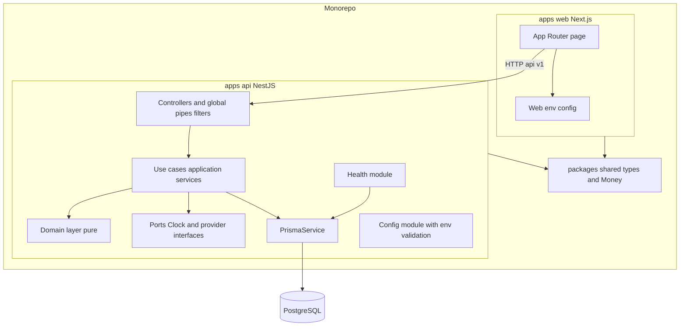
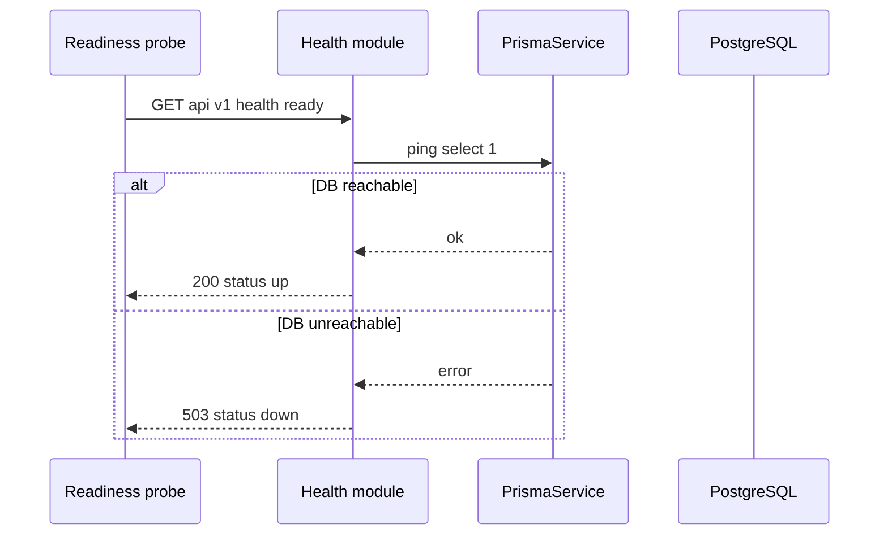

# Technical Design: Platform Foundation

## Overview

**Purpose**: This feature delivers the technical foundation of PayPilot — a pnpm/Turborepo monorepo containing a NestJS backend and a Next.js frontend, backed by PostgreSQL via Prisma, runnable locally through Docker Compose. It establishes the global backend infrastructure (validation, canonical errors, versioned routing, health checks, validated configuration) and the conventions (money, time, testing seams) that every later feature spec builds on.

**Users**: PayPilot developers will use this foundation to add feature modules (`auth-jwt`, `manual-expenses`, `recurring-bills`, etc.) without re-deciding structure, tooling, or cross-cutting concerns.

**Impact**: Creates the initial system from an empty repository. No business behavior is introduced.

### Goals

- A monorepo where one command installs everything and one command each runs lint/format/test across all workspaces.
- A bootable NestJS API with global validation, a canonical error envelope, a versioned route prefix, and liveness/readiness health checks.
- A bootable Next.js app that reads its API base URL from validated configuration.
- PostgreSQL + Prisma wired through an injectable `PrismaService`, with migration-driven schema.
- A testing harness supporting unit tests, real-PostgreSQL integration tests, an injectable clock, and substitutable provider ports.
- Documented money and time conventions, and fail-fast environment validation with no committed secrets.

### Non-Goals

- **No business features or domain logic**: no auth/JWT, no notification/WhatsApp provider implementation, no recurring bills, transactions/expenses, credit cards/invoices, dashboard, reminders, or CSV import.
- **No background-jobs infrastructure**: no Redis/BullMQ/cron; Docker Compose provisions PostgreSQL only. Deferred to `due-date-reminders`.
- **No CI/CD pipeline files**: the foundation MUST NOT create any pipeline definition — no GitHub Actions, GitLab CI, Vercel CI, or equivalent. It only provides **CI-ready scripts** (see below) that a future CI/CD spec can reuse. Production deployment is also out of scope.
- **No E2E test framework**: end-to-end tests are out of scope for the foundation (web gets a minimal smoke/unit test only — see Testing Strategy).
- **No business database tables**: only the conventions and the migration mechanism are established.
- **No automated dependency-update tooling**: do not introduce Renovate, Dependabot, or similar in the foundation implementation unless explicitly requested. The foundation defines the dependency security **policy and scripts** only — see Dependency and Supply Chain Security.

## Architecture

### Architecture Pattern & Boundary Map

Selected pattern: **layered feature-modules with ports for side-effects** (a pragmatic subset of hexagonal). It matches steering `structure.md`: transport → application → domain → data, with the domain layer free of framework imports and side-effecting concerns (clock, external providers, persistence) injected through ports. See `research.md` for the evaluated alternatives.



**Architecture Integration**:

- **Selected pattern**: Layered feature-modules; domain is pure and depends on nothing framework-specific.
- **Domain/feature boundaries**: Each future capability is one NestJS module under `apps/api/src/<feature>/`; the foundation ships only cross-cutting modules (`config`, `health`, `common`, `prisma`, `ports`).
- **New components rationale**: `PrismaService` (managed DB lifecycle + readiness), global validation pipe + exception filter (R2), config module (R6), health module (R7), `Clock` port (R8), shared `Money` value object (R4).
- **Steering compliance**: Backend owns financial truth; providers behind ports ([[integrations]]); money/time conventions per [[financial-rules]]; secrets via env per [[security]].

### Technology Stack

| Layer                    | Choice / Version                                                                                                  | Role in Feature                                          | Notes                                                          |
| ------------------------ | ----------------------------------------------------------------------------------------------------------------- | -------------------------------------------------------- | -------------------------------------------------------------- |
| Frontend                 | Next.js 16.2.x (App Router, React 19.2)                                                                           | Web app skeleton, env-driven API base URL                | Turbopack default; requires Node 20.9+ (satisfied by 24 LTS)   |
| Backend / Services       | NestJS 11.1.x                                                                                                     | API server, DI, global pipes/filters, modules            | Node 24 LTS, TypeScript 5.x strict                             |
| Data / Storage           | PostgreSQL 16 + Prisma 7.6.x                                                                                      | Schema, migrations, type-safe access via `PrismaService` | Pin version; new client generator (see research.md)            |
| Messaging / Events       | —                                                                                                                 | Not provisioned                                          | Deferred to `due-date-reminders`                               |
| Infrastructure / Runtime | Docker Compose, pnpm workspaces, Turborepo, Node 24 LTS                                                           | Local Postgres, single-command install + task running    | Testcontainers for integration tests (requires Docker)         |
| Quality                  | ESLint (flat config) + Prettier; Jest + Testcontainers (api/shared); Vitest + React Testing Library + jsdom (web) | Lint/format/test across workspaces                       | Shared root config; `turbo run test` aggregates all workspaces |

> Extended rationale and version-compatibility notes live in `research.md`.

### Runtime & Engines

- **Node.js 24 LTS** is the project runtime baseline. Rationale:
  - Node 24 is the latest **LTS** line; Node 26 is **Current** and is deliberately **not** used as the default runtime until it becomes LTS and ecosystem compatibility is validated.
  - Next.js 16 requires Node 20.9+, so Node 24 is compatible; NestJS 11 requires Node v20+ and recommends the latest LTS.
  - A single Node version covers the whole monorepo.
- The root `package.json` MUST pin the engine range:
  ```json
  { "engines": { "node": ">=24 <25" } }
  ```
- A repo-root **`.nvmrc`** MUST contain:
  ```
  24
  ```
- Docker images that run app code MUST use the **`node:24-bookworm-slim`** base image.
- The README **Prerequisites** section MUST state Node 24 LTS (e.g. via `nvm use`), pnpm, and Docker (Docker is required to run integration tests — see Testing Strategy).

## System Flows

The only non-trivial flow is **readiness**, which couples health to the database (R7.2/R7.3):



Liveness returns `200` whenever the process is running and performs no dependency checks.

## Requirements Traceability

| Requirement | Summary                                                | Components                                                                       | Interfaces                                                                     | Flows              |
| ----------- | ------------------------------------------------------ | -------------------------------------------------------------------------------- | ------------------------------------------------------------------------------ | ------------------ |
| 1.1–1.5     | Monorepo, shared types, single install, strict TS      | Workspace config, `packages/shared`                                              | pnpm workspaces, Turborepo, tsconfig base                                      | —                  |
| 2.1–2.2     | API boots, feature-module structure                    | `AppModule`, bootstrap                                                           | NestJS module pattern                                                          | —                  |
| 2.3–2.4     | Global validation, 4xx on invalid                      | `ValidationPipe` (global), `AllExceptionsFilter`                                 | DTO validation                                                                 | —                  |
| 2.5–2.6     | 5xx safe errors, canonical error shape                 | `AllExceptionsFilter`, `ErrorResponse`                                           | `ErrorResponse` contract                                                       | —                  |
| 2.7         | Route prefix + versioning                              | bootstrap (`setGlobalPrefix` + URI versioning)                                   | `/api/v1` convention                                                           | —                  |
| 3.1–3.3     | Web boots, env API URL, no authoritative finance       | `apps/web`, `webEnv`, web smoke test                                             | Web config schema, Vitest+RTL+jsdom                                            | —                  |
| 4.1–4.3     | Postgres via Prisma, migrations                        | `PrismaService`, Prisma schema                                                   | `PrismaService` lifecycle                                                      | —                  |
| 4.4–4.6     | Money/time conventions documented                      | `Money` (shared), conventions doc                                                | `Money` value object                                                           | —                  |
| 5.1–5.4     | Docker Compose Postgres only, no creds                 | `docker-compose.yml`                                                             | env wiring                                                                     | —                  |
| 6.1–6.5     | Env loaded + validated, fail-fast, example, no secrets | `ConfigModule`, `envSchema`, `.env.example`                                      | `AppConfig` typed config                                                       | startup validation |
| 7.1–7.3     | Liveness + readiness                                   | `HealthModule`, `HealthController`                                               | Terminus indicators                                                            | readiness flow     |
| 8.1–8.5     | Unit + integration tests, clock, provider override     | Jest + Testcontainers (api/shared), Vitest (web), `Clock` port, Turborepo `test` | `Clock`, testing module overrides                                              | —                  |
| 9.1–9.3     | Lint + format, non-zero on violation                   | ESLint/Prettier config, Turborepo tasks                                          | `pnpm lint` / `format`                                                         | —                  |
| 10.1–10.3   | README setup/run/env docs                              | `README.md`                                                                      | —                                                                              | —                  |
| 11.1–11.6   | Pinned, hardened, reproducible dependencies            | Dependency & Supply Chain Security                                               | `package.json` engines/packageManager, `pnpm-workspace.yaml`, CI-ready scripts | —                  |

## Components and Interfaces

| Component                | Domain/Layer    | Intent                                             | Req Coverage | Key Dependencies (P0/P1)     | Contracts |
| ------------------------ | --------------- | -------------------------------------------------- | ------------ | ---------------------------- | --------- |
| Bootstrap                | API / transport | Configure global prefix, versioning, pipes, filter | 2.3–2.7      | NestFactory (P0)             | —         |
| AllExceptionsFilter      | API / common    | Produce canonical `ErrorResponse` for all errors   | 2.4–2.6      | Config (P1)                  | Service   |
| ConfigModule + envSchema | API / config    | Load + validate env, fail-fast, typed access       | 6.1–6.3      | Zod (P0)                     | Service   |
| PrismaService            | API / data      | Managed PrismaClient lifecycle + ping              | 4.1–4.3, 7.2 | PostgreSQL (P0)              | Service   |
| HealthModule             | API / ops       | Liveness + readiness endpoints                     | 7.1–7.3      | Terminus, PrismaService (P0) | API       |
| Clock (port)             | API / domain    | Injectable time source for deterministic logic     | 8.3          | —                            | Service   |
| Money (value object)     | shared          | Exact money representation                         | 4.4          | —                            | State     |

Only components that introduce new boundaries get detail blocks below; bootstrap/config/lint are configuration-level.

### Common (API)

#### AllExceptionsFilter

| Field        | Detail                                                     |
| ------------ | ---------------------------------------------------------- |
| Intent       | Convert any thrown error into the canonical error envelope |
| Requirements | 2.4, 2.5, 2.6                                              |

**Responsibilities & Constraints**

- Global filter catching validation (4xx), business (mapped later), and unknown (5xx) errors.
- Never leaks stack traces, secrets, or internal messages on 5xx; emits a generic message + stable code.
- Attaches a `requestId` and ISO-8601 `timestamp` to every error.

**Contracts**: Service [x] / API [ ] / Event [ ] / Batch [ ] / State [ ]

##### Service Interface

```typescript
interface ErrorResponse {
  error: {
    code: string; // stable enum, e.g. "VALIDATION_ERROR", "INTERNAL_ERROR"
    message: string; // human-readable, safe for clients
    requestId: string; // correlation id
    timestamp: string; // ISO-8601
    details?: ReadonlyArray<{ field: string; issue: string }>; // optional, validation only
  };
}
```

- Preconditions: a `requestId` is established per request by request-id middleware (see below).
- Postconditions: response body conforms to `ErrorResponse`; status reflects error category.
- Invariants: 5xx responses contain no internal detail.

**Request ID behavior**

- Request-id middleware runs early in the pipeline and resolves the id as follows:
  - If an incoming **`x-request-id`** header is present, use its value.
  - Otherwise, generate a **UUID v4**.
- The resolved request id is attached to the request context, included in **all logs** for that request, and echoed in the canonical `ErrorResponse.error.requestId`. (It SHOULD also be returned on the `x-request-id` response header for correlation.)

**Implementation Notes**

- Integration: request-id middleware registered globally; `AllExceptionsFilter` and the logger both read the same request id from context.
- Validation: `ValidationPipe` (whitelist + forbidNonWhitelisted) maps DTO failures to `VALIDATION_ERROR` with `details`.
- Risks: keep the error code enum in `packages/shared` so web and api agree.

### Config (API)

#### ConfigModule + envSchema

| Field        | Detail                                                  |
| ------------ | ------------------------------------------------------- |
| Intent       | Load environment variables and validate them at startup |
| Requirements | 6.1, 6.2, 6.3                                           |

**Responsibilities & Constraints**

- Parses `process.env` against a Zod schema; on failure, logs the offending variable **name** (never value) and aborts boot.
- Exposes a typed, frozen `AppConfig`; code reads config through it, not `process.env`.

**Contracts**: Service [x]

##### Service Interface

```typescript
interface AppConfig {
  readonly nodeEnv: "development" | "test" | "production";
  readonly port: number;
  readonly databaseUrl: string; // sourced from env, never logged
  readonly apiPrefix: string; // default "api"
  readonly apiVersion: string; // default "1"
}
// envSchema: ZodSchema<AppConfig-shaped raw env> validated in ConfigModule.forRoot
```

- Preconditions: env vars present in process environment (from Docker Compose / `.env`).
- Postconditions: valid → typed config provider; invalid → process exits non-zero.
- Invariants: secret values are never written to logs or error messages.

**Implementation Notes**

- Integration: `@nestjs/config` `forRoot({ validate })`; `.env.example` lists names only.
- Validation: required vars include `DATABASE_URL`, `PORT`; web uses a parallel `webEnv` for `NEXT_PUBLIC_API_BASE_URL`.
- Risks: ensure test env supplies a `DATABASE_URL` pointing at the Testcontainers instance.

### Data (API)

#### PrismaService

| Field        | Detail                                                 |
| ------------ | ------------------------------------------------------ |
| Intent       | Own PrismaClient lifecycle and expose a readiness ping |
| Requirements | 4.1, 4.2, 4.3, 7.2                                     |

**Responsibilities & Constraints**

- Extends/wraps `PrismaClient`; connects on module init, disconnects on shutdown.
- Provides `isHealthy()` (`SELECT 1`) for the readiness indicator.

**Dependencies**

- Outbound: PostgreSQL — persistence (P0)
- External: Prisma 7.6.x client — data access (P0)

**Contracts**: Service [x]

##### Service Interface

```typescript
interface PrismaLifecycle {
  onModuleInit(): Promise<void>; // connect
  onModuleDestroy(): Promise<void>; // disconnect
  isHealthy(): Promise<boolean>; // SELECT 1
}
```

**Implementation Notes**

- Integration: injected wherever data access is needed; readiness check consumes `isHealthy()`.
- Validation: integration test connects to a Testcontainers Postgres and runs a trivial query.
- Risks: Prisma 7 generated-client path — see **Prisma Client Generation** under Data Models (research.md for background).

### Ops (API)

#### HealthModule / HealthController

| Field        | Detail                        |
| ------------ | ----------------------------- |
| Intent       | Expose liveness and readiness |
| Requirements | 7.1, 7.2, 7.3                 |

**Contracts**: API [x]

##### API Contract

| Method | Endpoint             | Request | Response                          | Errors                        |
| ------ | -------------------- | ------- | --------------------------------- | ----------------------------- |
| GET    | /api/v1/health/live  | —       | `{ status: "up" }`                | —                             |
| GET    | /api/v1/health/ready | —       | `{ status: "up", checks: {...} }` | 503 when a dependency is down |

**Implementation Notes**

- Integration: `@nestjs/terminus`; readiness composes a Prisma indicator using `PrismaService.isHealthy()`.
- Risks: keep liveness dependency-free so it stays green during transient DB blips.
- **Path note**: health endpoints stay under the versioned prefix (`/api/v1/health/live`, `/api/v1/health/ready`) for now, consistent with R2.7. A future **deployment spec** may require **unversioned** probe paths (e.g. `/health/live`, `/healthz`) for orchestrators/load balancers; if so, expose those as additional aliases without removing the versioned routes.

### Domain port (API)

#### Clock

| Field        | Detail                                                          |
| ------------ | --------------------------------------------------------------- |
| Intent       | Injectable time source so date-sensitive logic is deterministic |
| Requirements | 8.3                                                             |

**Contracts**: Service [x]

##### Service Interface

```typescript
interface Clock {
  now(): Date; // current instant (UTC)
}
// SystemClock implements Clock using real time; FixedClock(now) for tests.
```

- Invariants: domain/use-case code depends on `Clock`, never on `Date.now()` directly.

**Implementation Notes**

- Integration: provided via a DI token; tests override with `FixedClock`. Establishes the same port pattern future providers (e.g. `NotificationProvider`) will follow.

### Shared

#### `packages/shared` boundary constraints

- `packages/shared` MUST be **framework-agnostic**: it MUST NOT import NestJS, Next.js, Prisma, or any infrastructure-specific library.
- It MAY contain only **pure TypeScript**: contracts/interfaces, enums (e.g. the error `code` enum), value objects (e.g. `Money`), and side-effect-free helpers.
- Both `apps/api` and `apps/web` depend on it; it depends on neither. This keeps shared contracts safe to import from any runtime (Node, browser, edge) and enforceable via lint (no disallowed imports).

#### Money (value object)

| Field        | Detail                                                    |
| ------------ | --------------------------------------------------------- |
| Intent       | Exact monetary representation shared by api and web types |
| Requirements | 4.4                                                       |

**Contracts**: State [x]

##### State Management

```typescript
interface Money {
  readonly amountMinor: number; // integer minor units (e.g. cents); NEVER floating money
  readonly currency: string; // ISO-4217, e.g. "BRL"
}
```

- **MVP representation**: `amountMinor` MAY be a JavaScript `number`, but it MUST always be an integer and MUST pass `Number.isSafeInteger` — constructor/factory validates this and rejects non-integer or unsafe values.
- **Persistence**: stored as `BIGINT` minor units **plus** a currency column in future feature tables.
- **Future-proofing**: if values larger than `Number.MAX_SAFE_INTEGER` minor units are ever needed, the API boundary migrates `amountMinor` to a `string` or `bigint` representation. This is an explicit, documented evolution path — not part of the MVP.
- State model: immutable value object; arithmetic helpers operate on integer `amountMinor`.

## Data Models

No business tables are created in this spec. What the foundation establishes is the **schema mechanism** (Prisma migrations) and the **modeling conventions** future specs must follow (R4.6).

### Money & Time Conventions (authoritative)

- **Money**: integer minor units in `BIGINT` + explicit ISO-4217 currency; never floating-point. Represented in code by the shared `Money` value object.
- **Instants** (`created_at`, `updated_at`, audit times): `timestamptz`, stored in **UTC**.
- **Calendar values** (due dates, reference months): date-only types (no time, no timezone) representing the user's calendar date; a reference month is the first day of that month.
- **Clock**: business logic receives the current instant via the injected `Clock`; converting an instant to a calendar date requires an explicit timezone (never the server's implicit zone).
- **Migrations**: all schema changes flow through Prisma migrations (`{seq}_{action}_{object}` naming), applied to an empty DB without manual SQL.

### Prisma Client Generation (Prisma 7)

- **Generator**: use the new `prisma-client` generator (Prisma 7), which emits TypeScript into the project rather than into `node_modules`.
- **Explicit output path**: the schema MUST set an explicit `output` for the generated client:
  ```prisma
  generator client {
    provider = "prisma-client"
    output   = "../src/generated/prisma"   // resolved within apps/api
  }
  ```
- **Committed vs ignored**: the generated client folder (`apps/api/src/generated/prisma`) is **git-ignored, not committed**. It is a build artifact regenerated from `schema.prisma`.
- **Generation in the setup flow**: `prisma generate` is exposed as the `db:generate` script and run explicitly after `.env` exists (it is **not** a `postinstall` hook — Prisma 7 `generate` requires `DATABASE_URL` via `prisma.config.ts`, so a postinstall would break a fresh clone install). `PrismaService` imports `PrismaClient` from the explicit output path (`src/generated/prisma/client`).
- **Prisma 7 connection model**: the `datasource` block carries only `provider` (Prisma 7 removed `url` from the schema). The connection URL lives in `prisma.config.ts` (`defineConfig` + `env("DATABASE_URL")`, loading the repo-root `.env` via `dotenv`) for Migrate/CLI; at runtime the URL is supplied through the **`@prisma/adapter-pg`** driver adapter (`pg`) passed to the `PrismaClient` constructor in `PrismaService`.

## Error Handling

### Error Strategy

A single global `AllExceptionsFilter` converts every error into the canonical `ErrorResponse` (defined above). Validation failures from the global `ValidationPipe` become `400 VALIDATION_ERROR` with field-level `details`; unknown errors become `500 INTERNAL_ERROR` with a generic, secret-free message.

### Error Categories and Responses

- **User Errors (4xx)**: invalid input → `VALIDATION_ERROR` with field details.
- **System Errors (5xx)**: unexpected exceptions → `INTERNAL_ERROR`, generic message, full detail logged server-side with `requestId`.
- **Business Logic Errors (422/409)**: no business rules in this spec; the envelope and code-enum location (`packages/shared`) are prepared for them.

### Monitoring

Structured logging with `requestId` correlation; never log secrets, tokens, or env values (per [[security]]). Readiness endpoint surfaces dependency health for external probes.

## Testing Strategy

### Unit Tests

- `AllExceptionsFilter` maps validation, known, and unknown errors to the correct status + canonical body (no leakage on 5xx).
- `envSchema` accepts a valid env and rejects/aborts on a missing required variable without exposing its value.
- `Money` arithmetic stays exact on integer minor units.
- `Clock`/`FixedClock` returns the injected instant.

### Integration Tests

> **Docker is required to run integration tests.** They use **Testcontainers** to spin up a real, ephemeral **PostgreSQL** instance per run; without a running Docker daemon these tests cannot execute (this is called out in the README prerequisites).

- `PrismaService` connects to a **Testcontainers PostgreSQL** instance and runs a query (R8.2).
- `GET /api/v1/health/live` returns `200`; `GET /api/v1/health/ready` returns `200` when DB up and `503` when down.
- Global `ValidationPipe` rejects an invalid request body on a throwaway probe route with `400 VALIDATION_ERROR`.
- Demonstrate provider/clock override via `Test.createTestingModule(...).overrideProvider(Clock)` (R8.4).

### Web (apps/web) Tests

The foundation defines a **minimal** web test setup so the monorepo-level test command works across all workspaces:

- Test runner: **Vitest** with **React Testing Library** and **jsdom**.
- At least **one smoke/unit test** verifying that the default page (or a simple component) renders.
- **E2E is out of scope** for this spec (no Playwright/Cypress).

### Test aggregation

- The root **`pnpm test`** command runs **API tests, `packages/shared` tests, and web tests** through Turborepo (`turbo run test`), satisfying the single-command goal (8.1).

### Smoke (API boot)

- App boots with a valid env and serves health; boot fails fast with an invalid env.
- Next.js app resolves `NEXT_PUBLIC_API_BASE_URL` from validated config (covered by the web smoke test above).

## Security Considerations

- **Secrets**: only `.env.example` (names, no values) is committed; real `.env` is gitignored (R6.4, R6.5, [[security]]).
- **Fail-fast config**: missing/invalid required env aborts boot, preventing half-configured runs.
- **No secret leakage**: error bodies and logs never include env values, `DATABASE_URL`, or stack traces on 5xx.
- **Baseline only**: authentication/authorization is intentionally deferred to `auth-jwt`; this spec sets the validation/error/config seams those will use.

## Dependency and Supply Chain Security

This section defines the foundation's supply-chain posture. It establishes **policy, configuration, and scripts** only; automated update tooling is explicitly a non-goal (see Non-Goals).

### Package Manager & Engines

- The project uses **pnpm 11** with an **exact pinned version** (compatible with Node.js 24 LTS). pnpm 11 also enables `minimumReleaseAge` by default, reinforcing the hardening posture below.
- The root `package.json` MUST define all three fields with an exact `packageManager` version (no placeholder):
  ```json
  {
    "packageManager": "pnpm@11.9.0",
    "engines": {
      "node": ">=24 <25",
      "pnpm": ">=11 <12"
    }
  }
  ```
  (`packageManager` pins the exact version via Corepack; `engines.pnpm` guards against running an incompatible major.)

#### Acceptance criterion — validate hardening keys against the pinned pnpm version

- During implementation, the supply-chain setup MUST verify that the selected pnpm 11 version actually supports and honors each configured hardening key: `savePrefix`, `minimumReleaseAge`, `blockExoticSubdeps`, `allowBuilds`.
- If any key is unsupported or silently ignored by the selected version, **stop and update this design** before proceeding. This validation is an explicit acceptance criterion for the supply-chain setup (not optional).

### Lockfile as Trusted Source of Truth

- `pnpm-lock.yaml` MUST be **committed** and treated as part of the trusted source of truth.
- The project shall provide an **`install:ci`** script (`pnpm install --frozen-lockfile`) suitable for CI usage and reproducible installs (no lockfile mutation). When CI is introduced, that script shall be used.
- Any dependency update that changes `pnpm-lock.yaml` MUST be **reviewed intentionally** (lockfile diffs are a required part of review, not auto-accepted).

### Exact Versions, No Dynamic Ranges

- Direct dependencies MUST be saved with **exact versions** (no `^`/`~` ranges).
- The workspace MUST set **`savePrefix: ""`** so newly added dependencies are pinned exactly.

### Hardened Resolution

- **`minimumReleaseAge: 1440`** (minutes; i.e. 24h) or stricter — reduces the window for installing a freshly published, potentially compromised package.
- **`blockExoticSubdeps: true`** — prevents transitive dependencies from resolving from exotic sources (Git repos, direct tarball URLs).

### Build Script Approval

- Dependency install/build (lifecycle) scripts MUST require **explicit approval** via `pnpm approve-builds` (no implicit postinstall script execution).
- Approved build scripts MUST be tracked declaratively in `pnpm-workspace.yaml` under **`allowBuilds`**.

### Auditing

- The project provides security audit scripts suitable for CI usage (and runnable locally):
  - `pnpm audit --audit-level high`
  - `pnpm audit --prod --audit-level high`

### CI-Ready Scripts (pipeline files remain out of scope)

The foundation prepares reproducible commands that a future CI/CD spec can call; it does **not** author any pipeline file. The project shall provide these root scripts:

| Script                | Purpose                                                    |
| --------------------- | ---------------------------------------------------------- |
| `install:ci`          | `pnpm install --frozen-lockfile` — reproducible install    |
| `db:generate`         | `prisma generate` — produce the Prisma client artifact     |
| `test`                | run all workspace tests via Turborepo (api + shared + web) |
| `lint`                | lint all workspaces                                        |
| `format:check`        | verify formatting without writing                          |
| `security:audit`      | `pnpm audit --audit-level high`                            |
| `security:audit:prod` | `pnpm audit --prod --audit-level high`                     |

### Documentation

- The README MUST document the dependency policy, including **how to add a dependency safely** (exact-version save, build-script approval flow, lockfile review, running audits).

### Reference: root `package.json` scripts

```json
{
  "scripts": {
    "install:ci": "pnpm install --frozen-lockfile",
    "db:generate": "pnpm --filter @paypilot/api exec prisma generate",
    "test": "turbo run test",
    "lint": "turbo run lint",
    "format:check": "prettier --check .",
    "security:audit": "pnpm audit --audit-level high",
    "security:audit:prod": "pnpm audit --prod --audit-level high",
    "security:approve-builds": "pnpm approve-builds"
  }
}
```

> These are reproducible commands for local use and future CI reuse; the foundation does not create any pipeline file.

### Reference: `pnpm-workspace.yaml` baseline

```yaml
packages:
  - "apps/*"
  - "packages/*"

savePrefix: ""
minimumReleaseAge: 1440
blockExoticSubdeps: true
auditLevel: high
# allowBuilds: list approved dependency build scripts here (populated via pnpm approve-builds)
```

## Resolved Decisions

These previously-open questions are now closed with explicit decisions for the foundation.

### Decision 1: Prisma 7 + NestJS generated-client integration (RESOLVED)

- **Use Prisma 7** with the `prisma-client` generator and an **explicit generated client output path**:
  ```prisma
  generator client {
    provider = "prisma-client"
    output   = "../src/generated/prisma"
  }
  ```
- The generated Prisma client is a **build artifact** and MUST NOT be manually edited.
- The generated client folder is **git-ignored** unless there is a strong technical reason to commit it.
- The project MUST provide scripts to generate the Prisma client **before build/test when required** (wired into `postinstall` and CI, per Prisma Client Generation under Data Models).
- The API accesses Prisma exclusively through an **injectable `PrismaService`**.
- The foundation MUST include an **integration test** that verifies Prisma + NestJS integration by connecting to a **real PostgreSQL instance** (Testcontainers) and executing a trivial query through `PrismaService`.
- **Outcome**: this closes the Prisma 7 + NestJS integration risk for the foundation.

### Decision 2: Turborepo remote caching (RESOLVED)

- **Do not enable Turborepo remote caching** in the foundation; use **local caching only**.
- Rationale: the foundation does not yet define CI/CD, multiple active contributors, or slow shared workflows that would justify external cache infrastructure.
- The local setup MUST NOT require Vercel/Turbo tokens or any external caching credentials.
- **Follow-up**: remote caching may be revisited in a future CI/CD or developer-experience spec.
