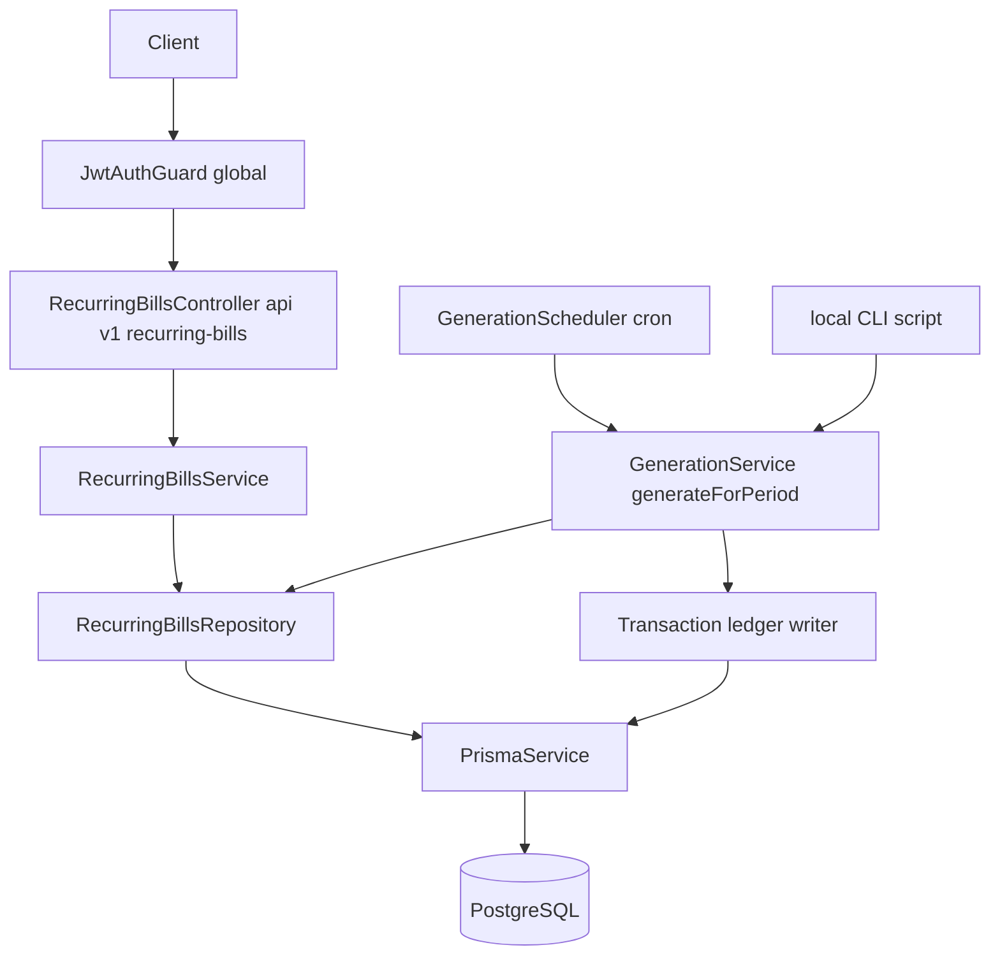

# Technical Design: recurring-bills

## Overview

**Purpose**: Add recurring bill definitions and **idempotent monthly generation** of ledger transactions from them. First feature to write the `Transaction` ledger from a non-manual source (`source = RECURRING`) and to introduce background work — so it upholds financial-rules **R3** (no duplicate monthly transactions) via a **database-level** guarantee.

**Users**: Authenticated users define recurring bills; a scheduled job (or internal trigger) generates the monthly transactions into their ledger.

**Impact**: New `RecurringBillsModule` + `RecurringBill` model; `Transaction` gains a nullable recurring link (`recurringBillId`, `periodKey`) + uniqueness + a CHECK constraint; `TransactionSource` gains `RECURRING`; `ExpensesRepository` becomes source-scoped to `MANUAL`. Adds `@nestjs/schedule`.

### Goals
- Recurring bill CRUD (owner-scoped) + idempotent monthly generation into the ledger.
- DB-level idempotency per `(recurringBillId, periodKey)`; ledger immutability for generated periods.
- Source-protected ledger (manual vs recurring) with no admin/RBAC and no Redis.

### Non-Goals
- Reminders/notifications, variable amounts/proration, non-monthly frequencies, cards/installments, CSV import, multi-currency, dashboards, editing generated transactions via bill endpoints, admin/RBAC, Redis/BullMQ.

## Architecture



**Integration**: bill routes auto-protected by the global guard; owner from `@CurrentUser`. Money/date via the shared `Money`/mapper. Errors via `AllExceptionsFilter`. Generation is **not** a public HTTP endpoint — it runs via the cron and an internal service (+ optional local CLI).

### Technology Stack
| Layer | Choice | Role |
|-------|--------|------|
| Scheduling | `@nestjs/schedule` (in-process cron) | periodic generation trigger (non-prod-grade; see below) |
| Transport | NestJS controller + DTOs | bill CRUD |
| Data | Prisma 7 + `Transaction`/`RecurringBill` | persistence, DB-level idempotency |

## System Flows

Generation (idempotent, concurrency-safe):

```mermaid
sequenceDiagram
    participant T as Trigger (cron / CLI / test)
    participant G as GenerationService
    participant R as RecurringBillsRepository
    participant L as Ledger (Transaction)
    T->>G: generateForPeriod("2026-03")
    G->>R: find active bills
    loop each bill
        G->>G: compute date = clamp(dayOfMonth, period); check eligibility (start/end vs date)
        alt eligible
            G->>L: insert snapshot row (recurringBillId, periodKey, source=RECURRING)
            alt unique violation P2002
                L-->>G: already generated → skipped++
            else inserted
                L-->>G: created++
            end
        else not eligible
            G->>G: zero for this bill
        end
    end
    G-->>T: summary { created, skipped, failed }
```

## Requirements Traceability
| Req | Components |
|-----|------------|
| 1–4 bill CRUD | RecurringBillsController/Service/Repository, DTOs |
| 5 generation + snapshot | GenerationService, ledger writer |
| 6 idempotency (R3) | `@@unique(recurringBillId, periodKey)` + `P2002` catch; no mutate on rerun |
| 7 period/day/clamp | period `YYYY-MM` + clamp helper, date-only mapper |
| 8 eligibility vs generated date | GenerationService eligibility check |
| 9 trigger/schedule + summary | GenerationScheduler (cron), CLI, summary object |
| 10 isolation | owner-scoped queries, `@CurrentUser`, generated tx owned by bill user |
| 11 money/date validation | DTO validators + `createMoney` |
| 12 persistence/errors/tests | migration, enum, filter, tests |
| 13 source protection | source-scoped `ExpensesRepository`, CHECK constraint, tests |

## Components and Interfaces

| Component | Intent | Reqs |
|-----------|--------|------|
| RecurringBillsController | `/api/v1/recurring-bills` CRUD; `DELETE` = deactivate → 204 | 1–4 |
| RecurringBillsService | validation, money/date, ownership | 1–4,10,11 |
| RecurringBillsRepository | owner-scoped Prisma access | 1–4,10 |
| GenerationService | `generateForPeriod(period)` — eligibility, clamp, idempotent insert, summary | 5–8,10 |
| GenerationScheduler | `@nestjs/schedule` cron → `generateForPeriod(deriveCurrentPeriod(clock))` (UTC month) | 9 |
| (local CLI script) | trigger generation for a `YYYY-MM` (ops/testing) | 9 |
| ExpensesRepository (changed) | add `source: "MANUAL"` to all where-clauses | 13 |

### GenerationService (contract)
```typescript
interface GenerationSummary {
  period: string;       // YYYY-MM
  created: number;
  skipped: number;      // already generated (unique conflict) or duplicate
  failed: number;
}
interface GenerationService {
  generateForPeriod(period: string): Promise<GenerationSummary>;
}
```
- For each active bill: `date = clampDay(dayOfMonth, period)`; eligible iff `startDate <= date <= (endDate ?? +inf)`. Insert a snapshot `Transaction` (`type=EXPENSE`, `source=RECURRING`, `recurringBillId`, `periodKey=period`, amount/currency/description/category from the bill, `transactionDate=date`, owner = bill.userId). Unique violation (`P2002`) → `skipped++`, never mutate the existing row. Other errors → `failed++` (logged, no cross-user leak).
- Summary aggregates counts only (no per-user data).

### DTOs (bill CRUD)
- `CreateRecurringBillDto`: `amountMinor` (`@IsInt @IsPositive @Max(MAX_SAFE_INTEGER)`), `currency` (trim+uppercase, `@IsIn(["BRL"])`), `dayOfMonth` (`@IsInt @Min(1) @Max(31)`), `description` (trim, `@IsNotEmpty`, `@MaxLength(255)`), `category?` (trim, `@MaxLength(100)`), `startDate` (`YYYY-MM-DD` calendar), `endDate?` (`YYYY-MM-DD`); cross-field `endDate >= startDate` (else 400).
- `UpdateRecurringBillDto = PartialType` (editable fields only; never owner/id/timestamps; empty body → 400).
- `ListRecurringBillsQueryDto`: `page`/`pageSize` (`@Type(Number)`, max 100); optional `active` filter with an **explicit boolean parser** (do not rely on `@Type(() => Boolean)`, which coerces any non-empty string to `true`): `"true" → true`, `"false" → false`, `undefined → no filter`, **any other value → 400 `VALIDATION_ERROR`**.

### Delete / Deactivate
`DELETE /api/v1/recurring-bills/:id` **deactivates** the bill (sets `isActive=false`) and returns **`204 No Content`**. It is never a hard delete and never deletes or alters already-generated transactions; deactivation only stops future generation.

## Data Models

### RecurringBill (new)
```
model RecurringBill {
  id            String    @id @default(uuid()) @db.Uuid
  userId        String    @db.Uuid
  user          User      @relation(fields: [userId], references: [id], onDelete: Restrict)
  amountMinor   BigInt
  currency      String    @db.Char(3)
  dayOfMonth    Int       @db.SmallInt
  description   String    @db.VarChar(255)
  categoryLabel String?   @db.VarChar(100)
  startDate     DateTime  @db.Date
  endDate       DateTime? @db.Date
  isActive      Boolean   @default(true)
  createdAt     DateTime  @default(now()) @db.Timestamptz(6)
  updatedAt     DateTime  @updatedAt @db.Timestamptz(6)
  transactions  Transaction[]
  @@index([userId])
  @@map("recurring_bills")
}
```

### Transaction (extended) — idempotency link (Option A1)
```
enum TransactionSource { MANUAL  RECURRING }   // + RECURRING

model Transaction {
  // ...existing fields...
  recurringBillId String?        @db.Uuid
  recurringBill   RecurringBill? @relation(fields: [recurringBillId], references: [id], onDelete: Restrict)
  periodKey       String?        @db.Char(7)   // "YYYY-MM"
  @@unique([recurringBillId, periodKey])       // NULLs distinct → manual rows never conflict
}
```
- **Idempotency (R6):** `@@unique([recurringBillId, periodKey])` gives the DB-level guarantee; PostgreSQL treats NULLs as distinct, so `MANUAL` rows (both null) never collide. (Options A2/B compared in `research.md`; A1 chosen.)
- **Valid-state CHECK (custom SQL in the migration):** `RECURRING` ⇒ both fields set; non-`RECURRING` ⇒ both NULL:
  ```sql
  ALTER TABLE "transactions" ADD CONSTRAINT "transactions_recurring_link_chk" CHECK (
    (source = 'RECURRING' AND "recurringBillId" IS NOT NULL AND "periodKey" IS NOT NULL)
    OR (source <> 'RECURRING' AND "recurringBillId" IS NULL AND "periodKey" IS NULL)
  );
  ```
  Prisma can't model CHECK in-schema → append to the generated migration (`migrate dev --create-only`, then edit). Fallback (app-level + tests) only if problematic, documented.
- **Migration**: create `recurring_bills`; add enum value `RECURRING`; add `recurringBillId`/`periodKey` + unique + FK + CHECK to `transactions`. Snapshot = the generated row's own columns.

## Source Protection (R13)
`ExpensesRepository` is updated so every where-clause includes `source: "MANUAL"` (findOwned/findMany/updateOwned/deleteOwned). Manual endpoints therefore cannot read/update/delete a `RECURRING` row (returns 404). Regression tests assert this. Recurring-bill endpoints never expose edit/delete of generated transactions.

## Scheduler (non-production-grade)
`@nestjs/schedule` runs an in-process cron that calls `generateForPeriod(currentPeriod)`. The cron derives `currentPeriod` via the **`Clock` abstraction** (`CLOCK` port) using the **UTC calendar month** of `clock.now()` (`deriveCurrentPeriod(clock) → "YYYY-MM"` from `getUTCFullYear`/`getUTCMonth`) — **never** server-local time or `Date.now()` directly, so the target period is deterministic and timezone-independent (R7.4). Documented caveats: in a **multi-instance** deploy multiple instances may fire simultaneously; this is **safe only because DB-level idempotency (A1) is the source of truth** — no in-memory lock is relied on for financial correctness. BullMQ/Redis remain out of scope (revisit in a future ops/deployment spec).

## Controlled Trigger (no admin/RBAC)
Generation is exposed as the internal `GenerationService.generateForPeriod(period)` (called by the cron) and, optionally, a **local CLI script** taking a `YYYY-MM` argument. **No public HTTP trigger.** Any test/local-only route must not be registered in the production `AppModule`.

## Error Handling
Reuse `AllExceptionsFilter`/`ErrorCode`: 400 validation, 401 guard, 404 not-owned/missing. Generation runs server-side: per-bill failures are counted (`failed`) and logged with request/run correlation, never leaking cross-user data; the run does not abort on a single bill's conflict.

## Testing Strategy

### Unit
- clamp/period helper: day 29/30/31 clamps in short months (Feb, 30-day months); period `YYYY-MM` parsing; no tz shift.
- eligibility: start/end vs generated date (boundaries inclusive).
- GenerationService: sets `type=EXPENSE`/`source=RECURRING`, snapshots bill values; summary counts.

### Integration (Testcontainers, real PostgreSQL — serial, non-UTC TZ)
- Bill CRUD + isolation (cross-user → 404).
- **Idempotency / R3:** duplicate generation for same (bill, period) → one row; **concurrent generation via `Promise.all`** → exactly one; unique conflict handled as "already generated"; **rerun does not mutate** the existing transaction.
- Eligibility: inactive / out-of-window bills generate **zero**.
- Day 29/30/31 clamp correctness in short months (end-to-end).
- **Source protection:** manual-expense endpoints cannot read/update/delete a `source = RECURRING` row (404); manual-expenses existing tests stay green.
- CHECK constraint rejects an invalid manual+recurringBillId row (if exercised via raw insert).

## Security Considerations
- Per-user isolation via token-derived `userId` + owner-scoped queries; generated tx owned by the bill's user.
- Source protection prevents cross-feature mutation of ledger rows.
- No public generation endpoint; no admin system; no Redis.

## Resolved Decisions
- **Idempotency**: Option **A1** (nullable `recurringBillId`+`periodKey` + `@@unique`); `P2002` → already-generated.
- **Valid states**: DB **CHECK** constraint (custom SQL).
- **Source protection**: `ExpensesRepository` scoped to `MANUAL` + regression tests.
- **Scheduler**: `@nestjs/schedule` in-process cron (non-prod-grade; DB idempotency is the safety net).
- **Trigger**: internal service + optional local CLI; **no** public HTTP; test routes not in prod modules.
- **Period/clamp/eligibility**: `YYYY-MM`, clamp to last day, eligibility vs generated date.
