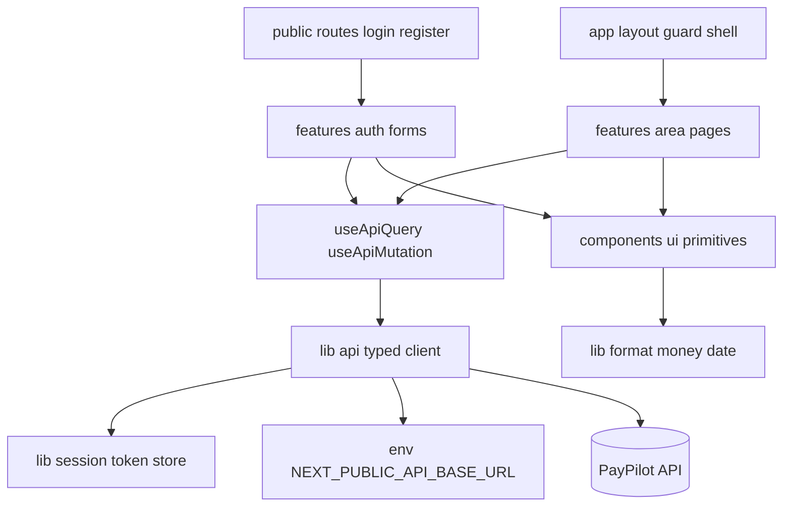
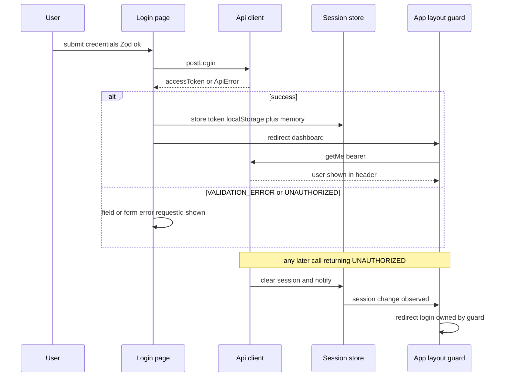

# Technical Design: web-mvp-shell

## Overview

**Purpose**: Turn the scaffold-only `apps/web` into PayPilot's **authenticated web shell**: public register/login, a protected app layout with navigation for all six areas, one typed API client over `packages/shared` contracts, and the shared UI conventions (forms/Zod, canonical-error UX, four view states, money/date formatting) every future feature-UI spec builds on.

**Users**: End users register, log in, navigate all areas, see their real data in shallow read/list pages, upload a CSV, and manage reminder settings — entirely from the browser.

**Impact**: `apps/web` gains route groups, `lib/` + `components/ui/` + `features/` layers, and CSS-Modules styling. `packages/shared` gains the consumed request/response contracts. **`apps/api` is not touched** (frontend-only spec; backend adoption of shared types deferred — drift risk documented). One new **dev** dependency: `@testing-library/user-event` 14.6.1 (exact, policy-checked).

### Goals
- Auth flows (register with auto-login, login, logout) + client-side route protection with `UNAUTHORIZED` degradation.
- Single typed API client (`ApiError` as the one failure shape) with multipart support.
- Navigable shell + six shallow feature pages proving the conventions end-to-end.
- Shared primitives/formatters with unit tests; accessibility basics enforced by role/label queries.

### Non-Goals
- Any backend change (endpoints, schema, API-side adoption of shared types); full CRUD editing per entity; the real monthly dashboard (monthly-dashboard spec); paid/unpaid UI (bill-payments spec); charts/analytics; SSR of authenticated data or middleware auth; refresh tokens; offline; i18n beyond fixed pt-BR display; design system beyond the minimal pattern.

## Requirements Traceability
| Req | Summary | Components |
|-----|---------|-----------|
| 1.1–1.6 | Public auth screens + flows | `(public)` routes, auth feature forms, session store, api/auth |
| 2.1–2.5 | Session + route protection | `lib/session` (store + AuthProvider), `(app)/layout` guard |
| 3.1–3.4 | App shell + navigation | `(app)/layout` (Header/Sidebar), dashboard landing |
| 4.1–4.5 | Typed API client | `lib/api` (http core, `ApiError`, endpoint modules) |
| 5.1–5.3 | Canonical error UX | `ApiError` mapping, `Field` errors, `ErrorState` (requestId + retry) |
| 6.1–6.7 | Six feature pages, graceful degradation | `features/*` + `(app)` routes, `(app)/error.tsx` |
| 7.1–7.4 | Money/date conventions | `lib/format` (money, date, amount-input) |
| 8.1–8.3 | Four view states | `useApiQuery`, `Loading`/`EmptyState`/`ErrorState`, session-keyed state |
| 9.1–9.3 | Accessibility | `components/ui` primitives (labels, aria, landmarks) |
| 10.1–10.3 | Tests | Vitest + Testing Library + user-event; mocked client boundary |

## Architecture

### Existing Architecture Analysis
`apps/web` today: root layout + one public page + validated `env.ts` + Vitest/jsdom harness. Reused as-is: `env.ts` (the client's only config), the test harness, `packages/shared` (`ErrorCode`, `ErrorResponse`), and the API's shipped behavior (bearer auth, canonical envelope, `{ data, meta }` pagination). This design instantiates `frontend-architecture.md` exactly; dependency direction `app/` → `features/` → `components/ui` + `lib/`, never reversed.

### Architecture Pattern & Boundary Map

**Key decisions**: route groups `(public)`/`(app)`; the `(app)` layout is the single auth gate (deny by default); `lib/api` is the only module touching `fetch`/base URL; expected API failures are typed values (never thrown into React), with `(app)/error.tsx` as the unexpected-crash net so the shell survives any page failure (6.7).

### Technology Stack
| Layer | Choice / Version | Role | Notes |
|-------|------------------|------|-------|
| Framework | Next.js 16 App Router + React 19 (installed) | routes, layouts, client components | protection is client-side (MVP) |
| Forms/validation | Zod 4 (installed) | schemas mirroring backend DTOs | no react-hook-form — controlled forms |
| Styling | CSS Modules + `tokens.css` | minimal component pattern | **no new dependency**; Tailwind deferred |
| Data fetching | hand-rolled `useApiQuery`/`useApiMutation` | four states 1:1 | TanStack Query deferred (research.md) |
| Contracts | `packages/shared/src/api/` (new) | request/response types | backend adoption deferred — drift risk documented |
| Testing | Vitest + Testing Library + **`@testing-library/user-event` 14.6.1 (new, dev, exact)** | behavioral tests | zero runtime deps, policy-checked |

## System Flows


Flow decisions: register performs auto-login (register → login → dashboard; a failure between the two lands on `/login` with a prompt). The guard renders a loading state until `getMe` resolves — protected content never flashes (2.4).

## Components and Interfaces

| Component | Domain/Layer | Intent | Req | Contracts |
|-----------|--------------|--------|-----|-----------|
| Shared API contracts | packages/shared | request/response types | 4 | State |
| ApiClient (`lib/api`) | infra | typed fetch boundary + `ApiError` | 4, 5 | Service |
| SessionStore + AuthProvider (`lib/session`) | infra | token persistence, auth context, guard | 1, 2 | Service/State |
| Query/Mutation hooks (`lib/api/hooks`) | application | four-state data access | 8 | Service |
| Formatters (`lib/format`) | domain (pure) | money/date/amount-input | 7 | Service |
| UI primitives (`components/ui`) | UI | Field, Button, Loading, EmptyState, ErrorState, Pagination, Table | 5, 8, 9 | State |
| Auth feature (`features/auth`) | feature | login/register forms | 1 | — |
| Area pages (`features/{expenses,bills,cards,imports,reminders,dashboard}`) | feature | six shallow pages | 6 | — |
| Routes (`app/(public)`, `app/(app)`) | transport | route groups, shell layout, error.tsx | 2, 3, 6.7 | — |

### packages/shared: API contracts (new `src/api/`)
```typescript
// auth.ts
interface AuthCredentials { email: string; password: string; }
interface AuthTokenResponse { accessToken: string; }
interface MeResponse { id: string; email: string; }
// pagination.ts
interface PageMeta { page: number; pageSize: number; total: number; }
interface Paginated<T> { data: T[]; meta: PageMeta; }
// views: ExpenseView, RecurringBillView, CreditCardView, InvoiceView,
// ImportSummary, ImportRunView, ReminderSettingsView — field-for-field the
// shapes the API returns today (amounts as integer minor units, dates as
// YYYY-MM-DD strings, cycle as YYYY-MM).
```
- **Constraint (clarification 2)**: `apps/api` is not edited; these types mirror shipped responses. Drift risk documented here and in research.md; a future cleanup spec has the API implement them.

### lib/api — typed client
```typescript
type ApiResult<T> = { ok: true; data: T } | { ok: false; error: ApiError };
class ApiError { code: ErrorCode | "NETWORK_ERROR"; message: string; requestId: string | null; details?: ErrorDetail[]; }
// http core: request(path, { method, body?, auth?: boolean, formData? })
// - attaches bearer from SessionStore when auth (default true)
// - non-2xx → parse ErrorResponse → ApiError; unparseable/network → NETWORK_ERROR (retryable)
// - UNAUTHORIZED → SessionStore.clear() (notifying the session layer via its
//   change subscription) and returns the typed unauthorized ApiError. The
//   client performs NO navigation — the redirect to /login is owned by
//   AuthProvider/the (app) layout, which observes the session change (2.3).
// endpoint modules: auth.ts, expenses.ts, bills.ts, cards.ts, imports.ts (FormData upload), reminders.ts
```
- Invariants: no `fetch`/base-URL outside this folder — but the client is **not** the owner of UI navigation (no router/`window.location` here); providers of failures never throw for expected errors — pages receive `ApiResult`; tokens never appear in URLs or logs.

### lib/session — store + guard
```typescript
interface SessionStore {
  get(): string | null;
  set(token: string): void;
  clear(): void;
  subscribe(listener: () => void): () => void; // change notification
} // localStorage + in-memory mirror
// AuthProvider (client component in (app) layout) — the ONLY owner of auth
// navigation/redirects:
//  - no token → redirect /login (2.2)
//  - token → getMe(); pending → full-page Loading (2.4)
//  - subscribes to SessionStore: when the session is cleared (logout, or the
//    api client detecting UNAUTHORIZED), it performs the redirect to /login (2.3)
//  - exposes useAuth(): { user, logout }  — logout = clear (redirect follows
//    via the subscription) (1.5)
```

### lib/api/hooks — four-state data access
```typescript
type QueryState<T> = { status: "loading" } | { status: "error"; error: ApiError; retry(): void }
  | { status: "empty" } | { status: "loaded"; data: T };
function useApiQuery<T>(fn: () => Promise<ApiResult<T>>, deps: unknown[], isEmpty?: (d: T) => boolean): QueryState<T>;
function useApiMutation<I, O>(fn: (input: I) => Promise<ApiResult<O>>): { run(input: I): Promise<ApiResult<O>>; pending: boolean; error: ApiError | null };
```
- State is component-local (no global cache) → logout/login can never leak another session's data (8.3).

### lib/format (pure, unit-tested)
- `formatMoney(amountMinor: number, currency: "BRL"): string` — deterministic manual grouping (`123456` → `R$ 1.234,56`; API reminder-formatter algorithm); no float math.
- `parseAmountInput(text: string): number | null` — user decimal text → integer minor units (Zod refinement uses it).
- `formatDate(dateIso: string): string` — string-based `DD/MM/YYYY` display; never constructs `Date` for display math.

### components/ui (minimal pattern; CSS Modules + `tokens.css`)
- `Field` (label + input + `aria-describedby` error), `FormError` (`role="alert"`), `Button` (pending state), `Loading` (`aria-busy`), `EmptyState` (guidance + optional action), `ErrorState` (message + requestId + retry button), `Pagination`, `Table`. No business logic, no API imports (9.x enforced here once).

### Routes & feature pages
| Route | Content | Endpoint(s) |
|-------|---------|-------------|
| `(public)/login`, `(public)/register` | auth forms (Zod; field mapping) | POST login / register (+ auto-login) |
| `(app)/dashboard` | landing: greeting + area shortcuts | — (me from context) |
| `(app)/expenses` | paginated list | GET expenses |
| `(app)/bills` | paginated list + active filter | GET recurring-bills |
| `(app)/cards` | card list + cycle picker per card | GET credit-cards |
| `(app)/cards/[cardId]/invoices/[cycle]` | derived invoice (due date, total, rows) | GET invoice; 404 → friendly not-found |
| `(app)/imports` | upload form + summary render + run lookup by id | POST imports (multipart), GET imports/:id |
| `(app)/reminders` | settings form (phone E.164 + enabled) | GET/PUT reminders/settings |
| `(app)/error.tsx` | segment crash net — shell survives (6.7) | — |

- Each page = thin `page.tsx` + `features/<area>` body using `useApiQuery` + primitives; all four states; oversized import file (413) and whole-file 400 render via `ErrorState`/form error with `requestId`.

## Error Handling
Single mapping in one module (5.1): `VALIDATION_ERROR` → `details[].field` onto form fields (form-level fallback); `UNAUTHORIZED` → session cleared by the client, redirect performed by AuthProvider (2.3); `NOT_FOUND` → friendly state; `CONFLICT` → actionable message (e.g. email already registered); `TOO_MANY_REQUESTS`/`INTERNAL_ERROR`/`NETWORK_ERROR` → retryable generic message. `requestId` always displayed on request-level surfaces; raw backend messages never primary UX; no token/body logging in production builds. Unavailable endpoint (env/timing gap) = `NETWORK_ERROR` → per-page `ErrorState`; the shell chrome is data-independent and never breaks.

## Testing Strategy

### Unit (pure)
- `formatMoney`/`parseAmountInput`/`formatDate`: grouping, cents, invalid input, date edges (10.1, 7.4).
- `ApiError` mapping from envelope fixtures incl. unparseable body → `NETWORK_ERROR`.

### Component (Testing Library + user-event, mocked `lib/api` boundary — no network)
- Login/register: Zod messages, submit wiring, `VALIDATION_ERROR` field mapping, `CONFLICT` message, auto-login redirect.
- Route protection: unauthenticated → redirected; pending `getMe` → loading (no content flash); `UNAUTHORIZED` mid-session → session cleared + redirect.
- Representative list page (expenses): four states incl. pagination and formatted amounts/dates; empty state has guidance + action.
- Imports: upload success renders summary counts + invalid rows; 413/400 → error surfaces with requestId.
- Reminders: settings round-trip; invalid phone blocked client-side; server `VALIDATION_ERROR` mapped.
- Shell: nav lists the six areas, active state, logout clears + redirects; queries by role/label only (9.3).

## Security Considerations
**Token storage (clarification 3, stated verbatim):** the browser token storage (localStorage + in-memory mirror) is an **MVP UX decision** carrying a residual **XSS-exposure risk**; the **API remains the security boundary** — client-side route protection is a UX guard only, and every response is owner-scoped server-side; **tokens are never logged or placed in URLs**; future **auth-hardening should consider httpOnly cookies and/or a refresh-token flow**. Additionally: no third-party scripts; `NEXT_PUBLIC_API_BASE_URL` is the only public config and carries no secrets; production builds log no error bodies or tokens to the console.

## Resolved Decisions
- **Option B** (gap analysis): instantiate the steering structure; zero backend edits.
- **Session**: localStorage + in-memory mirror (risk documented above); logout = client-side discard (no backend endpoint exists).
- **Navigation ownership (validate-design fix)**: the API client detects `UNAUTHORIZED`, clears the session, and notifies via the SessionStore subscription/typed result; **AuthProvider/the (app) layout owns every redirect to `/login`**. The client stays the only module touching `fetch`/base URL, but never navigates.
- **Post-register**: auto-login (register → login → dashboard; mid-flow failure lands on `/login` with prompt).
- **Data fetching**: hand-rolled `useApiQuery`/`useApiMutation`, component-local state (no cross-session leakage); TanStack Query deferred.
- **Styling**: CSS Modules + `tokens.css`; Tailwind deferred.
- **Contracts**: promoted to `packages/shared/src/api/`; **API does not adopt them in this spec** (drift risk documented; future cleanup spec).
- **Invoice navigation**: per-card `YYYY-MM` cycle picker → `cards/[cardId]/invoices/[cycle]`; empty cycle = friendly not-found.
- **Backend prerequisites (clarification 1)**: tests mock the client boundary; runtime endpoint unavailability degrades via `ErrorState`; final acceptance per page requires the real API; **this spec implements no backend endpoint**.
- **New dependency**: `@testing-library/user-event` 14.6.1, dev-only, exact pin, policy-checked (research.md).
